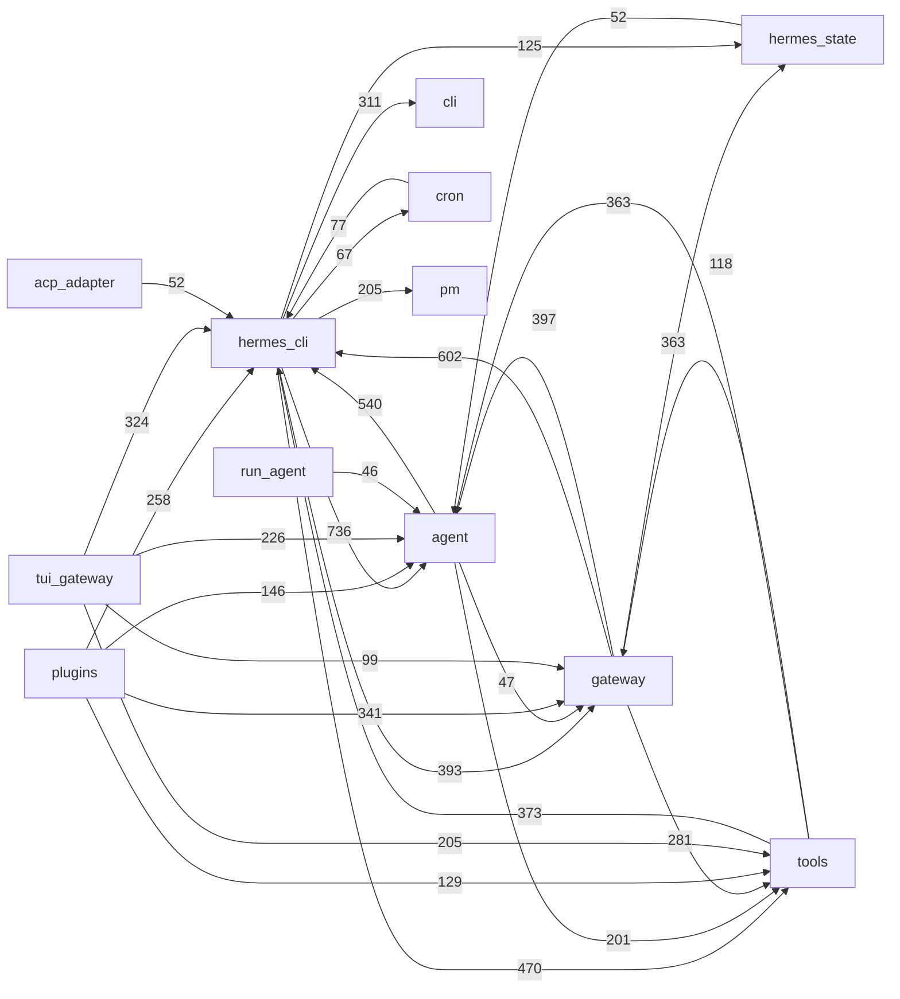

# Architecture map: Hermes Agent v0.23.0

Readers: the owner and the later comparison session. Decision served: how Hermes is built, at
subsystem level. Every statement about runtime behaviour rests on static reading of code at
commit `2bd378ed1b8d6bf2192cb26e0a55ff3091e6bd19`; nothing was observed running.

Two authority classes apply throughout. For what Hermes intends and what it calls its parts, its
maintainers' documents are the authority and are quoted. For what the system does, the code is
the authority and is cited. Where the two differ, both are recorded.

## 1. Hermes's stated design, in its own words

Sources: the root `AGENTS.md`, the per-directory `AGENTS.md` files, and the developer guide under
`website/docs/developer-guide/` at the tag. These come from the same maintainers; one does not
corroborate another.

**What Hermes says it is.** "Hermes is a personal AI agent that runs the same agent core across a
CLI, a messaging gateway (Telegram, Discord, Slack, ~20 platforms), a TUI, and an Electron desktop
app. It learns across sessions (memory + skills), delegates to subagents, runs scheduled jobs, and
drives a real terminal and browser. It is extended primarily through **plugins and skills**, not
by growing the core." ([`AGENTS.md#L12-L16`](https://github.com/NousResearch/hermes-agent/blob/2bd378ed1b8d6bf2192cb26e0a55ff3091e6bd19/AGENTS.md#L12-L16))

**Its two invariants.** "Two invariants shape almost every design decision and are the lens for
reviewing any change" ([`AGENTS.md#L18`](https://github.com/NousResearch/hermes-agent/blob/2bd378ed1b8d6bf2192cb26e0a55ff3091e6bd19/AGENTS.md#L18)):

- "**Per-conversation prompt caching is sacred.** Mutating past context, swapping toolsets,
  reloading memories or rebuilding the system prompt mid-conversation breaks the cached prefix and
  multiplies the user's cost; the ONE exception is context compression."
  ([`AGENTS.md#L20-L22`](https://github.com/NousResearch/hermes-agent/blob/2bd378ed1b8d6bf2192cb26e0a55ff3091e6bd19/AGENTS.md#L20-L22))
- "**The core is a narrow waist; capability lives at the edges.** Every model tool is sent on
  every API call, so the bar for a new _core_ tool is high. New capability should arrive as a CLI
  command + skill, a service-gated tool, or a plugin — not as core surface."
  ([`AGENTS.md#L24-L26`](https://github.com/NousResearch/hermes-agent/blob/2bd378ed1b8d6bf2192cb26e0a55ff3091e6bd19/AGENTS.md#L24-L26))

**Its footprint ladder.** "take the highest rung that solves it": "extend existing code → CLI
command + skill → service-gated tool … → plugin → MCP server in the catalog → new core tool
(fundamental, broadly useful, unreachable otherwise)." ([`AGENTS.md#L56-L59`](https://github.com/NousResearch/hermes-agent/blob/2bd378ed1b8d6bf2192cb26e0a55ff3091e6bd19/AGENTS.md#L56-L59))

**Its design principles**, from the developer guide's table
([`architecture.md#L260-L269`](https://github.com/NousResearch/hermes-agent/blob/2bd378ed1b8d6bf2192cb26e0a55ff3091e6bd19/website/docs/developer-guide/architecture.md#L260-L269)):

| Principle | Hermes's wording |
| --- | --- |
| Prompt stability | "System prompt doesn't change mid-conversation. No cache-breaking mutations except explicit user actions (`/model`)." |
| Observable execution | "Every tool call is visible to the user via callbacks." |
| Interruptible | "API calls and tool execution can be cancelled mid-flight by user input or signals." |
| Platform-agnostic core | "One AIAgent class serves CLI, gateway, ACP, batch, and API server. Platform differences live in the entry point, not the agent." |
| Loose coupling | "Optional subsystems (MCP, plugins, memory providers, RL environments) use registry patterns and check_fn gating, not hard dependencies." |
| Profile isolation | "Each profile (`hermes -p <name>`) gets its own HERMES_HOME, config, memory, sessions, and gateway PID." |

**Its code layout rule.** "Every former god file is a **facade** (public entry points + the names
other packages import) plus **siblings** `<stem>_<topic>.py`, each owning one topic"; "Siblings
late-import the facade inside functions; never a module-level cycle."
([`AGENTS.md#L103-L109`](https://github.com/NousResearch/hermes-agent/blob/2bd378ed1b8d6bf2192cb26e0a55ff3091e6bd19/AGENTS.md#L103-L109))

**Its stated dependency chain** for tools
([`architecture.md#L273-L283`](https://github.com/NousResearch/hermes-agent/blob/2bd378ed1b8d6bf2192cb26e0a55ff3091e6bd19/website/docs/developer-guide/architecture.md#L273-L283)):
`tools/registry.py` "(no deps — imported by all tool files)", then `tools/*.py` "(each calls
registry.register() at import time)", then `model_tools.py`, then `run_agent.py, cli.py,
batch_runner.py, environments/`.

## 2. Glossary

Each entry is Hermes's term with Hermes's own definition or usage. The research files use these
terms with these meanings.

| Term | Hermes's own words | Citation |
| --- | --- | --- |
| `AIAgent` | "The core orchestration engine is the `AIAgent` class. `run_agent.py` is now a thin facade" | [`agent-loop.md#L9`](https://github.com/NousResearch/hermes-agent/blob/2bd378ed1b8d6bf2192cb26e0a55ff3091e6bd19/website/docs/developer-guide/agent-loop.md#L9) |
| facade, siblings | "a **facade** (public entry points + the names other packages import) plus **siblings** `<stem>_<topic>.py`" | [`AGENTS.md#L103-L104`](https://github.com/NousResearch/hermes-agent/blob/2bd378ed1b8d6bf2192cb26e0a55ff3091e6bd19/AGENTS.md#L103-L104) |
| turn, turn phases | "a turn is `agent/conversation_loop.py::run_conversation`"; "Each phase of an iteration is its own sibling" | [`agent/AGENTS.md#L9-L10`](https://github.com/NousResearch/hermes-agent/blob/2bd378ed1b8d6bf2192cb26e0a55ff3091e6bd19/agent/AGENTS.md#L9-L10), [`#L38`](https://github.com/NousResearch/hermes-agent/blob/2bd378ed1b8d6bf2192cb26e0a55ff3091e6bd19/agent/AGENTS.md#L38) |
| narrow waist | "The core is a narrow waist; capability lives at the edges." | [`AGENTS.md#L24`](https://github.com/NousResearch/hermes-agent/blob/2bd378ed1b8d6bf2192cb26e0a55ff3091e6bd19/AGENTS.md#L24) |
| footprint ladder | "take the highest rung that solves it" | [`AGENTS.md#L56`](https://github.com/NousResearch/hermes-agent/blob/2bd378ed1b8d6bf2192cb26e0a55ff3091e6bd19/AGENTS.md#L56) |
| tool, registry | "Central tool registry (`tools/registry.py`) … Each tool file self-registers at import time." | [`architecture.md#L220`](https://github.com/NousResearch/hermes-agent/blob/2bd378ed1b8d6bf2192cb26e0a55ff3091e6bd19/website/docs/developer-guide/architecture.md#L220) |
| toolset | "Single `TOOLSETS` dict"; "a tool is only exposed if a toolset names it" | [`tools/AGENTS.md#L72`](https://github.com/NousResearch/hermes-agent/blob/2bd378ed1b8d6bf2192cb26e0a55ff3091e6bd19/tools/AGENTS.md#L72), [`#L41`](https://github.com/NousResearch/hermes-agent/blob/2bd378ed1b8d6bf2192cb26e0a55ff3091e6bd19/tools/AGENTS.md#L41) |
| `check_fn` | "`check_fn` answers reachability/opt-in for the profile it runs under, never surface." | [`tools/AGENTS.md#L55`](https://github.com/NousResearch/hermes-agent/blob/2bd378ed1b8d6bf2192cb26e0a55ff3091e6bd19/tools/AGENTS.md#L55) |
| agent-level tools | "**Agent-level tools** (`todo`, `memory`, ...) are intercepted by `agent/tool_executor.py` through the `INLINE_TOOL_EXECUTORS` table" | [`agent/AGENTS.md#L51-L52`](https://github.com/NousResearch/hermes-agent/blob/2bd378ed1b8d6bf2192cb26e0a55ff3091e6bd19/agent/AGENTS.md#L51-L52) |
| system prompt tiers | "three ordered tiers": "**stable**", "**context**", "**volatile**" | [`prompt-assembly.md#L29-L35`](https://github.com/NousResearch/hermes-agent/blob/2bd378ed1b8d6bf2192cb26e0a55ff3091e6bd19/website/docs/developer-guide/prompt-assembly.md#L29-L35) |
| compression | "Compression is the sanctioned cache break — keep it the only one." | [`agent/AGENTS.md#L90-L91`](https://github.com/NousResearch/hermes-agent/blob/2bd378ed1b8d6bf2192cb26e0a55ff3091e6bd19/agent/AGENTS.md#L90-L91) |
| gateway | "Long-running process with 25+ platform adapters (built-in + bundled plugins), unified session routing, user authorization … slash command dispatch, hook system, cron ticking, and background maintenance." | [`architecture.md#L232`](https://github.com/NousResearch/hermes-agent/blob/2bd378ed1b8d6bf2192cb26e0a55ff3091e6bd19/website/docs/developer-guide/architecture.md#L232) |
| profile | "Each profile (`hermes -p <name>`) gets its own HERMES_HOME, config, memory, sessions, and gateway PID." | [`architecture.md#L269`](https://github.com/NousResearch/hermes-agent/blob/2bd378ed1b8d6bf2192cb26e0a55ff3091e6bd19/website/docs/developer-guide/architecture.md#L269) |
| plugin | "Plugins live in their own directory and work within the ABCs / hooks / `ctx` surface we provide." | [`plugins/AGENTS.md#L9`](https://github.com/NousResearch/hermes-agent/blob/2bd378ed1b8d6bf2192cb26e0a55ff3091e6bd19/plugins/AGENTS.md#L9) |
| memory provider | "`agent/memory_provider.py` (ABC) + `agent/memory_manager.py` (orchestrator) drive memory-provider plugins" | [`agent/AGENTS.md#L124-L125`](https://github.com/NousResearch/hermes-agent/blob/2bd378ed1b8d6bf2192cb26e0a55ff3091e6bd19/agent/AGENTS.md#L124-L125) |
| context engine | "`agent/context_engine.py` drives context-engine plugins"; "ContextEngine ABC (pluggable)" | [`agent/AGENTS.md#L125`](https://github.com/NousResearch/hermes-agent/blob/2bd378ed1b8d6bf2192cb26e0a55ff3091e6bd19/agent/AGENTS.md#L125), [`architecture.md#L65`](https://github.com/NousResearch/hermes-agent/blob/2bd378ed1b8d6bf2192cb26e0a55ff3091e6bd19/website/docs/developer-guide/architecture.md#L65) |
| skills, optional skills | "**`skills/`** — built-in, loadable by default"; "**`optional-skills/`** — heavier/niche skills shipped but NOT active" | [`skills/AGENTS.md#L8-L9`](https://github.com/NousResearch/hermes-agent/blob/2bd378ed1b8d6bf2192cb26e0a55ff3091e6bd19/skills/AGENTS.md#L8-L9) |
| curator | "Background maintenance that tracks usage on agent-created skills and auto-archives stale ones" | [`skills/AGENTS.md#L66`](https://github.com/NousResearch/hermes-agent/blob/2bd378ed1b8d6bf2192cb26e0a55ff3091e6bd19/skills/AGENTS.md#L66) |
| session storage, lineage | "SQLite-based session storage with FTS5 full-text search. Sessions have lineage tracking (parent/child across compressions)" | [`architecture.md#L226`](https://github.com/NousResearch/hermes-agent/blob/2bd378ed1b8d6bf2192cb26e0a55ff3091e6bd19/website/docs/developer-guide/architecture.md#L226) |
| auxiliary | "**Auxiliary (side-LLM) work** — curator, vision, embedding, title generation, session_search, compression" | [`agent/AGENTS.md#L99-L100`](https://github.com/NousResearch/hermes-agent/blob/2bd378ed1b8d6bf2192cb26e0a55ff3091e6bd19/agent/AGENTS.md#L99-L100) |
| trajectories | "Generates ShareGPT-format trajectories from agent sessions for training data generation." | [`architecture.md#L256`](https://github.com/NousResearch/hermes-agent/blob/2bd378ed1b8d6bf2192cb26e0a55ff3091e6bd19/website/docs/developer-guide/architecture.md#L256) |
| prompt surface | "what a stock install sends before the first user message: the system prompt and the `tools[]` array" | [`prompt-assembly.md#L331`](https://github.com/NousResearch/hermes-agent/blob/2bd378ed1b8d6bf2192cb26e0a55ff3091e6bd19/website/docs/developer-guide/prompt-assembly.md#L331) |

The memory and learning terms (memory, user profile, background review, write origin, skill
states, ledger and others) are defined in `memory-learning-architecture.md`.

## 3. Subsystems

The areas are the ones Hermes's routing table names
([`AGENTS.md#L148-L166`](https://github.com/NousResearch/hermes-agent/blob/2bd378ed1b8d6bf2192cb26e0a55ff3091e6bd19/AGENTS.md#L148-L166)). Sizes are the census figures in
`evidence-log.md` section 2.1. The mapping from directory to subsystem is partial: 84 Python
files sit at the repository root, 63 of them in the `hermes_state*.py` family.

| Subsystem | Location | Python files / lines | Role, in Hermes's words | Citation |
| --- | --- | ---: | --- | --- |
| Agent core | `run_agent.py`, `agent/` | 421 / 151,839 (`agent/`) | "turn loop phases, providers, memory, compression, prompt builder" | [`AGENTS.md#L83`](https://github.com/NousResearch/hermes-agent/blob/2bd378ed1b8d6bf2192cb26e0a55ff3091e6bd19/AGENTS.md#L83) |
| CLI | `cli.py`, `hermes_cli/` | 817 / 311,261 | "CLI subcommands, setup, config, plugins loader, updater, web_routers/" | [`AGENTS.md#L84`](https://github.com/NousResearch/hermes-agent/blob/2bd378ed1b8d6bf2192cb26e0a55ff3091e6bd19/AGENTS.md#L84) |
| Tools | `tools/`, `toolsets.py`, `model_tools.py` | 373 / 131,466 | "Tool implementations (tools/registry.py) + environments/ backends" | [`AGENTS.md#L85`](https://github.com/NousResearch/hermes-agent/blob/2bd378ed1b8d6bf2192cb26e0a55ff3091e6bd19/AGENTS.md#L85) |
| Gateway | `gateway/` | 353 / 130,470 | "run.py facade + run\_\*.py phases + session\*.py + platforms/" | [`AGENTS.md#L86`](https://github.com/NousResearch/hermes-agent/blob/2bd378ed1b8d6bf2192cb26e0a55ff3091e6bd19/AGENTS.md#L86) |
| Plugins | `plugins/` | 307 / 92,544 | "memory/, context_engine/, model-providers/, kanban/, image_gen/, ..." | [`AGENTS.md#L87`](https://github.com/NousResearch/hermes-agent/blob/2bd378ed1b8d6bf2192cb26e0a55ff3091e6bd19/AGENTS.md#L87) |
| Session state | `hermes_state.py` and siblings | 63 files at the root | "SessionDB facade; hermes_state_\*.py siblings" | [`AGENTS.md#L81`](https://github.com/NousResearch/hermes-agent/blob/2bd378ed1b8d6bf2192cb26e0a55ff3091e6bd19/AGENTS.md#L81) |
| TUI backend | `tui_gateway/`, `ui-tui/` | 124 / 48,905 | "Ink terminal UI + its Python JSON-RPC backend (also serves Desktop)" | [`AGENTS.md#L89`](https://github.com/NousResearch/hermes-agent/blob/2bd378ed1b8d6bf2192cb26e0a55ff3091e6bd19/AGENTS.md#L89) |
| Cron | `cron/` | 54 / 20,384 | "jobs.py + scheduler.py (+ scheduler\_\*.py)" | [`AGENTS.md#L91`](https://github.com/NousResearch/hermes-agent/blob/2bd378ed1b8d6bf2192cb26e0a55ff3091e6bd19/AGENTS.md#L91) |
| Skills | `skills/`, `optional-skills/` | 50 / 11,827 and 101 / 27,941 | "Built-in skills (by category) optional-skills/: shipped, not active" | [`AGENTS.md#L88`](https://github.com/NousResearch/hermes-agent/blob/2bd378ed1b8d6bf2192cb26e0a55ff3091e6bd19/AGENTS.md#L88) |
| ACP adapter | `acp_adapter/` | 22 / 6,641 | "ACP server (VS Code / Zed / JetBrains)" | [`architecture.md#L132`](https://github.com/NousResearch/hermes-agent/blob/2bd378ed1b8d6bf2192cb26e0a55ff3091e6bd19/website/docs/developer-guide/architecture.md#L132) |
| Package manager and host facts | `pm/`, `hermes_platform/` | 56 / 14,823 and 15 / 2,054 | "dependency/environment manager; machine facts + executable lookup" | [`AGENTS.md#L92`](https://github.com/NousResearch/hermes-agent/blob/2bd378ed1b8d6bf2192cb26e0a55ff3091e6bd19/AGENTS.md#L92) |
| Tests | `tests/` | 7,640 / 1,587,142 | "Pytest suite, mirrors the source tree" | [`AGENTS.md#L95`](https://github.com/NousResearch/hermes-agent/blob/2bd378ed1b8d6bf2192cb26e0a55ff3091e6bd19/AGENTS.md#L95) |

Out of this study's scope and not read: `apps/desktop/`, `web/`, `ui-tui/`, tool implementations
and platform adapters beyond their base class.

## 4. One request, traced statically

A text message arriving on a messaging platform, followed to the reply. Each hop is a caller
citation and a callee citation. Hops marked "reached" were confirmed by reading the call; a hop's
conditions (authorisation, slash commands, session guards, queueing) were not enumerated.

| Hop | Caller | Callee |
| --- | --- | --- |
| 1 | A platform adapter subclass of `BasePlatformAdapter` ([`gateway/platforms/base.py#L1809`](https://github.com/NousResearch/hermes-agent/blob/2bd378ed1b8d6bf2192cb26e0a55ff3091e6bd19/gateway/platforms/base.py#L1809)) builds a `MessageEvent` ([`gateway/platforms/event.py#L67`](https://github.com/NousResearch/hermes-agent/blob/2bd378ed1b8d6bf2192cb26e0a55ff3091e6bd19/gateway/platforms/event.py#L67)) | `BasePlatformAdapter.handle_message` ([`base.py#L3924`](https://github.com/NousResearch/hermes-agent/blob/2bd378ed1b8d6bf2192cb26e0a55ff3091e6bd19/gateway/platforms/base.py#L3924)), which "returns quickly by spawning a background task" |
| 2 | `asyncio.create_task(self._process_message_background(...))` ([`base.py#L3842`](https://github.com/NousResearch/hermes-agent/blob/2bd378ed1b8d6bf2192cb26e0a55ff3091e6bd19/gateway/platforms/base.py#L3842)) | `_process_message_background` ([`base.py#L4462`](https://github.com/NousResearch/hermes-agent/blob/2bd378ed1b8d6bf2192cb26e0a55ff3091e6bd19/gateway/platforms/base.py#L4462)) |
| 3 | `response = await self._message_handler(event)` ([`base.py#L4481`](https://github.com/NousResearch/hermes-agent/blob/2bd378ed1b8d6bf2192cb26e0a55ff3091e6bd19/gateway/platforms/base.py#L4481)) | the handler installed by `adapter.set_message_handler(...)` ([`gateway/run_adapters.py#L1352`](https://github.com/NousResearch/hermes-agent/blob/2bd378ed1b8d6bf2192cb26e0a55ff3091e6bd19/gateway/run_adapters.py#L1352)); it binds the profile scope and calls `self._handle_message(event)` ([`run_adapters.py#L1542`](https://github.com/NousResearch/hermes-agent/blob/2bd378ed1b8d6bf2192cb26e0a55ff3091e6bd19/gateway/run_adapters.py#L1542)) |
| 4 | `GatewayRunner._handle_message` ([`gateway/run_inbound.py#L1265`](https://github.com/NousResearch/hermes-agent/blob/2bd378ed1b8d6bf2192cb26e0a55ff3091e6bd19/gateway/run_inbound.py#L1265)) | `self._handle_message_with_agent(...)` ([`run_inbound.py#L1352`](https://github.com/NousResearch/hermes-agent/blob/2bd378ed1b8d6bf2192cb26e0a55ff3091e6bd19/gateway/run_inbound.py#L1352)), defined at [`gateway/run_turn.py#L200`](https://github.com/NousResearch/hermes-agent/blob/2bd378ed1b8d6bf2192cb26e0a55ff3091e6bd19/gateway/run_turn.py#L200) |
| 5 | `agent_result = await self._run_agent(...)` ([`run_turn.py#L252`](https://github.com/NousResearch/hermes-agent/blob/2bd378ed1b8d6bf2192cb26e0a55ff3091e6bd19/gateway/run_turn.py#L252)) | `_run_agent` ([`run_turn.py#L835`](https://github.com/NousResearch/hermes-agent/blob/2bd378ed1b8d6bf2192cb26e0a55ff3091e6bd19/gateway/run_turn.py#L835)) builds a `TurnRunner` ([`run_turn.py#L1005`](https://github.com/NousResearch/hermes-agent/blob/2bd378ed1b8d6bf2192cb26e0a55ff3091e6bd19/gateway/run_turn.py#L1005); class at [`gateway/run_turn_runner.py#L186`](https://github.com/NousResearch/hermes-agent/blob/2bd378ed1b8d6bf2192cb26e0a55ff3091e6bd19/gateway/run_turn_runner.py#L186)) |
| 6 | `TurnRunner.run_sync` ([`run_turn_runner.py#L1211`](https://github.com/NousResearch/hermes-agent/blob/2bd378ed1b8d6bf2192cb26e0a55ff3091e6bd19/gateway/run_turn_runner.py#L1211)), run in an executor | a cached or fresh `AIAgent` (`_build_fresh_agent`, [`gateway/session_execution.py#L151`](https://github.com/NousResearch/hermes-agent/blob/2bd378ed1b8d6bf2192cb26e0a55ff3091e6bd19/gateway/session_execution.py#L151), constructing at [`#L161`](https://github.com/NousResearch/hermes-agent/blob/2bd378ed1b8d6bf2192cb26e0a55ff3091e6bd19/gateway/session_execution.py#L161)) |
| 7 | `result = agent.run_conversation(api_message, **kwargs)` ([`run_turn_runner.py#L1034`](https://github.com/NousResearch/hermes-agent/blob/2bd378ed1b8d6bf2192cb26e0a55ff3091e6bd19/gateway/run_turn_runner.py#L1034)) | `AIAgent.run_conversation` ([`agent/turn_facade.py#L22`](https://github.com/NousResearch/hermes-agent/blob/2bd378ed1b8d6bf2192cb26e0a55ff3091e6bd19/agent/turn_facade.py#L22)), a forwarder that takes the session turn lease and calls `agent.conversation_loop.run_conversation` ([`turn_facade.py#L148`](https://github.com/NousResearch/hermes-agent/blob/2bd378ed1b8d6bf2192cb26e0a55ff3091e6bd19/agent/turn_facade.py#L148); defined at [`agent/conversation_loop.py#L1802`](https://github.com/NousResearch/hermes-agent/blob/2bd378ed1b8d6bf2192cb26e0a55ff3091e6bd19/agent/conversation_loop.py#L1802)) |
| 8 | Turn context build ([`agent/turn_context.py#L1205`](https://github.com/NousResearch/hermes-agent/blob/2bd378ed1b8d6bf2192cb26e0a55ff3091e6bd19/agent/turn_context.py#L1205)) | `_restore_or_build_system_prompt` ([`conversation_loop.py#L802`](https://github.com/NousResearch/hermes-agent/blob/2bd378ed1b8d6bf2192cb26e0a55ff3091e6bd19/agent/conversation_loop.py#L802)): reuses the stored prompt when it matches the runtime ([`#L825`](https://github.com/NousResearch/hermes-agent/blob/2bd378ed1b8d6bf2192cb26e0a55ff3091e6bd19/agent/conversation_loop.py#L825), [`#L868`](https://github.com/NousResearch/hermes-agent/blob/2bd378ed1b8d6bf2192cb26e0a55ff3091e6bd19/agent/conversation_loop.py#L868)), otherwise builds one ([`#L918`](https://github.com/NousResearch/hermes-agent/blob/2bd378ed1b8d6bf2192cb26e0a55ff3091e6bd19/agent/conversation_loop.py#L918)) through `build_system_prompt` ([`agent/system_prompt.py#L804`](https://github.com/NousResearch/hermes-agent/blob/2bd378ed1b8d6bf2192cb26e0a55ff3091e6bd19/agent/system_prompt.py#L804)) |
| 9 | The loop's tool round, `run_tool_round` ([`agent/turn_tool_round.py#L49`](https://github.com/NousResearch/hermes-agent/blob/2bd378ed1b8d6bf2192cb26e0a55ff3091e6bd19/agent/turn_tool_round.py#L49)), calls `agent._execute_tool_calls(...)` ([`#L171`](https://github.com/NousResearch/hermes-agent/blob/2bd378ed1b8d6bf2192cb26e0a55ff3091e6bd19/agent/turn_tool_round.py#L171)) | `agent/tool_executor.py`: a name in `INLINE_TOOL_EXECUTORS` runs inline ([`tool_executor.py#L1680`](https://github.com/NousResearch/hermes-agent/blob/2bd378ed1b8d6bf2192cb26e0a55ff3091e6bd19/agent/tool_executor.py#L1680)); any other goes to `model_tools.handle_function_call` ([`tool_executor.py#L1713`](https://github.com/NousResearch/hermes-agent/blob/2bd378ed1b8d6bf2192cb26e0a55ff3091e6bd19/agent/tool_executor.py#L1713); defined at [`model_tools.py#L886`](https://github.com/NousResearch/hermes-agent/blob/2bd378ed1b8d6bf2192cb26e0a55ff3091e6bd19/model_tools.py#L886)), which ends in `registry.dispatch` ([`model_tools.py#L852`](https://github.com/NousResearch/hermes-agent/blob/2bd378ed1b8d6bf2192cb26e0a55ff3091e6bd19/model_tools.py#L852); [`tools/registry.py#L972`](https://github.com/NousResearch/hermes-agent/blob/2bd378ed1b8d6bf2192cb26e0a55ff3091e6bd19/tools/registry.py#L972)) |
| 10 | `finalize_turn(...)` ([`conversation_loop.py#L1605`](https://github.com/NousResearch/hermes-agent/blob/2bd378ed1b8d6bf2192cb26e0a55ff3091e6bd19/agent/conversation_loop.py#L1605); defined at [`agent/turn_finalizer.py#L619`](https://github.com/NousResearch/hermes-agent/blob/2bd378ed1b8d6bf2192cb26e0a55ff3091e6bd19/agent/turn_finalizer.py#L619)) | among its steps, `agent._spawn_background_review(...)` ([`turn_finalizer.py#L613`](https://github.com/NousResearch/hermes-agent/blob/2bd378ed1b8d6bf2192cb26e0a55ff3091e6bd19/agent/turn_finalizer.py#L613)) and `agent._save_trajectory(...)` ([`#L705`](https://github.com/NousResearch/hermes-agent/blob/2bd378ed1b8d6bf2192cb26e0a55ff3091e6bd19/agent/turn_finalizer.py#L705)); the conditions on each are in `memory-learning-architecture.md` |
| 11 | The result returns up hops 7 to 3 to `_process_message_background` | `await self._send_final_text(...)` ([`base.py#L4533`](https://github.com/NousResearch/hermes-agent/blob/2bd378ed1b8d6bf2192cb26e0a55ff3091e6bd19/gateway/platforms/base.py#L4533)); the adapter's own `send` is the abstract method at [`base.py#L2637`](https://github.com/NousResearch/hermes-agent/blob/2bd378ed1b8d6bf2192cb26e0a55ff3091e6bd19/gateway/platforms/base.py#L2637) |

Not traced: the model API call itself (the `agent/turn_api_*.py` phases), streaming delivery,
and session persistence inside the loop. `[unverified]` for those three.

```mermaid
sequenceDiagram
    participant P as Platform adapter
    participant B as BasePlatformAdapter
    participant G as GatewayRunner
    participant T as TurnRunner
    participant A as AIAgent
    participant L as conversation_loop
    participant X as tool_executor
    participant R as tools registry
    participant F as turn_finalizer
    P->>B: handle_message(MessageEvent)
    B->>B: create_task(_process_message_background)
    B->>G: _message_handler(event) -> _handle_message
    G->>G: _handle_message_with_agent -> _run_agent
    G->>T: run_sync (executor thread)
    T->>A: run_conversation(api_message)
    A->>L: run_conversation (after the turn lease)
    L->>L: restore or build system prompt
    loop until the model returns no tool call
        L->>X: _execute_tool_calls
        alt name in INLINE_TOOL_EXECUTORS
            X->>X: run inline (todo, memory, ...)
        else any other tool
            X->>R: handle_function_call -> registry.dispatch
        end
    end
    L->>F: finalize_turn
    F-->>A: may spawn a background review; may save a trajectory
    A-->>T: result
    T-->>G: result
    G-->>B: response text
    B->>P: _send_final_text -> send
```

## 5. Package graph



Caption and bound. Nodes are the eleven top-level Python packages plus root-module families
(`run_agent`, `cli`, `hermes_state*`, `model_tools`/`toolsets`, root utilities, batch scripts);
`tests/`, `scripts/`, `evals/`, `skills/`, `optional-skills/`, `website/`, `apps/`, `ui-tui/`,
`nix/` and `docker/` are outside the bound. An edge weight is the number of `import` and
`from … import` statements in the source node's files that name a module of the target node,
counted anywhere in a file. The drawing shows every edge with weight 45 or more, less the edges
to the root-utilities node; the full list of 141 edges, none dropped, is the script's output.
Instrument: a standalone script using stdlib `ast` that parses and imports nothing, run over
`git ls-files '*.py'`.

Three measurements from the full edge list:

- The four largest packages import each other in both directions: `hermes_cli`↔`agent`
  (736 / 540), `hermes_cli`↔`gateway` (393 / 602), `hermes_cli`↔`tools` (470 / 373),
  `agent`↔`tools` (201 / 363), `gateway`↔`tools` (281 / 118).
- Most of those imports sit inside functions, not at module level: 634 of the 736
  `hermes_cli`→`agent` statements, 494 of 540 `agent`→`hermes_cli`, 328 of 373
  `tools`→`hermes_cli`, 308 of 363 `tools`→`agent`.
- `plugins`→`gateway` is the exception: 246 of its 341 import statements are at module level.

## 6. Extension points

Enumerated from the source side: abstract base classes
(`rg '^class \w+\((.*\b)?ABC\b.*\):'` over non-test Python, 19 hits) and the registration methods
of the plugin context (`rg 'def register_\w+' hermes_cli/plugins*.py`).

### 6.1 Abstract base classes

| Interface | Citation | Where implementations load from |
| --- | --- | --- |
| `BasePlatformAdapter` | [`gateway/platforms/base.py#L1809`](https://github.com/NousResearch/hermes-agent/blob/2bd378ed1b8d6bf2192cb26e0a55ff3091e6bd19/gateway/platforms/base.py#L1809) | Core ingress adapters in `gateway/platforms/` and 27 bundled platform plugins in `plugins/platforms/` (directory listing); plugins register through `register_platform` |
| `MemoryProvider` | [`agent/memory_provider.py#L84`](https://github.com/NousResearch/hermes-agent/blob/2bd378ed1b8d6bf2192cb26e0a55ff3091e6bd19/agent/memory_provider.py#L84) | `plugins/memory/` (two in tree: `byterover`, `retaindb`) and catalog or user plugins; Hermes says "`plugins/memory/` is closed" to new in-tree providers ([`plugins/AGENTS.md#L19`](https://github.com/NousResearch/hermes-agent/blob/2bd378ed1b8d6bf2192cb26e0a55ff3091e6bd19/plugins/AGENTS.md#L19)) |
| `ContextEngine` | [`agent/context_engine.py#L48`](https://github.com/NousResearch/hermes-agent/blob/2bd378ed1b8d6bf2192cb26e0a55ff3091e6bd19/agent/context_engine.py#L48) | `plugins/context_engine/`; the default engine is `agent/context_compressor.py` ([`architecture.md#L66`](https://github.com/NousResearch/hermes-agent/blob/2bd378ed1b8d6bf2192cb26e0a55ff3091e6bd19/website/docs/developer-guide/architecture.md#L66)) |
| `ProviderBase`, `ProviderTransport` | [`agent/provider_base.py#L16`](https://github.com/NousResearch/hermes-agent/blob/2bd378ed1b8d6bf2192cb26e0a55ff3091e6bd19/agent/provider_base.py#L16), [`agent/transports/base.py#L12`](https://github.com/NousResearch/hermes-agent/blob/2bd378ed1b8d6bf2192cb26e0a55ff3091e6bd19/agent/transports/base.py#L12) | Hermes says "Provider profiles are plugins (`plugins/model-providers/<name>/`…)" ([`agent/AGENTS.md#L97`](https://github.com/NousResearch/hermes-agent/blob/2bd378ed1b8d6bf2192cb26e0a55ff3091e6bd19/agent/AGENTS.md#L97)) |
| `BaseEnvironment` | [`tools/environments/base.py#L263`](https://github.com/NousResearch/hermes-agent/blob/2bd378ed1b8d6bf2192cb26e0a55ff3091e6bd19/tools/environments/base.py#L263) | Terminal backends in `tools/environments/` (`local`, `docker`, `ssh`, `modal`, `managed_modal`, `daytona`, `vercel_sandbox` by file listing) and plugin backends |
| `SkillSource` | [`tools/skills_hub_models.py#L127`](https://github.com/NousResearch/hermes-agent/blob/2bd378ed1b8d6bf2192cb26e0a55ff3091e6bd19/tools/skills_hub_models.py#L127) | The `tools/skills_hub_*.py` source adapters |
| `CronScheduler` | [`cron/scheduler_provider.py#L136`](https://github.com/NousResearch/hermes-agent/blob/2bd378ed1b8d6bf2192cb26e0a55ff3091e6bd19/cron/scheduler_provider.py#L136) | `plugins/cron_providers/` `[unverified]` |
| `SecretSource`, `LoginBackend` | [`agent/secret_sources/base.py#L136`](https://github.com/NousResearch/hermes-agent/blob/2bd378ed1b8d6bf2192cb26e0a55ff3091e6bd19/agent/secret_sources/base.py#L136), [`agent/vault_backends/base.py#L29`](https://github.com/NousResearch/hermes-agent/blob/2bd378ed1b8d6bf2192cb26e0a55ff3091e6bd19/agent/vault_backends/base.py#L29) | not traced |
| `ContextReferenceProvider` | [`agent/context_references.py#L46`](https://github.com/NousResearch/hermes-agent/blob/2bd378ed1b8d6bf2192cb26e0a55ff3091e6bd19/agent/context_references.py#L46) | plugins, through `register_context_reference` |
| `DashboardAuthProvider` | [`hermes_cli/dashboard_auth/base.py#L92`](https://github.com/NousResearch/hermes-agent/blob/2bd378ed1b8d6bf2192cb26e0a55ff3091e6bd19/hermes_cli/dashboard_auth/base.py#L92) | `plugins/dashboard_auth/` `[unverified]` |
| `FileOperations`, `StreamingTTSProvider`, `ComputerUseBackend`, `TranscriptionStreamSession`, `UpstreamAdapter` | [`tools/file_operations.py#L98`](https://github.com/NousResearch/hermes-agent/blob/2bd378ed1b8d6bf2192cb26e0a55ff3091e6bd19/tools/file_operations.py#L98), [`tools/tts_streaming.py#L120`](https://github.com/NousResearch/hermes-agent/blob/2bd378ed1b8d6bf2192cb26e0a55ff3091e6bd19/tools/tts_streaming.py#L120), [`tools/computer_use/backend.py#L87`](https://github.com/NousResearch/hermes-agent/blob/2bd378ed1b8d6bf2192cb26e0a55ff3091e6bd19/tools/computer_use/backend.py#L87), [`agent/transcription_provider.py#L51`](https://github.com/NousResearch/hermes-agent/blob/2bd378ed1b8d6bf2192cb26e0a55ff3091e6bd19/agent/transcription_provider.py#L51), [`hermes_cli/proxy/adapters/base.py#L20`](https://github.com/NousResearch/hermes-agent/blob/2bd378ed1b8d6bf2192cb26e0a55ff3091e6bd19/hermes_cli/proxy/adapters/base.py#L20) | not traced (tool and UI internals are out of scope) |

Two further ABCs sit inside one platform plugin (`plugins/platforms/yuanbao/adapter.py`) and are
local to it.

### 6.2 The plugin context

A plugin registers through methods on its context object in `hermes_cli/plugins.py`:
`register_tool` ([L463](https://github.com/NousResearch/hermes-agent/blob/2bd378ed1b8d6bf2192cb26e0a55ff3091e6bd19/hermes_cli/plugins.py#L463)), `register_cli_command`
([L635](https://github.com/NousResearch/hermes-agent/blob/2bd378ed1b8d6bf2192cb26e0a55ff3091e6bd19/hermes_cli/plugins.py#L635)), `register_command` ([L649](https://github.com/NousResearch/hermes-agent/blob/2bd378ed1b8d6bf2192cb26e0a55ff3091e6bd19/hermes_cli/plugins.py#L649)),
`register_context_engine` ([L688](https://github.com/NousResearch/hermes-agent/blob/2bd378ed1b8d6bf2192cb26e0a55ff3091e6bd19/hermes_cli/plugins.py#L688)), `register_context_reference`
([L709](https://github.com/NousResearch/hermes-agent/blob/2bd378ed1b8d6bf2192cb26e0a55ff3091e6bd19/hermes_cli/plugins.py#L709)), `register_memory_provider`
([L725](https://github.com/NousResearch/hermes-agent/blob/2bd378ed1b8d6bf2192cb26e0a55ff3091e6bd19/hermes_cli/plugins.py#L725)), `register_dashboard_auth_provider`
([L737](https://github.com/NousResearch/hermes-agent/blob/2bd378ed1b8d6bf2192cb26e0a55ff3091e6bd19/hermes_cli/plugins.py#L737)), `register_platform` ([L779](https://github.com/NousResearch/hermes-agent/blob/2bd378ed1b8d6bf2192cb26e0a55ff3091e6bd19/hermes_cli/plugins.py#L779)),
`register_platform_handler` ([L831](https://github.com/NousResearch/hermes-agent/blob/2bd378ed1b8d6bf2192cb26e0a55ff3091e6bd19/hermes_cli/plugins.py#L831)), `register_auxiliary_task`
([L855](https://github.com/NousResearch/hermes-agent/blob/2bd378ed1b8d6bf2192cb26e0a55ff3091e6bd19/hermes_cli/plugins.py#L855)), `register_redaction_patterns`
([L878](https://github.com/NousResearch/hermes-agent/blob/2bd378ed1b8d6bf2192cb26e0a55ff3091e6bd19/hermes_cli/plugins.py#L878)), `register_locale` ([L892](https://github.com/NousResearch/hermes-agent/blob/2bd378ed1b8d6bf2192cb26e0a55ff3091e6bd19/hermes_cli/plugins.py#L892)),
`register_hook` ([L935](https://github.com/NousResearch/hermes-agent/blob/2bd378ed1b8d6bf2192cb26e0a55ff3091e6bd19/hermes_cli/plugins.py#L935)), `register_middleware`
([L939](https://github.com/NousResearch/hermes-agent/blob/2bd378ed1b8d6bf2192cb26e0a55ff3091e6bd19/hermes_cli/plugins.py#L939)) and `register_system_prompt_section`
([L959](https://github.com/NousResearch/hermes-agent/blob/2bd378ed1b8d6bf2192cb26e0a55ff3091e6bd19/hermes_cli/plugins.py#L959)). `register_skill` is in
[`hermes_cli/plugins_content.py#L32`](https://github.com/NousResearch/hermes-agent/blob/2bd378ed1b8d6bf2192cb26e0a55ff3091e6bd19/hermes_cli/plugins_content.py#L32).

Discovery, in Hermes's words: "Three discovery sources: `~/.hermes/plugins/` (user),
`.hermes/plugins/` (project), and pip entry points."
([`architecture.md#L238`](https://github.com/NousResearch/hermes-agent/blob/2bd378ed1b8d6bf2192cb26e0a55ff3091e6bd19/website/docs/developer-guide/architecture.md#L238)) In code, the sweep
collects directory manifests and then entry-point manifests
([`hermes_cli/plugins.py#L1325-L1336`](https://github.com/NousResearch/hermes-agent/blob/2bd378ed1b8d6bf2192cb26e0a55ff3091e6bd19/hermes_cli/plugins.py#L1325-L1336)); the bundled plugin
root is the repository's `plugins/` directory ([`#L75`](https://github.com/NousResearch/hermes-agent/blob/2bd378ed1b8d6bf2192cb26e0a55ff3091e6bd19/hermes_cli/plugins.py#L75)).

### 6.3 Extension without Python

Skills (a directory with `SKILL.md`), project context files (`.hermes.md`, `AGENTS.md`,
`CLAUDE.md`, `.cursorrules`), `SOUL.md`, and `config.yaml` are the "supported customization
surfaces" Hermes names
([`prompt-assembly.md#L305-L316`](https://github.com/NousResearch/hermes-agent/blob/2bd378ed1b8d6bf2192cb26e0a55ff3091e6bd19/website/docs/developer-guide/prompt-assembly.md#L305-L316)).

## 7. A1 to A6

### A1. What are the entry points, and how does each reach the agent core?

Verdict: three console scripts, and six documented surfaces that each construct or reuse an
`AIAgent`. Fact for the scripts and the gateway path; documented-only for the others.

- Console scripts ([`pyproject.toml#L586-L589`](https://github.com/NousResearch/hermes-agent/blob/2bd378ed1b8d6bf2192cb26e0a55ff3091e6bd19/pyproject.toml#L586-L589)):
  `hermes = "hermes_cli.main:main"` ([`hermes_cli/main.py#L3427`](https://github.com/NousResearch/hermes-agent/blob/2bd378ed1b8d6bf2192cb26e0a55ff3091e6bd19/hermes_cli/main.py#L3427)),
  `hermes-agent = "agent.legacy_cli:main"`
  ([`agent/legacy_cli.py#L60`](https://github.com/NousResearch/hermes-agent/blob/2bd378ed1b8d6bf2192cb26e0a55ff3091e6bd19/agent/legacy_cli.py#L60)) and
  `hermes-acp = "acp_adapter.entry:main"` ([`acp_adapter/entry.py#L163`](https://github.com/NousResearch/hermes-agent/blob/2bd378ed1b8d6bf2192cb26e0a55ff3091e6bd19/acp_adapter/entry.py#L163)).
- Hermes's diagram lists "CLI (cli.py) Gateway (gateway/run.py) ACP (acp_adapter/) Batch Runner
  API Server Python Library" above "AIAgent (run_agent.py)"
  ([`architecture.md#L15-L23`](https://github.com/NousResearch/hermes-agent/blob/2bd378ed1b8d6bf2192cb26e0a55ff3091e6bd19/website/docs/developer-guide/architecture.md#L15-L23)).
- Gateway: traced in section 4. The API server is a gateway platform that constructs its own
  agent ([`gateway/platforms/api_server.py#L2253`](https://github.com/NousResearch/hermes-agent/blob/2bd378ed1b8d6bf2192cb26e0a55ff3091e6bd19/gateway/platforms/api_server.py#L2253)).
- CLI: `HermesCLI` is the class at [`cli.py#L881`](https://github.com/NousResearch/hermes-agent/blob/2bd378ed1b8d6bf2192cb26e0a55ff3091e6bd19/cli.py#L881), composed of 18 mixins. Hermes's
  data-flow sketch names `HermesCLI.process_input()`
  ([`architecture.md#L147`](https://github.com/NousResearch/hermes-agent/blob/2bd378ed1b8d6bf2192cb26e0a55ff3091e6bd19/website/docs/developer-guide/architecture.md#L147)); no
  `process_input` exists in `cli.py`, `hermes_cli/`, `agent/` or `gateway/` at the tag
  (`rg -n process_input` over those four paths returned nothing; known positive for the probe:
  `rg 'class HermesCLI' cli.py` returns L881). The CLI's route to the agent was not traced.
- Cron and batch: documented at
  [`architecture.md#L168-L177`](https://github.com/NousResearch/hermes-agent/blob/2bd378ed1b8d6bf2192cb26e0a55ff3091e6bd19/website/docs/developer-guide/architecture.md#L168-L177) and
  [`#L61`](https://github.com/NousResearch/hermes-agent/blob/2bd378ed1b8d6bf2192cb26e0a55ff3091e6bd19/website/docs/developer-guide/architecture.md#L61); not traced.
- The gateway can also create local CLI, TUI and GUI sessions itself: "The existing
  `GatewayRunner` / `TurnRunner` own execution, approval waiters, tool calls, session storage,
  and canonical event delivery."
  ([`gateway-local-sessions.md#L8-L10`](https://github.com/NousResearch/hermes-agent/blob/2bd378ed1b8d6bf2192cb26e0a55ff3091e6bd19/website/docs/developer-guide/gateway-local-sessions.md#L8-L10))

### A2. What does one turn consist of, in order, and where is the model's prompt assembled?

Verdict: Fact at the level of section 4's hops; the documented nine-step lifecycle was confirmed
at four of its steps.

Hermes's own sequence is the "Turn Lifecycle" list
([`agent-loop.md#L63-L79`](https://github.com/NousResearch/hermes-agent/blob/2bd378ed1b8d6bf2192cb26e0a55ff3091e6bd19/website/docs/developer-guide/agent-loop.md#L63-L79)): generate a
task id, append the user message, "Build or reuse cached system prompt", check preflight
compression, build API messages, inject ephemeral layers, apply caching markers, make the
interruptible call, then either execute tool calls and loop or "persist session, flush memory if
needed, return".

In code: the turn is `agent/conversation_loop.py::run_conversation`
([L1802](https://github.com/NousResearch/hermes-agent/blob/2bd378ed1b8d6bf2192cb26e0a55ff3091e6bd19/agent/conversation_loop.py#L1802)); the prompt is restored or built once per turn
context ([`turn_context.py#L1205`](https://github.com/NousResearch/hermes-agent/blob/2bd378ed1b8d6bf2192cb26e0a55ff3091e6bd19/agent/turn_context.py#L1205);
[`conversation_loop.py#L802-L918`](https://github.com/NousResearch/hermes-agent/blob/2bd378ed1b8d6bf2192cb26e0a55ff3091e6bd19/agent/conversation_loop.py#L802-L918)); assembly is
`agent/system_prompt.py::build_system_prompt_parts` ([L738](https://github.com/NousResearch/hermes-agent/blob/2bd378ed1b8d6bf2192cb26e0a55ff3091e6bd19/agent/system_prompt.py#L738)) and
`build_system_prompt` ([L804](https://github.com/NousResearch/hermes-agent/blob/2bd378ed1b8d6bf2192cb26e0a55ff3091e6bd19/agent/system_prompt.py#L804)), using the stateless pieces in
`agent/prompt_builder.py`; tool calls run through `run_tool_round`; the turn ends in
`finalize_turn`. Hermes lists 24 phase siblings by name
([`agent/AGENTS.md#L39-L46`](https://github.com/NousResearch/hermes-agent/blob/2bd378ed1b8d6bf2192cb26e0a55ff3091e6bd19/agent/AGENTS.md#L39-L46)).

### A3. How does a tool become callable?

Verdict: Fact. Four steps, each in code.

1. A module under `tools/` calls `registry.register(...)` at import
   ([`tools/registry.py#L735`](https://github.com/NousResearch/hermes-agent/blob/2bd378ed1b8d6bf2192cb26e0a55ff3091e6bd19/tools/registry.py#L735), docstring "called at import time by
   each tool file").
2. `discover_builtin_tools()` ([`tools/registry.py#L121`](https://github.com/NousResearch/hermes-agent/blob/2bd378ed1b8d6bf2192cb26e0a55ff3091e6bd19/tools/registry.py#L121)) scans
   `tools/*.py` and `tools/<pkg>/tool.py` by AST for a top-level `registry.register` call and
   imports the modules that have one; `model_tools.py` calls it at import
   ([`model_tools.py#L151`](https://github.com/NousResearch/hermes-agent/blob/2bd378ed1b8d6bf2192cb26e0a55ff3091e6bd19/model_tools.py#L151)).
3. A toolset must name the tool: "discovery registers the schema, but a tool is only exposed if
   a toolset names it" ([`tools/AGENTS.md#L40-L41`](https://github.com/NousResearch/hermes-agent/blob/2bd378ed1b8d6bf2192cb26e0a55ff3091e6bd19/tools/AGENTS.md#L40-L41)). The default
   bundle is `_HERMES_CORE_TOOLS` ([`toolsets.py#L11`](https://github.com/NousResearch/hermes-agent/blob/2bd378ed1b8d6bf2192cb26e0a55ff3091e6bd19/toolsets.py#L11)); `TOOLSETS` is at
   [`toolsets.py#L71`](https://github.com/NousResearch/hermes-agent/blob/2bd378ed1b8d6bf2192cb26e0a55ff3091e6bd19/toolsets.py#L71).
4. `get_tool_definitions(...)` ([`model_tools.py#L227`](https://github.com/NousResearch/hermes-agent/blob/2bd378ed1b8d6bf2192cb26e0a55ff3091e6bd19/model_tools.py#L227)) returns the
   schemas for the enabled toolsets, filtered by each tool's `check_fn`; it may replace
   deferrable tools with a `tool_search` bridge
   ([`model_tools.py#L541-L543`](https://github.com/NousResearch/hermes-agent/blob/2bd378ed1b8d6bf2192cb26e0a55ff3091e6bd19/model_tools.py#L541-L543)). Hermes describes Tool Search as
   "opt-in"; core tools stay loaded, and "Cold, event-triggered built-ins may be deferred when
   they are named in `tools.tool_search.defer`"
   ([`tool-search.md#L12-L24`](https://github.com/NousResearch/hermes-agent/blob/2bd378ed1b8d6bf2192cb26e0a55ff3091e6bd19/website/docs/user-guide/features/tool-search.md#L12-L24)).

A plugin tool takes the same registry through `ctx.register_tool(...)`
([`tools/AGENTS.md#L25-L27`](https://github.com/NousResearch/hermes-agent/blob/2bd378ed1b8d6bf2192cb26e0a55ff3091e6bd19/tools/AGENTS.md#L25-L27)). Count at the tag: 56
`registry.register(` call sites under `tools/` (`rg -c`, summed); several are loops that register
more than one tool, so the count of call sites is a floor on the count of tools.

### A4. Where can the system be extended, and which extensions load from outside the core?

Verdict: Fact for the interfaces in section 6; loading locations are Fact for platforms, memory
providers and tools, and `[unverified]` where marked.

Extensions that load from outside the core tree: user and project plugin directories and pip
entry points (section 6.2); catalog plugins ("moved to the plugin catalog",
[`plugins/AGENTS.md#L20-L21`](https://github.com/NousResearch/hermes-agent/blob/2bd378ed1b8d6bf2192cb26e0a55ff3091e6bd19/plugins/AGENTS.md#L20-L21)); MCP servers; skills under
`<home>/skills/`; and the context files of section 6.3. Hermes's rule for all of them: "Plugins
never touch core" ([`plugins/AGENTS.md#L7`](https://github.com/NousResearch/hermes-agent/blob/2bd378ed1b8d6bf2192cb26e0a55ff3091e6bd19/plugins/AGENTS.md#L7)).

### A5. Where does durable state live, at the boundary level?

Verdict: Fact for each path cited; the list covers the stores this study met and is not a full
inventory of `<home>`.

Everything is under the profile home returned by `get_hermes_home()`: "all profile-aware via
`get_hermes_home()`" ([`AGENTS.md#L98-L99`](https://github.com/NousResearch/hermes-agent/blob/2bd378ed1b8d6bf2192cb26e0a55ff3091e6bd19/AGENTS.md#L98-L99)).

| Boundary | Location | Citation |
| --- | --- | --- |
| Session database | `<home>/state.db` (SQLite, full-text tables) | [`hermes_state.py#L181`](https://github.com/NousResearch/hermes-agent/blob/2bd378ed1b8d6bf2192cb26e0a55ff3091e6bd19/hermes_state.py#L181) |
| Settings and secrets | `<home>/config.yaml`, `<home>/.env` | [`AGENTS.md#L98`](https://github.com/NousResearch/hermes-agent/blob/2bd378ed1b8d6bf2192cb26e0a55ff3091e6bd19/AGENTS.md#L98) |
| Memory files | `<home>/memories/` | [`tools/memory_tool.py#L40`](https://github.com/NousResearch/hermes-agent/blob/2bd378ed1b8d6bf2192cb26e0a55ff3091e6bd19/tools/memory_tool.py#L40) |
| Skills and their sidecar files | `<home>/skills/` | [`tools/skill_usage.py#L47-L56`](https://github.com/NousResearch/hermes-agent/blob/2bd378ed1b8d6bf2192cb26e0a55ff3091e6bd19/tools/skill_usage.py#L47-L56) |
| Pending writes | `<home>/pending/<subsystem>/` | [`tools/write_approval.py#L66`](https://github.com/NousResearch/hermes-agent/blob/2bd378ed1b8d6bf2192cb26e0a55ff3091e6bd19/tools/write_approval.py#L66) |
| Cron jobs | `<home>/cron/jobs.json` | [`agent/curator_backup.py#L80`](https://github.com/NousResearch/hermes-agent/blob/2bd378ed1b8d6bf2192cb26e0a55ff3091e6bd19/agent/curator_backup.py#L80) |
| Logs and curator reports | `<home>/logs/`, `<home>/logs/curator/` | [`agent/curator.py#L477`](https://github.com/NousResearch/hermes-agent/blob/2bd378ed1b8d6bf2192cb26e0a55ff3091e6bd19/agent/curator.py#L477) |
| Verification evidence | `<home>/verification_evidence.db` | [`agent/verification_evidence.py#L124`](https://github.com/NousResearch/hermes-agent/blob/2bd378ed1b8d6bf2192cb26e0a55ff3091e6bd19/agent/verification_evidence.py#L124) |
| Skill bundles | `<home>/skill-bundles/` | [`agent/skill_bundles.py#L32`](https://github.com/NousResearch/hermes-agent/blob/2bd378ed1b8d6bf2192cb26e0a55ff3091e6bd19/agent/skill_bundles.py#L32) |
| Identity file | `<home>/SOUL.md` | [`prompt-assembly.md#L188`](https://github.com/NousResearch/hermes-agent/blob/2bd378ed1b8d6bf2192cb26e0a55ff3091e6bd19/website/docs/developer-guide/prompt-assembly.md#L188) |
| User plugins | `<home>/plugins/` | [`architecture.md#L238`](https://github.com/NousResearch/hermes-agent/blob/2bd378ed1b8d6bf2192cb26e0a55ff3091e6bd19/website/docs/developer-guide/architecture.md#L238) |

Trajectory files are the one store met outside `<home>`: `save_trajectory` appends to a relative
path ([`agent/trajectory.py#L40-L44`](https://github.com/NousResearch/hermes-agent/blob/2bd378ed1b8d6bf2192cb26e0a55ff3091e6bd19/agent/trajectory.py#L40-L44)).

### A6. Does the architecture Hermes describes match the structure the census and graph measure?

Verdict: frame QA-F1 holds for the decomposition and the request path; frame QA-F2 holds for
the documented counts and for the dependency chain as drawn. Instruments: the census, the
package graph script, a path-existence loop, and the trace in section 4.

Agreements:

- Every file and directory named in the developer guide's directory tree
  ([`architecture.md#L53-L140`](https://github.com/NousResearch/hermes-agent/blob/2bd378ed1b8d6bf2192cb26e0a55ff3091e6bd19/website/docs/developer-guide/architecture.md#L53-L140)) exists
  at the tag (a `[ -e <path> ]` loop printed no `MISSING` line).
- The gateway data flow as documented ("Adapter.on_message() → MessageEvent →
  GatewayRunner.\_handle_message() → … create AIAgent → AIAgent.run_conversation() → deliver
  response back through adapter",
  [`architecture.md#L159-L165`](https://github.com/NousResearch/hermes-agent/blob/2bd378ed1b8d6bf2192cb26e0a55ff3091e6bd19/website/docs/developer-guide/architecture.md#L159-L165)) matches
  the hops traced in section 4, with one name difference: the base adapter's method is
  `handle_message`, not `on_message`.
- The facade-and-siblings rule matches the measured file layout: 63 `hermes_state*.py` files at
  the root, and the gateway trace runs through `run_adapters.py`, `run_inbound.py`,
  `run_turn.py` and `run_turn_runner.py`.
- The navigation convention "Find code by topic: `grep -rn "def name" <dir>/<stem>_*.py`"
  ([`AGENTS.md#L108`](https://github.com/NousResearch/hermes-agent/blob/2bd378ed1b8d6bf2192cb26e0a55ff3091e6bd19/AGENTS.md#L108)) was tested on two instances before use and held on
  both: `def _handle_message` is in `gateway/run_inbound.py`, and `def request_prompt_refresh`
  is in `hermes_state_prompt_refresh.py`.
- "Siblings late-import the facade inside functions" matches the measurement that most
  cross-package imports are function-level (section 5).

Differences:

| Hermes's document says | The code at the tag shows | Instrument |
| --- | --- | --- |
| "Pytest suite (~25,000 tests across ~1,250 files)" ([`architecture.md#L139`](https://github.com/NousResearch/hermes-agent/blob/2bd378ed1b8d6bf2192cb26e0a55ff3091e6bd19/website/docs/developer-guide/architecture.md#L139)) | 53,639 test function definitions in 7,267 `test_*.py` files | census 2.3 |
| "`tools/registry.py` (no deps — imported by all tool files)" ([`architecture.md#L274`](https://github.com/NousResearch/hermes-agent/blob/2bd378ed1b8d6bf2192cb26e0a55ff3091e6bd19/website/docs/developer-guide/architecture.md#L274); repeated at [`tools/AGENTS.md#L9`](https://github.com/NousResearch/hermes-agent/blob/2bd378ed1b8d6bf2192cb26e0a55ff3091e6bd19/tools/AGENTS.md#L9)) | One module-level import of another Hermes module (`hermes_constants`, [`registry.py#L23`](https://github.com/NousResearch/hermes-agent/blob/2bd378ed1b8d6bf2192cb26e0a55ff3091e6bd19/tools/registry.py#L23)) and function-level imports of `agent.safe_worker_policy` ([`#L126`](https://github.com/NousResearch/hermes-agent/blob/2bd378ed1b8d6bf2192cb26e0a55ff3091e6bd19/tools/registry.py#L126)), `agent.secret_scope` ([`#L334`](https://github.com/NousResearch/hermes-agent/blob/2bd378ed1b8d6bf2192cb26e0a55ff3091e6bd19/tools/registry.py#L334)), `toolsets` ([`#L450`](https://github.com/NousResearch/hermes-agent/blob/2bd378ed1b8d6bf2192cb26e0a55ff3091e6bd19/tools/registry.py#L450)) and `model_tools` ([`#L985`](https://github.com/NousResearch/hermes-agent/blob/2bd378ed1b8d6bf2192cb26e0a55ff3091e6bd19/tools/registry.py#L985)) | `rg -n '^\s*(from\|import) ' tools/registry.py` |
| A one-way chain: registry ← tools ← `model_tools.py` ← `run_agent.py`, `cli.py` ([`architecture.md#L273-L281`](https://github.com/NousResearch/hermes-agent/blob/2bd378ed1b8d6bf2192cb26e0a55ff3091e6bd19/website/docs/developer-guide/architecture.md#L273-L281)) | `tools` imports `agent` in 363 statements and `hermes_cli` in 373; `agent` imports `tools` in 201; the packages form cycles at function level | package graph, section 5 |
| "`HermesCLI.process_input()`" in the CLI data flow ([`architecture.md#L147`](https://github.com/NousResearch/hermes-agent/blob/2bd378ed1b8d6bf2192cb26e0a55ff3091e6bd19/website/docs/developer-guide/architecture.md#L147)) | No `process_input` in `cli.py`, `hermes_cli/`, `agent/` or `gateway/` | `rg -n process_input` |
| "Terminal (7 backends)" in the diagram and "6 built-in backends" in the text ([`architecture.md#L43`](https://github.com/NousResearch/hermes-agent/blob/2bd378ed1b8d6bf2192cb26e0a55ff3091e6bd19/website/docs/developer-guide/architecture.md#L43), [`#L220`](https://github.com/NousResearch/hermes-agent/blob/2bd378ed1b8d6bf2192cb26e0a55ff3091e6bd19/website/docs/developer-guide/architecture.md#L220)) | The document disagrees with itself; `tools/environments/` holds seven backend modules by file listing (`local`, `docker`, `ssh`, `modal`, `managed_modal`, `daytona`, `vercel_sandbox`) | `ls tools/environments/*.py` |
| The skills index is in the **volatile** tier ([`prompt-assembly.md#L33`](https://github.com/NousResearch/hermes-agent/blob/2bd378ed1b8d6bf2192cb26e0a55ff3091e6bd19/website/docs/developer-guide/prompt-assembly.md#L33)) and "skills are part of the **stable** tier" ([`#L38`](https://github.com/NousResearch/hermes-agent/blob/2bd378ed1b8d6bf2192cb26e0a55ff3091e6bd19/website/docs/developer-guide/prompt-assembly.md#L38)) | The document disagrees with itself; the code's placement is recorded in `memory-learning-architecture.md` | read of both lines |
| `environments/` as a consumer in the tool dependency chain ([`architecture.md#L280`](https://github.com/NousResearch/hermes-agent/blob/2bd378ed1b8d6bf2192cb26e0a55ff3091e6bd19/website/docs/developer-guide/architecture.md#L280)) | No `environments/` directory exists at the top level of the repository at the tag; the terminal backends are under `tools/environments/` | `ls environments`; `ls tools/environments` |

The root `AGENTS.md` itself says "Counts shift constantly; the filesystem is canonical"
([`AGENTS.md#L73`](https://github.com/NousResearch/hermes-agent/blob/2bd378ed1b8d6bf2192cb26e0a55ff3091e6bd19/AGENTS.md#L73)). The differences above are of that kind, plus one structural
one: the tool dependency chain is drawn as acyclic and the measured import graph is not.
