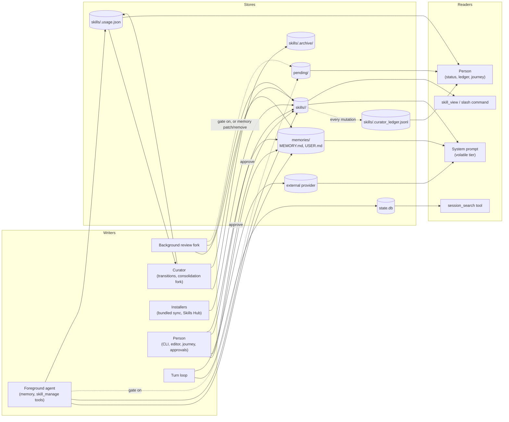
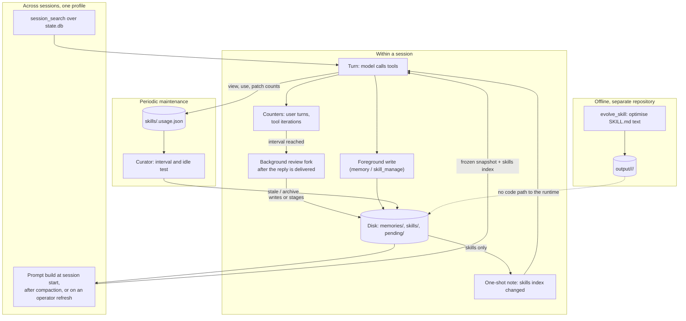

# Memory, learning and self-improvement: Hermes Agent v0.23.0

Readers: the owner and the later comparison session. Decision served: how Hermes learns, in its
own terms. Code citations are at `NousResearch/hermes-agent` commit
`2bd378ed1b8d6bf2192cb26e0a55ff3091e6bd19` and `NousResearch/hermes-agent-self-evolution` commit
`0a929e3aa20e15cf04dc7c28492a7d41a5139125`. Every statement about runtime behaviour rests on
static reading of code and tests; nothing was observed running.

In this file "memory", "skills", "curator", "learning" and "review" always carry Hermes's
meanings, as quoted in sections 1 and 2. `<home>` is the profile home, `get_hermes_home()`.

## 1. Hermes's own account

Quoted from the README, the user guide, the `AGENTS.md` files and the self-evolution repository.
All come from the same maintainers; one does not corroborate another.

### 1.1 What Hermes says it is

"**The self-improving AI agent built by Nous Research.** It's the only agent with a built-in
learning loop — it creates skills from experience, improves them during use, nudges itself to
persist knowledge, searches its own past conversations, and builds a deepening model of who you
are across sessions." ([`README.md#L19`](https://github.com/NousResearch/hermes-agent/blob/2bd378ed1b8d6bf2192cb26e0a55ff3091e6bd19/README.md#L19))

"**A closed learning loop** — Agent-curated memory with periodic nudges. Autonomous skill creation
after complex tasks. Skills self-improve during use. FTS5 session search with LLM summarization
for cross-session recall." ([`README.md#L26`](https://github.com/NousResearch/hermes-agent/blob/2bd378ed1b8d6bf2192cb26e0a55ff3091e6bd19/README.md#L26))

### 1.2 Memory

- "Hermes Agent has bounded, curated memory that persists across sessions."
  ([`memory.md#L9`](https://github.com/NousResearch/hermes-agent/blob/2bd378ed1b8d6bf2192cb26e0a55ff3091e6bd19/website/docs/user-guide/features/memory.md#L9))
- "Two files make up the agent's memory": `MEMORY.md`, "Agent's personal notes — environment
  facts, conventions, things learned", 2,200 characters; `USER.md`, "User profile — your
  preferences, communication style, expectations", 1,375 characters.
  ([`memory.md#L13-L18`](https://github.com/NousResearch/hermes-agent/blob/2bd378ed1b8d6bf2192cb26e0a55ff3091e6bd19/website/docs/user-guide/features/memory.md#L13-L18))
- "Both are stored in `~/.hermes/memories/` and are injected into the system prompt as a frozen
  snapshot at session start. The agent manages its own memory via the `memory` tool — it can add,
  patch, or remove entries." ([`memory.md#L20`](https://github.com/NousResearch/hermes-agent/blob/2bd378ed1b8d6bf2192cb26e0a55ff3091e6bd19/website/docs/user-guide/features/memory.md#L20))
- "**Frozen snapshot pattern:** The system prompt injection is captured once at session start and
  never changes mid-session. This is intentional — it preserves the LLM's prefix cache for
  performance." ([`memory.md#L57`](https://github.com/NousResearch/hermes-agent/blob/2bd378ed1b8d6bf2192cb26e0a55ff3091e6bd19/website/docs/user-guide/features/memory.md#L57))
- "Memory does **not** auto-compact: when a write would exceed the limit, the `memory` tool
  returns an error instead of silently dropping entries. The agent then makes room itself."
  ([`memory.md#L27-L29`](https://github.com/NousResearch/hermes-agent/blob/2bd378ed1b8d6bf2192cb26e0a55ff3091e6bd19/website/docs/user-guide/features/memory.md#L27-L29))
- "The whole memory system is built around the moment a session **ends**: `MEMORY.md` and
  `USER.md` carry the essentials into the next session, and `session_search` fills the gaps once
  the old context is gone." ([`memory.md#L61`](https://github.com/NousResearch/hermes-agent/blob/2bd378ed1b8d6bf2192cb26e0a55ff3091e6bd19/website/docs/user-guide/features/memory.md#L61))
- "The agent saves automatically — you don't need to ask."
  ([`memory.md#L159`](https://github.com/NousResearch/hermes-agent/blob/2bd378ed1b8d6bf2192cb26e0a55ff3091e6bd19/website/docs/user-guide/features/memory.md#L159))

### 1.3 Session search

"All CLI and messaging sessions are stored in SQLite (`~/.hermes/state.db`) with FTS5 full-text
search"; "Search queries return actual messages from the DB — no LLM summarization, no
truncation". ([`memory.md#L239-L240`](https://github.com/NousResearch/hermes-agent/blob/2bd378ed1b8d6bf2192cb26e0a55ff3091e6bd19/website/docs/user-guide/features/memory.md#L239-L240))

### 1.4 Skills

- "Skills are on-demand knowledge documents the agent can load when needed. They follow a
  **progressive disclosure** pattern to minimize token usage".
  ([`skills.md#L9`](https://github.com/NousResearch/hermes-agent/blob/2bd378ed1b8d6bf2192cb26e0a55ff3091e6bd19/website/docs/user-guide/features/skills.md#L9))
- "The agent can create, update, and delete its own skills via the `skill_manage` tool. This is
  the agent's **procedural memory** — when it figures out a non-trivial workflow, it saves the
  approach as a skill for future reuse."
  ([`skills.md#L608`](https://github.com/NousResearch/hermes-agent/blob/2bd378ed1b8d6bf2192cb26e0a55ff3091e6bd19/website/docs/user-guide/features/skills.md#L608))
- "Skills and memory work together in the self-improvement loop: memory stores small durable
  facts that should always be in context, while skills store longer procedures that should load
  only when relevant." ([`skills.md#L610-L612`](https://github.com/NousResearch/hermes-agent/blob/2bd378ed1b8d6bf2192cb26e0a55ff3091e6bd19/website/docs/user-guide/features/skills.md#L610-L612))
- A skill "captures **lessons, not logs**: a pitfall is a generalizable rule plus one clause of
  _why_ (the mechanism), attached to the step it affects, stated once."
  ([`skills.md#L631-L632`](https://github.com/NousResearch/hermes-agent/blob/2bd378ed1b8d6bf2192cb26e0a55ff3091e6bd19/website/docs/user-guide/features/skills.md#L631-L632))

### 1.5 The background review

- "After a turn, the background self-improvement review may quietly save a memory or update a
  skill. This is Hermes' consent-aware learning loop: repeated corrections and durable workflow
  lessons become compact memory entries or procedural skills, while `write_approval` can stage
  those writes for review before they affect future sessions."
  ([`memory.md#L366-L370`](https://github.com/NousResearch/hermes-agent/blob/2bd378ed1b8d6bf2192cb26e0a55ff3091e6bd19/website/docs/user-guide/features/memory.md#L366-L370))
- "The review runs on your **main chat model** by default, replaying the conversation — which is
  already warm in the prompt cache". ([`memory.md#L396-L397`](https://github.com/NousResearch/hermes-agent/blob/2bd378ed1b8d6bf2192cb26e0a55ff3091e6bd19/website/docs/user-guide/features/memory.md#L396-L397))

### 1.6 The curator

- "The curator is a background maintenance pass for **agent-created skills**. It tracks how often
  each skill is viewed, used, and patched, moves long-unused skills through `active → stale →
  archived` states, and periodically spawns a short auxiliary-model review that proposes
  consolidations or patches drift." ([`curator.md#L9`](https://github.com/NousResearch/hermes-agent/blob/2bd378ed1b8d6bf2192cb26e0a55ff3091e6bd19/website/docs/user-guide/features/curator.md#L9))
- "It exists so that skills created via the self-improvement loop don't pile up forever."
  ([`curator.md#L11`](https://github.com/NousResearch/hermes-agent/blob/2bd378ed1b8d6bf2192cb26e0a55ff3091e6bd19/website/docs/user-guide/features/curator.md#L11))
- "The curator also **never auto-deletes** — the worst outcome is archival into
  `~/.hermes/skills/.archive/`". ([`curator.md#L13`](https://github.com/NousResearch/hermes-agent/blob/2bd378ed1b8d6bf2192cb26e0a55ff3091e6bd19/website/docs/user-guide/features/curator.md#L13))

### 1.7 Offline self-evolution

- "Hermes Agent Self-Evolution uses DSPy + GEPA (Genetic-Pareto Prompt Evolution) to
  automatically evolve and optimize Hermes Agent's skills, tool descriptions, system prompts, and
  code — producing measurably better versions through reflective evolutionary search."
  ([`README.md#L5`](https://github.com/NousResearch/hermes-agent-self-evolution/blob/0a929e3aa20e15cf04dc7c28492a7d41a5139125/README.md#L5))
- "**No GPU training required.** Everything operates via API calls — mutating text, evaluating
  results, and selecting the best variants." ([`README.md#L7`](https://github.com/NousResearch/hermes-agent-self-evolution/blob/0a929e3aa20e15cf04dc7c28492a7d41a5139125/README.md#L7))
- "Lives in its own repo (`NousResearch/hermes-agent-self-evolution`), operates ON hermes-agent —
  not part of it." ([`PLAN.md#L5`](https://github.com/NousResearch/hermes-agent-self-evolution/blob/0a929e3aa20e15cf04dc7c28492a7d41a5139125/PLAN.md#L5))
- "**PR review** — All changes go through human review, never direct commit".
  ([`README.md#L76`](https://github.com/NousResearch/hermes-agent-self-evolution/blob/0a929e3aa20e15cf04dc7c28492a7d41a5139125/README.md#L76))

### 1.8 Does Hermes define improvement?

Finding: no definition of "improvement" or "learning" as a measured property of the running
agent was found in the documents read. The runtime documents describe improvement by what is
written: memory entries and skills are created, patched and pruned. The one place that states a
measure is the self-evolution repository, where a variant is better when its holdout score
exceeds the baseline's ([`evolve_skill.py#L224-L226`](https://github.com/NousResearch/hermes-agent-self-evolution/blob/0a929e3aa20e15cf04dc7c28492a7d41a5139125/evolution/skills/evolve_skill.py#L224-L226)).
Documents read for this finding: the README, `memory.md`, `curator.md`, the cited sections of
`skills.md`, the root, `agent/` and `skills/` `AGENTS.md` files, and the self-evolution `README.md`
and the cited sections of `PLAN.md`. A definition elsewhere in the 1.27 MB developer guide is not
excluded.

## 2. Glossary (memory and learning terms)

| Term | Hermes's own words | Citation |
| --- | --- | --- |
| memory | "bounded, curated memory that persists across sessions" | [`memory.md#L9`](https://github.com/NousResearch/hermes-agent/blob/2bd378ed1b8d6bf2192cb26e0a55ff3091e6bd19/website/docs/user-guide/features/memory.md#L9) |
| `MEMORY.md` / target `memory` | "facts about the ENVIRONMENT you operate in — tool quirks, project conventions, config gotchas, paths and endpoints that matter" | [`background_review.py#L375-L376`](https://github.com/NousResearch/hermes-agent/blob/2bd378ed1b8d6bf2192cb26e0a55ff3091e6bd19/agent/background_review.py#L375-L376) |
| `USER.md` / target `user` | "who the user is — persona, preferences, communication and work style, personal details they revealed, and expectations about how you should behave" | [`background_review.py#L372-L374`](https://github.com/NousResearch/hermes-agent/blob/2bd378ed1b8d6bf2192cb26e0a55ff3091e6bd19/agent/background_review.py#L372-L374) |
| entry | Entries are "joined by `ENTRY_DELIMITER`" (`"\n§\n"`); "budgets are in chars (model-independent)" | [`memory_tool_store.py#L1-L2`](https://github.com/NousResearch/hermes-agent/blob/2bd378ed1b8d6bf2192cb26e0a55ff3091e6bd19/tools/memory_tool_store.py#L1-L2), [`#L26`](https://github.com/NousResearch/hermes-agent/blob/2bd378ed1b8d6bf2192cb26e0a55ff3091e6bd19/tools/memory_tool_store.py#L26) |
| frozen snapshot | "captured once at session start and never changes mid-session" | [`memory.md#L57`](https://github.com/NousResearch/hermes-agent/blob/2bd378ed1b8d6bf2192cb26e0a55ff3091e6bd19/website/docs/user-guide/features/memory.md#L57) |
| memory provider | "The builtin provider is always allowed; only ONE external plugin provider may be registered at a time" | [`memory_manager.py#L3-L4`](https://github.com/NousResearch/hermes-agent/blob/2bd378ed1b8d6bf2192cb26e0a55ff3091e6bd19/agent/memory_manager.py#L3-L4) |
| session search | "long-term conversation recall over the SQLite session DB … No LLM calls — every shape returns actual DB messages." | [`session_search_tool.py#L2-L8`](https://github.com/NousResearch/hermes-agent/blob/2bd378ed1b8d6bf2192cb26e0a55ff3091e6bd19/tools/session_search_tool.py#L2-L8) |
| skill | "on-demand knowledge documents the agent can load when needed" | [`skills.md#L9`](https://github.com/NousResearch/hermes-agent/blob/2bd378ed1b8d6bf2192cb26e0a55ff3091e6bd19/website/docs/user-guide/features/skills.md#L9) |
| procedural memory | "This is the agent's **procedural memory**" (of `skill_manage`) | [`skills.md#L608`](https://github.com/NousResearch/hermes-agent/blob/2bd378ed1b8d6bf2192cb26e0a55ff3091e6bd19/website/docs/user-guide/features/skills.md#L608) |
| progressive disclosure | "Level 0: skills_list() … Level 1: skill_view(name) … Level 2: skill_view(name, path)" | [`skills.md#L177-L179`](https://github.com/NousResearch/hermes-agent/blob/2bd378ed1b8d6bf2192cb26e0a55ff3091e6bd19/website/docs/user-guide/features/skills.md#L177-L179) |
| self-improvement loop | "Skills and memory work together in the self-improvement loop" | [`skills.md#L610`](https://github.com/NousResearch/hermes-agent/blob/2bd378ed1b8d6bf2192cb26e0a55ff3091e6bd19/website/docs/user-guide/features/skills.md#L610) |
| background review, review fork | "the background self-improvement review that runs after a turn"; "a background fork of `AIAgent`" | [`memory.md#L331-L332`](https://github.com/NousResearch/hermes-agent/blob/2bd378ed1b8d6bf2192cb26e0a55ff3091e6bd19/website/docs/user-guide/features/memory.md#L331-L332), [`curator.md#L28`](https://github.com/NousResearch/hermes-agent/blob/2bd378ed1b8d6bf2192cb26e0a55ff3091e6bd19/website/docs/user-guide/features/curator.md#L28) |
| nudge | "Periodic built-in memory review" (`memory.nudge_interval`); "Nudge the agent to create skills after complex tasks" (`skills.creation_nudge_interval`) | [`config_defaults.py#L1306-L1307`](https://github.com/NousResearch/hermes-agent/blob/2bd378ed1b8d6bf2192cb26e0a55ff3091e6bd19/hermes_cli/config_defaults.py#L1306-L1307), [`cli-config.yaml.example#L1209`](https://github.com/NousResearch/hermes-agent/blob/2bd378ed1b8d6bf2192cb26e0a55ff3091e6bd19/cli-config.yaml.example#L1209) |
| write origin | "`origin` is `foreground` or `background_review`" | [`write_approval.py#L76`](https://github.com/NousResearch/hermes-agent/blob/2bd378ed1b8d6bf2192cb26e0a55ff3091e6bd19/tools/write_approval.py#L76) |
| write approval, staged, pending | "A simple on/off gate applied to **both** foreground turns and the background review"; writes "are **staged** for review" | [`memory.md#L333-L339`](https://github.com/NousResearch/hermes-agent/blob/2bd378ed1b8d6bf2192cb26e0a55ff3091e6bd19/website/docs/user-guide/features/memory.md#L333-L339) |
| curator | "a background maintenance pass for **agent-created skills**" | [`curator.md#L9`](https://github.com/NousResearch/hermes-agent/blob/2bd378ed1b8d6bf2192cb26e0a55ff3091e6bd19/website/docs/user-guide/features/curator.md#L9) |
| active, stale, archived | "moves long-unused skills through `active → stale → archived` states" | [`curator.md#L9`](https://github.com/NousResearch/hermes-agent/blob/2bd378ed1b8d6bf2192cb26e0a55ff3091e6bd19/website/docs/user-guide/features/curator.md#L9) |
| agent-created, `created_by` | "`created_by` is a policy flag, not a provenance claim … consumed as 'may autonomous curation touch this?'" | [`curator.md#L291-L293`](https://github.com/NousResearch/hermes-agent/blob/2bd378ed1b8d6bf2192cb26e0a55ff3091e6bd19/website/docs/user-guide/features/curator.md#L291-L293) |
| consolidation, umbrella | "consolidate overlapping ones into class-level umbrellas" | [`curator.md#L41`](https://github.com/NousResearch/hermes-agent/blob/2bd378ed1b8d6bf2192cb26e0a55ff3091e6bd19/website/docs/user-guide/features/curator.md#L41) |
| pin | "Pinning protects a skill from deletion" | [`curator.md#L322`](https://github.com/NousResearch/hermes-agent/blob/2bd378ed1b8d6bf2192cb26e0a55ff3091e6bd19/website/docs/user-guide/features/curator.md#L322) |
| lock | "While a skill is locked the agent cannot change it" | [`skill_lock.py#L4-L5`](https://github.com/NousResearch/hermes-agent/blob/2bd378ed1b8d6bf2192cb26e0a55ff3091e6bd19/tools/skill_lock.py#L4-L5) |
| ledger | "the append-only JSONL ledger at `~/.hermes/skills/.curator_ledger.jsonl`" | [`curator.md#L158`](https://github.com/NousResearch/hermes-agent/blob/2bd378ed1b8d6bf2192cb26e0a55ff3091e6bd19/website/docs/user-guide/features/curator.md#L158) |
| learning journey | "a timeline view of everything Hermes has learned — saved skills and memory entries plotted over time" | [`memory.md#L265`](https://github.com/NousResearch/hermes-agent/blob/2bd378ed1b8d6bf2192cb26e0a55ff3091e6bd19/website/docs/user-guide/features/memory.md#L265) |
| learning signal | "A skill appears on the timeline as soon as it has a learning signal: it was created in this profile …, created by the background review, or used at least once." | [`memory.md#L271`](https://github.com/NousResearch/hermes-agent/blob/2bd378ed1b8d6bf2192cb26e0a55ff3091e6bd19/website/docs/user-guide/features/memory.md#L271) |
| trajectory | "ShareGPT-compatible JSONL format for use as training data, debugging artifacts, and reinforcement learning datasets" | [`trajectory-format.md#L3-L4`](https://github.com/NousResearch/hermes-agent/blob/2bd378ed1b8d6bf2192cb26e0a55ff3091e6bd19/website/docs/developer-guide/trajectory-format.md#L3-L4) |
| self-evolution | "Evolutionary self-improvement for Hermes Agent" | [`README.md#L3`](https://github.com/NousResearch/hermes-agent-self-evolution/blob/0a929e3aa20e15cf04dc7c28492a7d41a5139125/README.md#L3) |
| fitness | "Fitness functions for evaluating evolved artifacts. Uses LLM-as-judge with rubrics to score agent outputs." | [`fitness.py#L1-L4`](https://github.com/NousResearch/hermes-agent-self-evolution/blob/0a929e3aa20e15cf04dc7c28492a7d41a5139125/evolution/core/fitness.py#L1-L4) |

## 3. Store cards

One card per durable store. "Writers" name the code path and what initiates it; "Readers" name
how the content reaches the model or a person.

### 3.1 Built-in memory: `<home>/memories/MEMORY.md` and `USER.md`

| Aspect | Detail |
| --- | --- |
| Location and schema | Two text files under `<home>/memories` ([`memory_tool.py#L40`](https://github.com/NousResearch/hermes-agent/blob/2bd378ed1b8d6bf2192cb26e0a55ff3091e6bd19/tools/memory_tool.py#L40)). Entries joined by `"\n§\n"` ([`memory_tool_store.py#L26`](https://github.com/NousResearch/hermes-agent/blob/2bd378ed1b8d6bf2192cb26e0a55ff3091e6bd19/tools/memory_tool_store.py#L26)). No per-entry metadata in the file. |
| Bound | Character limits per file: 2,200 and 1,375 by default ([`config_defaults.py#L1304-L1305`](https://github.com/NousResearch/hermes-agent/blob/2bd378ed1b8d6bf2192cb26e0a55ff3091e6bd19/hermes_cli/config_defaults.py#L1304-L1305)). A write over the limit returns an error; nothing is dropped automatically ([`memory.md#L27-L29`](https://github.com/NousResearch/hermes-agent/blob/2bd378ed1b8d6bf2192cb26e0a55ff3091e6bd19/website/docs/user-guide/features/memory.md#L27-L29)). |
| Writer 1 | The `memory` tool called by the model in a foreground turn. It is an agent-level tool, run inline ([`agent/AGENTS.md#L51-L52`](https://github.com/NousResearch/hermes-agent/blob/2bd378ed1b8d6bf2192cb26e0a55ff3091e6bd19/agent/AGENTS.md#L51-L52)). All mutations go through `MemoryStore._mutate`: file lock, re-read from disk, apply, atomic write ([`memory_tool_store.py#L350-L394`](https://github.com/NousResearch/hermes-agent/blob/2bd378ed1b8d6bf2192cb26e0a55ff3091e6bd19/tools/memory_tool_store.py#L350-L394)). |
| Writer 2 | The same tool called by the background review fork (section 3.6), with write origin `background_review` ([`background_review.py#L1001`](https://github.com/NousResearch/hermes-agent/blob/2bd378ed1b8d6bf2192cb26e0a55ff3091e6bd19/agent/background_review.py#L1001)). |
| Writer 3 | A person, through the learning journey's edit and delete, which also go through `_mutate` ([`learning_mutations.py#L85-L92`](https://github.com/NousResearch/hermes-agent/blob/2bd378ed1b8d6bf2192cb26e0a55ff3091e6bd19/agent/learning_mutations.py#L85-L92), [`#L116`](https://github.com/NousResearch/hermes-agent/blob/2bd378ed1b8d6bf2192cb26e0a55ff3091e6bd19/agent/learning_mutations.py#L116)); and approval of a pending write (section 3.3). |
| Readers | Rendered into the system prompt's volatile tier from a snapshot taken at load ([`system_prompt.py#L522-L531`](https://github.com/NousResearch/hermes-agent/blob/2bd378ed1b8d6bf2192cb26e0a55ff3091e6bd19/agent/system_prompt.py#L522-L531); [`memory_tool_store.py#L649-L652`](https://github.com/NousResearch/hermes-agent/blob/2bd378ed1b8d6bf2192cb26e0a55ff3091e6bd19/tools/memory_tool_store.py#L649-L652)). The `memory` tool has no read action ([`memory.md#L98`](https://github.com/NousResearch/hermes-agent/blob/2bd378ed1b8d6bf2192cb26e0a55ff3091e6bd19/website/docs/user-guide/features/memory.md#L98)). The learning journey reads the files for display ([`learning_graph.py#L166`](https://github.com/NousResearch/hermes-agent/blob/2bd378ed1b8d6bf2192cb26e0a55ff3091e6bd19/agent/learning_graph.py#L166)). |
| Controls | Content scan before acceptance: "Error string if _content_ matches injection/exfil patterns. Strict scope: memory enters the system prompt, so a poisoned entry persists across sessions." ([`memory_tool_store.py#L29-L32`](https://github.com/NousResearch/hermes-agent/blob/2bd378ed1b8d6bf2192cb26e0a55ff3091e6bd19/tools/memory_tool_store.py#L29-L32)). The approval gate `memory.write_approval` (section 3.3). The unattended-delete gate (section 5, L5). A drift guard that refuses to rewrite a file holding an entry longer than the whole limit, after saving a `.bak` snapshot ([`memory_tool_store.py#L50-L60`](https://github.com/NousResearch/hermes-agent/blob/2bd378ed1b8d6bf2192cb26e0a55ff3091e6bd19/tools/memory_tool_store.py#L50-L60), [`#L725-L734`](https://github.com/NousResearch/hermes-agent/blob/2bd378ed1b8d6bf2192cb26e0a55ff3091e6bd19/tools/memory_tool_store.py#L725-L734)). |
| Defaults | `memory_enabled: True`, `user_profile_enabled: True`, `write_approval: False`, `nudge_interval: 10`, `provider: ""` ([`config_defaults.py#L1296-L1310`](https://github.com/NousResearch/hermes-agent/blob/2bd378ed1b8d6bf2192cb26e0a55ff3091e6bd19/hermes_cli/config_defaults.py#L1296-L1310)). |
| Retention | No code path ages, scores or expires an entry. An entry stays until a `remove` or `patch` by the model, a person's edit, or an approved staged write. Byte-identical duplicates collapse on mutation ([`memory_tool_store.py#L367`](https://github.com/NousResearch/hermes-agent/blob/2bd378ed1b8d6bf2192cb26e0a55ff3091e6bd19/tools/memory_tool_store.py#L367)). |

### 3.2 Skills: `<home>/skills/<category>/<name>/`

| Aspect | Detail |
| --- | --- |
| Location and schema | A directory per skill holding `SKILL.md` with YAML frontmatter and optional `scripts/`, `references/`, `templates/` ([`skills/AGENTS.md#L18-L22`](https://github.com/NousResearch/hermes-agent/blob/2bd378ed1b8d6bf2192cb26e0a55ff3091e6bd19/skills/AGENTS.md#L18-L22), [`#L53`](https://github.com/NousResearch/hermes-agent/blob/2bd378ed1b8d6bf2192cb26e0a55ff3091e6bd19/skills/AGENTS.md#L53)). "All skills live in **`~/.hermes/skills/`** — the primary directory and source of truth." ([`skills.md#L11`](https://github.com/NousResearch/hermes-agent/blob/2bd378ed1b8d6bf2192cb26e0a55ff3091e6bd19/website/docs/user-guide/features/skills.md#L11)) |
| Bound | No hard size bound on a skill found in the runtime. An advisory linter warns on a body "past ~24k chars" and on "more than 60 reference files"; "They warn; they never block a write." ([`skills.md#L641-L644`](https://github.com/NousResearch/hermes-agent/blob/2bd378ed1b8d6bf2192cb26e0a55ff3091e6bd19/website/docs/user-guide/features/skills.md#L641-L644)) A description over 60 characters is rejected by `skill_manage` ([`skills/AGENTS.md#L31-L33`](https://github.com/NousResearch/hermes-agent/blob/2bd378ed1b8d6bf2192cb26e0a55ff3091e6bd19/skills/AGENTS.md#L31-L33)). |
| Writer 1 | `skill_manage` called by the model in a foreground turn: `create`, `patch`, `edit`, `delete`, `write_file`, `remove_file` ([`skill_manager_tool.py#L789-L800`](https://github.com/NousResearch/hermes-agent/blob/2bd378ed1b8d6bf2192cb26e0a55ff3091e6bd19/tools/skill_manager_tool.py#L789-L800); file writes at [`#L407-L428`](https://github.com/NousResearch/hermes-agent/blob/2bd378ed1b8d6bf2192cb26e0a55ff3091e6bd19/tools/skill_manager_tool.py#L407-L428)). A foreground create is recorded `created_by="learn"` ([`skill_usage.py#L522-L534`](https://github.com/NousResearch/hermes-agent/blob/2bd378ed1b8d6bf2192cb26e0a55ff3091e6bd19/tools/skill_usage.py#L522-L534)). |
| Writer 2 | `skill_manage` called by the background review fork; a create there is recorded `created_by="agent"` ([`skill_manager_tool.py#L773-L776`](https://github.com/NousResearch/hermes-agent/blob/2bd378ed1b8d6bf2192cb26e0a55ff3091e6bd19/tools/skill_manager_tool.py#L773-L776)). |
| Writer 3 | The curator: directory moves into `.archive/` by the automatic transitions, and `skill_manage` calls by its consolidation fork (section 3.7). |
| Writer 4 | Installers: bundled-skill sync at start-up and update (`sync_skills`, cold-pass row C-13) and Skills Hub installs through a quarantine directory (C-14). |
| Writer 5 | A person: their own editor, the CLI, and approval of a pending write. |
| Readers | The skills index in the system prompt's volatile tier ([`system_prompt.py#L785-L787`](https://github.com/NousResearch/hermes-agent/blob/2bd378ed1b8d6bf2192cb26e0a55ff3091e6bd19/agent/system_prompt.py#L785-L787)); `skill_view` on demand; a `/skill-name` command, which "inject[s] as a user message" ([`agent/AGENTS.md#L60-L61`](https://github.com/NousResearch/hermes-agent/blob/2bd378ed1b8d6bf2192cb26e0a55ff3091e6bd19/agent/AGENTS.md#L60-L61)); cron jobs with attached skills ([`cron/scheduler_prompt.py#L248`](https://github.com/NousResearch/hermes-agent/blob/2bd378ed1b8d6bf2192cb26e0a55ff3091e6bd19/cron/scheduler_prompt.py#L248)); pinned auto-load skills in the stable tier ([`system_prompt.py#L763-L764`](https://github.com/NousResearch/hermes-agent/blob/2bd378ed1b8d6bf2192cb26e0a55ff3091e6bd19/agent/system_prompt.py#L763-L764)). |
| Controls | `skills.write_approval` (section 3.3); the lock ([`skill_manager_guards.py#L224-L252`](https://github.com/NousResearch/hermes-agent/blob/2bd378ed1b8d6bf2192cb26e0a55ff3091e6bd19/tools/skill_manager_guards.py#L224-L252)); the pin, which refuses `delete` only ([`skill_manager_guards.py#L143-L144`](https://github.com/NousResearch/hermes-agent/blob/2bd378ed1b8d6bf2192cb26e0a55ff3091e6bd19/tools/skill_manager_guards.py#L143-L144)); the review fork's read-before-write guard ([`#L211-L221`](https://github.com/NousResearch/hermes-agent/blob/2bd378ed1b8d6bf2192cb26e0a55ff3091e6bd19/tools/skill_manager_guards.py#L211-L221)) and delete guard ([`#L164-L208`](https://github.com/NousResearch/hermes-agent/blob/2bd378ed1b8d6bf2192cb26e0a55ff3091e6bd19/tools/skill_manager_guards.py#L164-L208)); an optional content scan, `skills.guard_agent_created` ([`config_defaults.py#L1455-L1458`](https://github.com/NousResearch/hermes-agent/blob/2bd378ed1b8d6bf2192cb26e0a55ff3091e6bd19/hermes_cli/config_defaults.py#L1455-L1458)). |
| Defaults | `write_approval: False`, `guard_agent_created: False`, `ledger: True` ([`config_defaults.py#L1458-L1476`](https://github.com/NousResearch/hermes-agent/blob/2bd378ed1b8d6bf2192cb26e0a55ff3091e6bd19/hermes_cli/config_defaults.py#L1458-L1476)). |
| Retention | Decided by the curator for skills whose usage record says `created_by: "agent"` (section 3.7). Other skills are never auto-transitioned. |

### 3.3 Pending writes: `<home>/pending/{memory,skills}/<id>.json`

| Aspect | Detail |
| --- | --- |
| Location and schema | One JSON file per staged write with `id`, `subsystem`, `action`, `summary`, `origin`, `created_at` and `payload`, "the exact kwargs to replay the write on approval" ([`write_approval.py#L74-L86`](https://github.com/NousResearch/hermes-agent/blob/2bd378ed1b8d6bf2192cb26e0a55ff3091e6bd19/tools/write_approval.py#L74-L86)). |
| Bound | None found. |
| Writers | `stage_write`, called from the memory tool ([`memory_tool.py#L100`](https://github.com/NousResearch/hermes-agent/blob/2bd378ed1b8d6bf2192cb26e0a55ff3091e6bd19/tools/memory_tool.py#L100), [`#L203`](https://github.com/NousResearch/hermes-agent/blob/2bd378ed1b8d6bf2192cb26e0a55ff3091e6bd19/tools/memory_tool.py#L203)) and from `skill_manage` ([`skill_manager_tool.py#L686`](https://github.com/NousResearch/hermes-agent/blob/2bd378ed1b8d6bf2192cb26e0a55ff3091e6bd19/tools/skill_manager_tool.py#L686)). |
| Readers | A person, through `/memory pending`, `/skills pending`, `/skills diff`, and approve or reject ([`memory.md#L345-L350`](https://github.com/NousResearch/hermes-agent/blob/2bd378ed1b8d6bf2192cb26e0a55ff3091e6bd19/website/docs/user-guide/features/memory.md#L345-L350); [`skills.md#L688-L693`](https://github.com/NousResearch/hermes-agent/blob/2bd378ed1b8d6bf2192cb26e0a55ff3091e6bd19/website/docs/user-guide/features/skills.md#L688-L693)). The model does not read it. |
| Trigger | The gate is on (`<subsystem>.write_approval`), or, for memory `patch` and `remove` from an unattended review, always (section 5, L5). |
| Retention | Until a person approves or rejects. A staged memory `patch` or `remove` pins the full entry it matched; approval is refused if that entry changed ([`memory_tool.py#L62-L66`](https://github.com/NousResearch/hermes-agent/blob/2bd378ed1b8d6bf2192cb26e0a55ff3091e6bd19/tools/memory_tool.py#L62-L66)). |

### 3.4 Skill usage record: `<home>/skills/.usage.json`

| Aspect | Detail |
| --- | --- |
| Location and schema | One JSON map keyed by skill name. Each record: `created_by`, `use_count`, `view_count`, `last_used_at`, `last_viewed_at`, `patch_count`, `patch_generation`, `last_reused_patch_generation`, `last_patched_at`, `created_at`, `state`, `pinned`, `archived_at`, `first_seen_at` ([`skill_usage.py#L348-L353`](https://github.com/NousResearch/hermes-agent/blob/2bd378ed1b8d6bf2192cb26e0a55ff3091e6bd19/tools/skill_usage.py#L348-L353)); `locked` is stored beside `pinned` ([`skill_lock.py#L3-L4`](https://github.com/NousResearch/hermes-agent/blob/2bd378ed1b8d6bf2192cb26e0a55ff3091e6bd19/tools/skill_lock.py#L3-L4)). |
| Bound | None found; one record per skill. |
| Writers | `bump_view` when `skill_view` runs ([`skills_tool.py#L777`](https://github.com/NousResearch/hermes-agent/blob/2bd378ed1b8d6bf2192cb26e0a55ff3091e6bd19/tools/skills_tool.py#L777)); `bump_use` when a skill is loaded through a command, the skills tool or a cron job ([`skill_commands.py#L429`](https://github.com/NousResearch/hermes-agent/blob/2bd378ed1b8d6bf2192cb26e0a55ff3091e6bd19/agent/skill_commands.py#L429), [`skills_tool.py#L780`](https://github.com/NousResearch/hermes-agent/blob/2bd378ed1b8d6bf2192cb26e0a55ff3091e6bd19/tools/skills_tool.py#L780), [`scheduler_prompt.py#L248`](https://github.com/NousResearch/hermes-agent/blob/2bd378ed1b8d6bf2192cb26e0a55ff3091e6bd19/cron/scheduler_prompt.py#L248)); `bump_patch` and `record_created` after a `skill_manage` mutation ([`skill_manager_tool.py#L773-L776`](https://github.com/NousResearch/hermes-agent/blob/2bd378ed1b8d6bf2192cb26e0a55ff3091e6bd19/tools/skill_manager_tool.py#L773-L776)); `set_state` by the curator ([`curator.py#L224`](https://github.com/NousResearch/hermes-agent/blob/2bd378ed1b8d6bf2192cb26e0a55ff3091e6bd19/agent/curator.py#L224)); `set_pinned`, lock and adopt from the CLI. |
| Readers | The curator's transitions ([`curator.py#L227-L260`](https://github.com/NousResearch/hermes-agent/blob/2bd378ed1b8d6bf2192cb26e0a55ff3091e6bd19/agent/curator.py#L227-L260)); the delete, pin and lock guards; `hermes curator status`; the learning journey ([`learning_graph.py#L61`](https://github.com/NousResearch/hermes-agent/blob/2bd378ed1b8d6bf2192cb26e0a55ff3091e6bd19/agent/learning_graph.py#L61)). It is not rendered into the model's prompt. |
| Retention | A record is reset on create and removed on a hard delete ([`skill_manager_tool.py#L773-L780`](https://github.com/NousResearch/hermes-agent/blob/2bd378ed1b8d6bf2192cb26e0a55ff3091e6bd19/tools/skill_manager_tool.py#L773-L780)). |

### 3.5 Skill ledger and blobs: `<home>/skills/.curator_ledger.jsonl`, `<home>/.curator_backups/blobs/`

| Aspect | Detail |
| --- | --- |
| Location and schema | Append-only JSON lines: `id`, `ts`, `actor`, `action`, `skill`, `evidence`, `before`, `after` ([`skill_ledger.py#L298-L320`](https://github.com/NousResearch/hermes-agent/blob/2bd378ed1b8d6bf2192cb26e0a55ff3091e6bd19/tools/skill_ledger.py#L298-L320)); file contents stored by hash as blobs ([`#L84-L89`](https://github.com/NousResearch/hermes-agent/blob/2bd378ed1b8d6bf2192cb26e0a55ff3091e6bd19/tools/skill_ledger.py#L84-L89)). |
| Bound | `skills.ledger_max_bytes`, 5 MB by default ([`config_defaults.py#L1476`](https://github.com/NousResearch/hermes-agent/blob/2bd378ed1b8d6bf2192cb26e0a55ff3091e6bd19/hermes_cli/config_defaults.py#L1476)); past it the next append deduplicates and then drops the oldest entries ([`curator.md#L180`](https://github.com/NousResearch/hermes-agent/blob/2bd378ed1b8d6bf2192cb26e0a55ff3091e6bd19/website/docs/user-guide/features/curator.md#L180)). |
| Writers | Every skill mutation: "curator auto-transitions, agent `skill_manage` calls, and your own CLI archive/restore/purge" ([`curator.md#L158`](https://github.com/NousResearch/hermes-agent/blob/2bd378ed1b8d6bf2192cb26e0a55ff3091e6bd19/website/docs/user-guide/features/curator.md#L158)); in code, `record_mutation` after a `skill_manage` success ([`skill_manager_tool.py#L751-L760`](https://github.com/NousResearch/hermes-agent/blob/2bd378ed1b8d6bf2192cb26e0a55ff3091e6bd19/tools/skill_manager_tool.py#L751-L760)). |
| Readers | A person: `hermes curator ledger` and `hermes curator rollback <entry-id>` ([`hermes_cli/curator.py#L542`](https://github.com/NousResearch/hermes-agent/blob/2bd378ed1b8d6bf2192cb26e0a55ff3091e6bd19/hermes_cli/curator.py#L542)). The model does not read it. |
| Role in control | "The ledger is telemetry, never a gate — if writing an entry fails, the mutation still goes through." ([`curator.md#L173`](https://github.com/NousResearch/hermes-agent/blob/2bd378ed1b8d6bf2192cb26e0a55ff3091e6bd19/website/docs/user-guide/features/curator.md#L173)) |

### 3.6 The background review (a writer, with no store of its own)

| Aspect | Detail |
| --- | --- |
| What it is | A second `AIAgent`, forked after a turn with a copy of the conversation and a review prompt, limited to 16 iterations ([`background_review.py#L173`](https://github.com/NousResearch/hermes-agent/blob/2bd378ed1b8d6bf2192cb26e0a55ff3091e6bd19/agent/background_review.py#L173)). It inherits the parent's cached system prompt ([`#L1031`](https://github.com/NousResearch/hermes-agent/blob/2bd378ed1b8d6bf2192cb26e0a55ff3091e6bd19/agent/background_review.py#L1031)) and tool list; a dispatch-side whitelist decides what it may call ([`#L1114-L1127`](https://github.com/NousResearch/hermes-agent/blob/2bd378ed1b8d6bf2192cb26e0a55ff3091e6bd19/agent/background_review.py#L1114-L1127)). |
| Trigger: memory | A counter of user turns. `_tick_memory_nudge` increments `_turns_since_memory` each turn and fires when it reaches `memory.nudge_interval` ([`turn_context.py#L765-L774`](https://github.com/NousResearch/hermes-agent/blob/2bd378ed1b8d6bf2192cb26e0a55ff3091e6bd19/agent/turn_context.py#L765-L774)). A foreground call to the `memory` tool resets the counter ([`tool_executor.py#L736-L737`](https://github.com/NousResearch/hermes-agent/blob/2bd378ed1b8d6bf2192cb26e0a55ff3091e6bd19/agent/tool_executor.py#L736-L737)). The counter is restored from history on resume ([`turn_context.py#L757-L762`](https://github.com/NousResearch/hermes-agent/blob/2bd378ed1b8d6bf2192cb26e0a55ff3091e6bd19/agent/turn_context.py#L757-L762)). |
| Trigger: skills | A counter of tool-calling iterations. `_iters_since_skill` increments per iteration when `skill_manage` is available ([`turn_iteration_prep.py#L166-L167`](https://github.com/NousResearch/hermes-agent/blob/2bd378ed1b8d6bf2192cb26e0a55ff3091e6bd19/agent/turn_iteration_prep.py#L166-L167)); the turn finaliser fires the skill review when it reaches `skills.creation_nudge_interval` ([`turn_finalizer.py#L863-L869`](https://github.com/NousResearch/hermes-agent/blob/2bd378ed1b8d6bf2192cb26e0a55ff3091e6bd19/agent/turn_finalizer.py#L863-L869)). A foreground `skill_manage` call resets it ([`tool_executor.py#L738-L739`](https://github.com/NousResearch/hermes-agent/blob/2bd378ed1b8d6bf2192cb26e0a55ff3091e6bd19/agent/tool_executor.py#L738-L739)). |
| Conditions | The fork spawns only when the turn produced a final response, was not interrupted, `skip_background_review` is unset, and at least one of the two triggers fired ([`turn_finalizer.py#L605-L616`](https://github.com/NousResearch/hermes-agent/blob/2bd378ed1b8d6bf2192cb26e0a55ff3091e6bd19/agent/turn_finalizer.py#L605-L616)). It runs "AFTER delivery so it never competes with the user's task" ([`#L602-L603`](https://github.com/NousResearch/hermes-agent/blob/2bd378ed1b8d6bf2192cb26e0a55ff3091e6bd19/agent/turn_finalizer.py#L602-L603)). `auxiliary.background_review.enabled` defaults to `True` ([`config_defaults.py#L796`](https://github.com/NousResearch/hermes-agent/blob/2bd378ed1b8d6bf2192cb26e0a55ff3091e6bd19/hermes_cli/config_defaults.py#L796)); a finite one-shot turn disables it ([`background_review.py#L234-L238`](https://github.com/NousResearch/hermes-agent/blob/2bd378ed1b8d6bf2192cb26e0a55ff3091e6bd19/agent/background_review.py#L234-L238)). Other entry points: an explicit `/refine`-style command and a cold-session review (cold-pass row C-36). |
| What it may call | `skills` tools always; the `memory` tool only when memory is enabled and the memory trigger fired; `read_file` and `search_files`; nothing that writes files or runs a terminal ([`background_review.py#L1119-L1127`](https://github.com/NousResearch/hermes-agent/blob/2bd378ed1b8d6bf2192cb26e0a55ff3091e6bd19/agent/background_review.py#L1119-L1127)). |
| What it is told | For memory: "Save only facts GROUNDED in this conversation — a user message or tool result you can point to." ([`background_review.py#L383-L384`](https://github.com/NousResearch/hermes-agent/blob/2bd378ed1b8d6bf2192cb26e0a55ff3091e6bd19/agent/background_review.py#L383-L384)) For skills: "Be ACTIVE — most sessions produce at least one skill update, even if small. A pass that does nothing is a missed learning opportunity, not a neutral outcome." ([`#L457-L459`](https://github.com/NousResearch/hermes-agent/blob/2bd378ed1b8d6bf2192cb26e0a55ff3091e6bd19/agent/background_review.py#L457-L459)) |
| Deferral | On a managed local model server the review is queued until the machine is idle, one slot per session, in memory only ([`review_idle_queue.py#L1-L11`](https://github.com/NousResearch/hermes-agent/blob/2bd378ed1b8d6bf2192cb26e0a55ff3091e6bd19/agent/review_idle_queue.py#L1-L11)). |

### 3.7 The curator: `<home>/skills/.curator_state`, `.archive/`, `.curator_backups/`, `<home>/logs/curator/`

| Aspect | Detail |
| --- | --- |
| State file | JSON with `last_run_at`, `run_count`, `paused`, `last_run_summary`, `last_report_path`, `last_run_duration_seconds` ([`curator.py#L40-L41`](https://github.com/NousResearch/hermes-agent/blob/2bd378ed1b8d6bf2192cb26e0a55ff3091e6bd19/agent/curator.py#L40-L41), [`#L957-L985`](https://github.com/NousResearch/hermes-agent/blob/2bd378ed1b8d6bf2192cb26e0a55ff3091e6bd19/agent/curator.py#L957-L985)). |
| Trigger | `maybe_run_curator`, called from gateway housekeeping, the CLI/TUI runtime and the `serve` maintenance timer (cold-pass row C-38). It runs when `should_run_now()` is true and the caller's idle time is at least `min_idle_hours` ([`curator.py#L1204-L1209`](https://github.com/NousResearch/hermes-agent/blob/2bd378ed1b8d6bf2192cb26e0a55ff3091e6bd19/agent/curator.py#L1204-L1209)). `should_run_now` requires the curator enabled, not paused, and `last_run_at` older than `interval_hours`; the first observation only seeds `last_run_at` ([`#L160-L180`](https://github.com/NousResearch/hermes-agent/blob/2bd378ed1b8d6bf2192cb26e0a55ff3091e6bd19/agent/curator.py#L160-L180)). |
| Phase 1, automatic transitions | For each curator-managed skill, skipping pinned, locked and cron-referenced ones: archive when the latest activity is at or before the archive cutoff; mark `stale` when at or before the stale cutoff; a never-used skill younger than the stale cutoff is left or reactivated ([`curator.py#L209-L260`](https://github.com/NousResearch/hermes-agent/blob/2bd378ed1b8d6bf2192cb26e0a55ff3091e6bd19/agent/curator.py#L209-L260)). No model call. |
| Phase 2, consolidation | Only when `curator.consolidate` is true: a tar snapshot, then a forked agent on a review prompt ([`curator.py#L927-L946`](https://github.com/NousResearch/hermes-agent/blob/2bd378ed1b8d6bf2192cb26e0a55ff3091e6bd19/agent/curator.py#L927-L946), [`#L962-L969`](https://github.com/NousResearch/hermes-agent/blob/2bd378ed1b8d6bf2192cb26e0a55ff3091e6bd19/agent/curator.py#L962-L969)). |
| Outputs | Skill directories moved to `<home>/skills/.archive/` ([`skill_usage.py#L55`](https://github.com/NousResearch/hermes-agent/blob/2bd378ed1b8d6bf2192cb26e0a55ff3091e6bd19/tools/skill_usage.py#L55)); `state` updates in `.usage.json`; ledger entries with actor `curator` ([`curator.py#L194-L202`](https://github.com/NousResearch/hermes-agent/blob/2bd378ed1b8d6bf2192cb26e0a55ff3091e6bd19/agent/curator.py#L194-L202)); `run.json` and `REPORT.md` per run under `<home>/logs/curator/` ([`#L739-L740`](https://github.com/NousResearch/hermes-agent/blob/2bd378ed1b8d6bf2192cb26e0a55ff3091e6bd19/agent/curator.py#L739-L740)); snapshots under `<home>/skills/.curator_backups/` ([`curator_backup.py#L63-L68`](https://github.com/NousResearch/hermes-agent/blob/2bd378ed1b8d6bf2192cb26e0a55ff3091e6bd19/agent/curator_backup.py#L63-L68)). |
| Defaults | `enabled: True`, `interval_hours: 168`, `min_idle_hours: 2`, `stale_after_days: 14`, `archive_after_days: 30`, `consolidate: False`, `prune_builtins: False`, `archive_ttl_days: 0` ([`config_defaults.py#L1484-L1499`](https://github.com/NousResearch/hermes-agent/blob/2bd378ed1b8d6bf2192cb26e0a55ff3091e6bd19/hermes_cli/config_defaults.py#L1484-L1499); the same constants at [`curator.py#L31-L35`](https://github.com/NousResearch/hermes-agent/blob/2bd378ed1b8d6bf2192cb26e0a55ff3091e6bd19/agent/curator.py#L31-L35)). |
| Scope | Skills whose record has `created_by == "agent"` or `agent_created is True` ([`skill_usage.py#L290-L297`](https://github.com/NousResearch/hermes-agent/blob/2bd378ed1b8d6bf2192cb26e0a55ff3091e6bd19/tools/skill_usage.py#L290-L297)); bundled skills too when `prune_builtins` is on; never hub-installed ones ([`#L232-L237`](https://github.com/NousResearch/hermes-agent/blob/2bd378ed1b8d6bf2192cb26e0a55ff3091e6bd19/tools/skill_usage.py#L232-L237)). |

### 3.8 Session database: `<home>/state.db`

| Aspect | Detail |
| --- | --- |
| Location and schema | SQLite ([`hermes_state.py#L181`](https://github.com/NousResearch/hermes-agent/blob/2bd378ed1b8d6bf2192cb26e0a55ff3091e6bd19/hermes_state.py#L181)) with a `messages` table and full-text tables kept by triggers (cold-pass row C-32). The schema was not read beyond that. |
| Writers | Session persistence in the turn loop. Not traced; `[unverified]`. |
| Readers | The `session_search` tool: "No LLM calls — every shape returns actual DB messages." ([`session_search_tool.py#L2-L8`](https://github.com/NousResearch/hermes-agent/blob/2bd378ed1b8d6bf2192cb26e0a55ff3091e6bd19/tools/session_search_tool.py#L2-L8)) The insights engine aggregates it into usage reports ([`insights.py#L1-L2`](https://github.com/NousResearch/hermes-agent/blob/2bd378ed1b8d6bf2192cb26e0a55ff3091e6bd19/agent/insights.py#L1-L2)). |
| Retention | Under in-place compaction the pre-compaction turns are "soft-archived under the same id … still searchable via `session_search` and recoverable, never deleted" ([`context-compression-and-caching.md#L333`](https://github.com/NousResearch/hermes-agent/blob/2bd378ed1b8d6bf2192cb26e0a55ff3091e6bd19/website/docs/developer-guide/context-compression-and-caching.md#L333)). Pruning of the database was not traced. |

### 3.9 External memory provider (at most one)

| Aspect | Detail |
| --- | --- |
| Location | Outside the built-in files; each provider owns its storage. The interface is `MemoryProvider` ([`memory_provider.py#L84`](https://github.com/NousResearch/hermes-agent/blob/2bd378ed1b8d6bf2192cb26e0a55ff3091e6bd19/agent/memory_provider.py#L84)). |
| Writers | The manager fans hooks out to the provider: `sync_turn` after each turn ([`turn_finalizer.py#L598-L601`](https://github.com/NousResearch/hermes-agent/blob/2bd378ed1b8d6bf2192cb26e0a55ff3091e6bd19/agent/turn_finalizer.py#L598-L601)), `on_session_end`, `on_pre_compress`, `on_delegation`, and `on_memory_write` when the built-in memory tool writes ([`memory_provider.py#L151`](https://github.com/NousResearch/hermes-agent/blob/2bd378ed1b8d6bf2192cb26e0a55ff3091e6bd19/agent/memory_provider.py#L151), [`#L183`](https://github.com/NousResearch/hermes-agent/blob/2bd378ed1b8d6bf2192cb26e0a55ff3091e6bd19/agent/memory_provider.py#L183), [`#L194`](https://github.com/NousResearch/hermes-agent/blob/2bd378ed1b8d6bf2192cb26e0a55ff3091e6bd19/agent/memory_provider.py#L194), [`#L212`](https://github.com/NousResearch/hermes-agent/blob/2bd378ed1b8d6bf2192cb26e0a55ff3091e6bd19/agent/memory_provider.py#L212)). |
| Readers | A provider block in the volatile tier of the system prompt ([`system_prompt.py#L535-L546`](https://github.com/NousResearch/hermes-agent/blob/2bd378ed1b8d6bf2192cb26e0a55ff3091e6bd19/agent/system_prompt.py#L535-L546)), and per-turn recall "injected into the current-turn user message" ([`prompt-assembly.md#L278`](https://github.com/NousResearch/hermes-agent/blob/2bd378ed1b8d6bf2192cb26e0a55ff3091e6bd19/website/docs/developer-guide/prompt-assembly.md#L278)). |
| Controls | One external provider at a time ([`memory_manager.py#L272-L282`](https://github.com/NousResearch/hermes-agent/blob/2bd378ed1b8d6bf2192cb26e0a55ff3091e6bd19/agent/memory_manager.py#L272-L282)). A call must name the profile the manager was initialised for ([`memory_caller_scope.py#L7-L10`](https://github.com/NousResearch/hermes-agent/blob/2bd378ed1b8d6bf2192cb26e0a55ff3091e6bd19/agent/memory_caller_scope.py#L7-L10)). "Cron sessions pass `skip_memory=True` by default" ([`agent/AGENTS.md#L127`](https://github.com/NousResearch/hermes-agent/blob/2bd378ed1b8d6bf2192cb26e0a55ff3091e6bd19/agent/AGENTS.md#L127)). |
| Default | `memory.provider: ""`, built-in only ([`config_defaults.py#L1308-L1310`](https://github.com/NousResearch/hermes-agent/blob/2bd378ed1b8d6bf2192cb26e0a55ff3091e6bd19/hermes_cli/config_defaults.py#L1308-L1310)). Provider internals were not read. |

### 3.10 Trajectory files and verification evidence

| Store | Detail |
| --- | --- |
| Trajectory files | `trajectory_samples.jsonl` and `failed_trajectories.jsonl` in the current working directory ([`trajectory.py#L37-L44`](https://github.com/NousResearch/hermes-agent/blob/2bd378ed1b8d6bf2192cb26e0a55ff3091e6bd19/agent/trajectory.py#L37-L44)). Written at the end of a turn only when the agent was constructed with `save_trajectories` true ([`session_persistence.py#L599-L604`](https://github.com/NousResearch/hermes-agent/blob/2bd378ed1b8d6bf2192cb26e0a55ff3091e6bd19/agent/session_persistence.py#L599-L604)); the constructor default is `False` ([`run_agent.py#L244`](https://github.com/NousResearch/hermes-agent/blob/2bd378ed1b8d6bf2192cb26e0a55ff3091e6bd19/run_agent.py#L244)). No runtime reader was found. |
| Verification evidence | `<home>/verification_evidence.db`: "records what the agent actually proved in a code workspace. Deliberately passive — it never runs a suite, never blocks completion" ([`verification_evidence.py#L1-L3`](https://github.com/NousResearch/hermes-agent/blob/2bd378ed1b8d6bf2192cb26e0a55ff3091e6bd19/agent/verification_evidence.py#L1-L3)). Bounded by age (30 days) and count ([`#L22-L25`](https://github.com/NousResearch/hermes-agent/blob/2bd378ed1b8d6bf2192cb26e0a55ff3091e6bd19/agent/verification_evidence.py#L22-L25)). It records evidence about code work in a session; no path was found by which it changes a memory entry or a skill. |

## 4. Diagrams

### 4.1 Writers and readers per store

### 4.2 The loop across the time scales the code supports

No mechanism was found at two of the brief's candidate scales: across installations (S4), and
model weights (S6). On S4, Hermes says "Memory is scoped per profile by design"
([`memory.md#L23`](https://github.com/NousResearch/hermes-agent/blob/2bd378ed1b8d6bf2192cb26e0a55ff3091e6bd19/website/docs/user-guide/features/memory.md#L23)); skills can arrive from
outside an installation through the Skills Hub and bundled-skill sync, which are installs, not a
return path from one installation's learning to another's. On S6, the runtime exports trajectory
files "for use as training data" (section 3.10) and the self-evolution repository states "No GPU
training required"; no code in either pinned repository trains or loads weights from them.

## 5. L1 to L10

### L1. Stores

Answered by the store cards. Three stores hold what Hermes calls memory, skills and learning:
the two memory files (bounded by characters), the skills tree (no hard bound; advisory linter),
and the session database (bound not traced). Four sidecar stores serve them: pending writes,
the usage record, the ledger with its blobs, and the curator's state, archive, snapshots and
reports.

### L2 and L3. Writers and triggers

| Store | Writer | Initiated by | Config key and default |
| --- | --- | --- | --- |
| Memory files | `memory` tool, foreground | The model's own tool call during a turn; guidance in the system prompt asks for it | `memory.memory_enabled: True` |
| Memory files | `memory` tool, review fork | User-turn counter reaching the interval | `memory.nudge_interval: 10` ([`config_defaults.py#L1307`](https://github.com/NousResearch/hermes-agent/blob/2bd378ed1b8d6bf2192cb26e0a55ff3091e6bd19/hermes_cli/config_defaults.py#L1307)) |
| Skills | `skill_manage`, foreground | The model's own tool call; `/learn` | none |
| Skills | `skill_manage`, review fork | Tool-iteration counter reaching the interval | `skills.creation_nudge_interval`: code fallback 10 ([`agent_init.py#L1286-L1288`](https://github.com/NousResearch/hermes-agent/blob/2bd378ed1b8d6bf2192cb26e0a55ff3091e6bd19/agent/agent_init.py#L1286-L1288)); see section 7 |
| Skills, usage record, archive | Curator transitions | Interval and idle test at session start, gateway housekeeping or the maintenance timer | `curator.interval_hours: 168`, `min_idle_hours: 2` |
| Skills | Curator consolidation fork | The same, when switched on | `curator.consolidate: False` |
| Pending | `stage_write` | A gated write | `memory.write_approval: False`, `skills.write_approval: False` |
| Usage record | `bump_view`, `bump_use`, `bump_patch` | A skill being viewed, loaded or mutated | none |
| Ledger | `record_mutation` | Any skill mutation | `skills.ledger: True` |
| External provider | `sync_turn` and other hooks | The end of each turn and session events | `memory.provider: ""` |
| Trajectory files | `save_trajectory` | The end of a turn | `save_trajectories` constructor argument, default `False` |

### L4. Re-entry

- Memory: the snapshot taken when the store loads is placed in the volatile tier at prompt
  build. A mid-session write changes the file and the live store, not the prompt
  ([`memory_tool_store.py#L649-L652`](https://github.com/NousResearch/hermes-agent/blob/2bd378ed1b8d6bf2192cb26e0a55ff3091e6bd19/tools/memory_tool_store.py#L649-L652)). The prompt is
  rebuilt, with memory reloaded from disk, at these points: a new session; context compression
  ([`system_prompt.py#L816-L834`](https://github.com/NousResearch/hermes-agent/blob/2bd378ed1b8d6bf2192cb26e0a55ff3091e6bd19/agent/system_prompt.py#L816-L834)); and an operator's
  `hermes sessions refresh-prompts` request, adopted at the session's next turn
  ([`prompt_refresh.py#L1-L13`](https://github.com/NousResearch/hermes-agent/blob/2bd378ed1b8d6bf2192cb26e0a55ff3091e6bd19/agent/prompt_refresh.py#L1-L13), [`#L80-L94`](https://github.com/NousResearch/hermes-agent/blob/2bd378ed1b8d6bf2192cb26e0a55ff3091e6bd19/agent/prompt_refresh.py#L80-L94)).
  The same invalidation is also called from four session-switch and rewind sites
  ([`cli_session_switch.py#L37`](https://github.com/NousResearch/hermes-agent/blob/2bd378ed1b8d6bf2192cb26e0a55ff3091e6bd19/hermes_cli/cli_session_switch.py#L37),
  [`cli_session_mixin.py#L630`](https://github.com/NousResearch/hermes-agent/blob/2bd378ed1b8d6bf2192cb26e0a55ff3091e6bd19/hermes_cli/cli_session_mixin.py#L630),
  [`#L768`](https://github.com/NousResearch/hermes-agent/blob/2bd378ed1b8d6bf2192cb26e0a55ff3091e6bd19/hermes_cli/cli_session_mixin.py#L768),
  [`tui_gateway/methods_tools.py#L874`](https://github.com/NousResearch/hermes-agent/blob/2bd378ed1b8d6bf2192cb26e0a55ff3091e6bd19/tui_gateway/methods_tools.py#L874));
  their conditions were not read. `rg '_invalidate_system_prompt\(\)'` over non-test Python
  returned six call sites in all.
- Skills: the index is in the same tier and is frozen the same way. A change to the set of skills
  during a conversation reaches the model as a one-shot note on the next user message, and "The
  index itself converges at the next rebuild boundary (compaction)."
  ([`prompt-assembly.md#L56-L61`](https://github.com/NousResearch/hermes-agent/blob/2bd378ed1b8d6bf2192cb26e0a55ff3091e6bd19/website/docs/developer-guide/prompt-assembly.md#L56-L61)) A
  skill's body reaches the model only when loaded by `skill_view`, a slash command, a cron
  attachment or auto-load. A patch to an already-loaded skill's body does not re-enter the
  running conversation by any path found.
- Sessions: only when the model calls `session_search`.
- External provider: a prompt block at build and recall injected per turn.
- Usage record, ledger, pending, curator reports: never rendered to the model.

### L5. Controls

| Control | What it does | Default at the tag | Citation |
| --- | --- | --- | --- |
| `memory.write_approval` | Gate off: allow. Gate on: a foreground write prompts inline when someone can answer, otherwise stages; a background write stages. | `False` | [`write_approval.py#L201-L216`](https://github.com/NousResearch/hermes-agent/blob/2bd378ed1b8d6bf2192cb26e0a55ff3091e6bd19/tools/write_approval.py#L201-L216); [`config_defaults.py#L1303`](https://github.com/NousResearch/hermes-agent/blob/2bd378ed1b8d6bf2192cb26e0a55ff3091e6bd19/hermes_cli/config_defaults.py#L1303) |
| `skills.write_approval` | Gate on: every `skill_manage` write stages, whatever its origin. | `False` | [`write_approval.py#L208-L210`](https://github.com/NousResearch/hermes-agent/blob/2bd378ed1b8d6bf2192cb26e0a55ff3091e6bd19/tools/write_approval.py#L208-L210); [`config_defaults.py#L1467`](https://github.com/NousResearch/hermes-agent/blob/2bd378ed1b8d6bf2192cb26e0a55ff3091e6bd19/hermes_cli/config_defaults.py#L1467) |
| Unattended memory delete gate | In a review fork, `patch` and `remove` are never applied; they are staged for approval. `add` stays available. Independent of `write_approval`. | Always on | [`memory_tool.py#L181-L215`](https://github.com/NousResearch/hermes-agent/blob/2bd378ed1b8d6bf2192cb26e0a55ff3091e6bd19/tools/memory_tool.py#L181-L215) |
| Memory content scan | Rejects entries matching injection or exfiltration patterns | Always on | [`memory_tool_store.py#L29-L32`](https://github.com/NousResearch/hermes-agent/blob/2bd378ed1b8d6bf2192cb26e0a55ff3091e6bd19/tools/memory_tool_store.py#L29-L32) |
| Review tool whitelist | The fork may dispatch skills tools, the memory tool under two conditions, and two read-only file tools | Always on | [`background_review.py#L1119-L1127`](https://github.com/NousResearch/hermes-agent/blob/2bd378ed1b8d6bf2192cb26e0a55ff3091e6bd19/agent/background_review.py#L1119-L1127) |
| Review delete guard | A review fork may delete only a curator-managed, unpinned, local skill | Always on | [`skill_manager_guards.py#L164-L208`](https://github.com/NousResearch/hermes-agent/blob/2bd378ed1b8d6bf2192cb26e0a55ff3091e6bd19/tools/skill_manager_guards.py#L164-L208) |
| Review read-before-write | A review fork must load a file before mutating it | Always on | [`skill_manager_guards.py#L211-L221`](https://github.com/NousResearch/hermes-agent/blob/2bd378ed1b8d6bf2192cb26e0a55ff3091e6bd19/tools/skill_manager_guards.py#L211-L221) |
| Pin | Refuses `delete`; exempts the skill from curator transitions | Per skill, off | [`skill_manager_guards.py#L143-L144`](https://github.com/NousResearch/hermes-agent/blob/2bd378ed1b8d6bf2192cb26e0a55ff3091e6bd19/tools/skill_manager_guards.py#L143-L144); [`curator.py#L232`](https://github.com/NousResearch/hermes-agent/blob/2bd378ed1b8d6bf2192cb26e0a55ff3091e6bd19/agent/curator.py#L232) |
| Lock | Refuses every mutating `skill_manage` action, `write_file`/`patch` inside the skill's directory, and terminal commands whose write targets are there. "It is a policy check, not a sandbox: a script that writes there through its own logic is not seen." Terminal enforcement is "Local backend only". | Per skill, off | [`skill_lock.py#L1-L13`](https://github.com/NousResearch/hermes-agent/blob/2bd378ed1b8d6bf2192cb26e0a55ff3091e6bd19/tools/skill_lock.py#L1-L13); [`terminal_tool_guards.py#L373-L375`](https://github.com/NousResearch/hermes-agent/blob/2bd378ed1b8d6bf2192cb26e0a55ff3091e6bd19/tools/terminal_tool_guards.py#L373-L375); [`file_tools_write_guards.py#L174`](https://github.com/NousResearch/hermes-agent/blob/2bd378ed1b8d6bf2192cb26e0a55ff3091e6bd19/tools/file_tools_write_guards.py#L174) |
| `skills.guard_agent_created` | Content scan of skills the agent writes | `False` | [`config_defaults.py#L1455-L1458`](https://github.com/NousResearch/hermes-agent/blob/2bd378ed1b8d6bf2192cb26e0a55ff3091e6bd19/hermes_cli/config_defaults.py#L1455-L1458) |
| Reversal | Archive restore; whole-tree snapshot rollback; single-entry ledger rollback; memory `.bak` on drift | Available | [`curator.md#L129-L141`](https://github.com/NousResearch/hermes-agent/blob/2bd378ed1b8d6bf2192cb26e0a55ff3091e6bd19/website/docs/user-guide/features/curator.md#L129-L141), [`#L171`](https://github.com/NousResearch/hermes-agent/blob/2bd378ed1b8d6bf2192cb26e0a55ff3091e6bd19/website/docs/user-guide/features/curator.md#L171) |
| Profile scope | Memory is per profile; a provider call must name its profile | Always on | [`memory_caller_scope.py#L7-L10`](https://github.com/NousResearch/hermes-agent/blob/2bd378ed1b8d6bf2192cb26e0a55ff3091e6bd19/agent/memory_caller_scope.py#L7-L10) |

### L6. Retention

- Memory entries: kept until removed or patched. The decision input is the model's judgement
  inside a turn, a person's edit, or a person's approval of a staged proposal. No time, usage or
  score input exists in code.
- Skills marked agent-created: `active`, `stale` or `archived` by elapsed time since the latest
  activity, against `stale_after_days` and `archive_after_days`. The input is the usage record's
  timestamps and `use_count` ([`curator.py#L244-L260`](https://github.com/NousResearch/hermes-agent/blob/2bd378ed1b8d6bf2192cb26e0a55ff3091e6bd19/agent/curator.py#L244-L260)).
  Consolidation, when on, adds a model's judgement.
- Other skills (foreground-created, hand-written, hub-installed, bundled by default): no
  automatic retention decision; "permanently invisible to the lifecycle" unless adopted
  ([`curator.md#L254`](https://github.com/NousResearch/hermes-agent/blob/2bd378ed1b8d6bf2192cb26e0a55ff3091e6bd19/website/docs/user-guide/features/curator.md#L254)).
- Archived skills: kept until an explicit purge; `archive_ttl_days: 0` means never.
- Removal: "never deletes — archive is the maximum" for the curator
  ([`skills/AGENTS.md#L79`](https://github.com/NousResearch/hermes-agent/blob/2bd378ed1b8d6bf2192cb26e0a55ff3091e6bd19/skills/AGENTS.md#L79)). A foreground `skill_manage` delete removes
  the directory ([`skill_manager_tool.py#L609`](https://github.com/NousResearch/hermes-agent/blob/2bd378ed1b8d6bf2192cb26e0a55ff3091e6bd19/tools/skill_manager_tool.py#L609)) and is
  recoverable from the ledger's blobs.

### L7. Evidence of effect

Verdict: the code records use of a stored item; no code was found that measures the effect of a
stored item on later behaviour or outcomes.

- Recorded: per-skill `use_count`, `view_count`, `patch_count`, timestamps, and whether a skill
  was reused after its latest patch (`reuse_after_patch`, from `patch_generation` against
  `last_reused_patch_generation`), emitted as a lifecycle fact
  ([`skill_usage.py#L497-L508`](https://github.com/NousResearch/hermes-agent/blob/2bd378ed1b8d6bf2192cb26e0a55ff3091e6bd19/tools/skill_usage.py#L497-L508)).
- Recorded: the curator's per-run report and counts; the ledger's before and after hashes.
- Recorded: session-level token, cost, tool and skill usage aggregates
  ([`insights.py#L1-L2`](https://github.com/NousResearch/hermes-agent/blob/2bd378ed1b8d6bf2192cb26e0a55ff3091e6bd19/agent/insights.py#L1-L2)).
- Not found: any record of which memory entry was used in a turn; any comparison of task outcome
  with and without a skill or entry; any score attached to a memory entry or a skill.
- Negative probe, sites searched: `rg -n -i` for
  `effectiveness|success_rate|outcome_score|skill_score|memory_score|usefulness|utility_score|win_rate|ablation|with_skill|without_skill|reuse_after_patch`
  over the Python of `agent/`, `tools/` and `hermes_cli/observability/`. Known positive:
  `reuse_after_patch` matched in `tools/skill_usage.py` and
  `hermes_cli/observability/shared_metrics_contract.py`. The other hits were the compressor's
  own "effectiveness" verdict (whether a compaction brought the prompt under its threshold) and
  two functions named for a skill safety rule; none scores a memory entry or a skill. The sweep
  covers those vocabulary terms in those three trees; a measure under another name, or in a
  plugin, would not be found by it.

### L8. The offline loop (self-evolution repository)

| Question | Answer from code | Citation |
| --- | --- | --- |
| What is changed | The body text of one `SKILL.md`, found under the Hermes repository's `skills/` directory | [`evolve_skill.py#L61-L66`](https://github.com/NousResearch/hermes-agent-self-evolution/blob/0a929e3aa20e15cf04dc7c28492a7d41a5139125/evolution/skills/evolve_skill.py#L61-L66), [`#L144`](https://github.com/NousResearch/hermes-agent-self-evolution/blob/0a929e3aa20e15cf04dc7c28492a7d41a5139125/evolution/skills/evolve_skill.py#L144) |
| By what procedure | `dspy.GEPA(metric=skill_fitness_metric, max_steps=iterations).compile(...)`, falling back to `dspy.MIPROv2` on any exception | [`evolve_skill.py#L155-L176`](https://github.com/NousResearch/hermes-agent-self-evolution/blob/0a929e3aa20e15cf04dc7c28492a7d41a5139125/evolution/skills/evolve_skill.py#L155-L176) |
| On what data | A dataset from one of three sources: synthetic (generated by a model from the skill text), a golden file, or mined session history from Claude Code, Copilot and Hermes | [`evolve_skill.py#L82-L114`](https://github.com/NousResearch/hermes-agent-self-evolution/blob/0a929e3aa20e15cf04dc7c28492a7d41a5139125/evolution/skills/evolve_skill.py#L82-L114) |
| Judged how | `skill_fitness_metric`: 0 for empty output; otherwise `0.3 + 0.7 × (share of the expected-behaviour words that appear in the output)`. The comment reads "Quick heuristic scoring (for speed during optimization)". | [`fitness.py#L107-L136`](https://github.com/NousResearch/hermes-agent-self-evolution/blob/0a929e3aa20e15cf04dc7c28492a7d41a5139125/evolution/core/fitness.py#L107-L136) |
| The LLM judge | `LLMJudge` is defined and imported by `evolve_skill.py`; no call site constructs it (`rg 'LLMJudge'` over the repository's Python returned the class and that import only). A config field `create_pr: bool = True` exists and nothing reads it. | [`fitness.py#L34-L39`](https://github.com/NousResearch/hermes-agent-self-evolution/blob/0a929e3aa20e15cf04dc7c28492a7d41a5139125/evolution/core/fitness.py#L34-L39) |
| Gates | `validate_all`: size limit, growth limit, non-empty, skill structure. `run_test_suite` is defined; no call site invokes it (`rg 'run_test_suite\('` returned only the definition) | [`constraints.py#L30-L53`](https://github.com/NousResearch/hermes-agent-self-evolution/blob/0a929e3aa20e15cf04dc7c28492a7d41a5139125/evolution/core/constraints.py#L30-L53), [`#L55`](https://github.com/NousResearch/hermes-agent-self-evolution/blob/0a929e3aa20e15cf04dc7c28492a7d41a5139125/evolution/core/constraints.py#L55) |
| Holdout | Baseline and evolved modules are both scored on the holdout split with the same metric; the difference is "improvement" | [`evolve_skill.py#L206-L226`](https://github.com/NousResearch/hermes-agent-self-evolution/blob/0a929e3aa20e15cf04dc7c28492a7d41a5139125/evolution/skills/evolve_skill.py#L206-L226) |
| Output | `evolved_skill.md`, `baseline_skill.md` and `metrics.json` in `output/<skill>/<timestamp>/`; a failed variant in `output/<skill>/evolved_FAILED.md` | [`evolve_skill.py#L199-L203`](https://github.com/NousResearch/hermes-agent-self-evolution/blob/0a929e3aa20e15cf04dc7c28492a7d41a5139125/evolution/skills/evolve_skill.py#L199-L203), [`#L255-L283`](https://github.com/NousResearch/hermes-agent-self-evolution/blob/0a929e3aa20e15cf04dc7c28492a7d41a5139125/evolution/skills/evolve_skill.py#L255-L283) |
| How results reach the runtime | No code path. The script ends by printing "Review the diff: diff …/baseline_skill.md …/evolved_skill.md". No git, branch or pull-request call exists in `evolution/` (`rg -i 'git \|pull request\|gh pr\|branch'` matched only the string "Would validate constraints and create PR" in the dry-run message) | [`evolve_skill.py#L287-L289`](https://github.com/NousResearch/hermes-agent-self-evolution/blob/0a929e3aa20e15cf04dc7c28492a7d41a5139125/evolution/skills/evolve_skill.py#L287-L289), [`#L76`](https://github.com/NousResearch/hermes-agent-self-evolution/blob/0a929e3aa20e15cf04dc7c28492a7d41a5139125/evolution/skills/evolve_skill.py#L76) |
| Implemented scope | Phase 1 (skill files) is marked implemented; Phases 2 to 5 are marked planned. The packages for them hold only `__init__.py`. | [`README.md#L54-L60`](https://github.com/NousResearch/hermes-agent-self-evolution/blob/0a929e3aa20e15cf04dc7c28492a7d41a5139125/README.md#L54-L60) |

#### Where and when DSPy and GEPA are used (added 2026-11-10 at the owner's question)

**In the runtime repository: nowhere in code.** `git grep -n -i -I -E '\bdspy\b|\bgepa\b'` over the
tracked files of `hermes-agent` at the tag matched ten files, all skill or documentation text:
the optional skill `optional-skills/mlops/research/dspy/` (four files), the optional skill
`optional-skills/research/darwinian-evolver/SKILL.md`, four `website/` pages and
`website/sidebars.ts`. No Python file imports either library, and no dependency names them.
Known positive for the probe: the same command form matches `curator` in `agent/curator.py`.
The DSPy skill is a shipped-but-inactive optional skill that teaches an agent to use DSPy for a
user's task; it is not part of Hermes's own learning.

**In the self-evolution repository: DSPy is the only declared optimisation dependency**
(`dspy>=3.0.0`, [`pyproject.toml#L18`](https://github.com/NousResearch/hermes-agent-self-evolution/blob/0a929e3aa20e15cf04dc7c28492a7d41a5139125/pyproject.toml#L18)); GEPA is reached only as
`dspy.GEPA`. It runs when a person invokes `python -m evolution.skills.evolve_skill`; nothing
schedules it and nothing in the runtime calls it.

| Use | Where | Citation |
| --- | --- | --- |
| The skill under test is wrapped as a `dspy.Module` whose one predictor is `dspy.ChainOfThought` over a signature with input fields `skill_instructions` and `task_input`. The "agent" being scored is that single model call; Hermes itself is not run. | `SkillModule` | [`skill_module.py#L84-L114`](https://github.com/NousResearch/hermes-agent-self-evolution/blob/0a929e3aa20e15cf04dc7c28492a7d41a5139125/evolution/skills/skill_module.py#L84-L114) |
| Synthetic test cases are generated by a `dspy.ChainOfThought` predictor | `SyntheticDatasetBuilder` | [`dataset_builder.py#L96-L128`](https://github.com/NousResearch/hermes-agent-self-evolution/blob/0a929e3aa20e15cf04dc7c28492a7d41a5139125/evolution/core/dataset_builder.py#L96-L128) |
| Mined session messages are scored for relevance by a `dspy.ChainOfThought` predictor | the relevance scorer | [`external_importers.py#L430-L446`](https://github.com/NousResearch/hermes-agent-self-evolution/blob/0a929e3aa20e15cf04dc7c28492a7d41a5139125/evolution/core/external_importers.py#L430-L446) |
| The optimiser call: `dspy.GEPA(metric=skill_fitness_metric, max_steps=iterations)`, with `dspy.MIPROv2(metric=..., auto="light")` in the `except Exception` branch | `evolve` | [`evolve_skill.py#L155-L176`](https://github.com/NousResearch/hermes-agent-self-evolution/blob/0a929e3aa20e15cf04dc7c28492a7d41a5139125/evolution/skills/evolve_skill.py#L155-L176) |

Two findings from setting that call beside DSPy's own source. DSPy is a third codebase; it was
read from the PyPI wheels `dspy-3.0.0` and `dspy-3.4.1` (downloaded 2026-11-10 12:35 UTC,
unpacked and read as data, never imported), file `dspy/teleprompt/gepa/gepa.py`. `dspy.ai` was
outside this session's allowed network domains, so the documentation site was not read.

1. **The GEPA call does not match `dspy.GEPA`'s constructor in either version read.** The
   constructor takes `metric` and keyword-only arguments; none is named `max_steps` (in 3.4.1,
   lines 399 to 435; `rg max_steps` over the wheel matches only another optimiser, `simba.py`).
   It also requires exactly one of `auto`, `max_full_evals` and `max_metric_calls`, a
   `reflection_lm` or an instruction proposer, and a metric that accepts five arguments (lines
   437 to 466 in 3.4.1); `skill_fitness_metric` accepts three. An unexpected keyword raises
   `TypeError` at construction, and the script's `except Exception` then prints "GEPA not
   available" and runs `MIPROv2`. On this static reading, with any DSPy release from 3.0.0 to
   3.4.1 the path taken is the fallback and GEPA does not run. This was not executed.
2. **What either optimiser changes is the predictor's instruction text, and the script reads a
   different attribute.** GEPA's candidates are `pred.signature.instructions` for each named
   predictor (3.4.1, lines 140 and 652). The skill body is held in `self.skill_text` and passed
   as an input field ([`skill_module.py#L104-L113`](https://github.com/NousResearch/hermes-agent-self-evolution/blob/0a929e3aa20e15cf04dc7c28492a7d41a5139125/evolution/skills/skill_module.py#L104-L113)).
   After compiling, the script takes the result from `optimized_module.skill_text`
   ([`evolve_skill.py#L183`](https://github.com/NousResearch/hermes-agent-self-evolution/blob/0a929e3aa20e15cf04dc7c28492a7d41a5139125/evolution/skills/evolve_skill.py#L183)).
   No line in `evolution/` assigns `skill_text` after construction. On this reading the
   "evolved" skill text written to `evolved_skill.md` is the baseline text, and any score change
   on the holdout comes from changed predictor instructions or demonstrations that are not
   saved. This is an inference across two codebases from static reading; it is an **Assumption
   to verify**, and running the script once would settle it.

The repository's one tracked report, `reports/phase1_validation_report.pdf`, was not read.

### L9. The research path

- The runtime can append each finished conversation to a JSONL file in ShareGPT format when
  `save_trajectories` is set (section 3.10).
- `batch_runner.py` runs "the agent over a JSONL prompt dataset in parallel" and writes
  per-batch trajectory files and statistics ([`batch_runner.py#L2-L6`](https://github.com/NousResearch/hermes-agent/blob/2bd378ed1b8d6bf2192cb26e0a55ff3091e6bd19/batch_runner.py#L2-L6)).
- `trajectory_compressor.py` post-processes trajectories "into a token budget"
  ([`trajectory_compressor.py#L2`](https://github.com/NousResearch/hermes-agent/blob/2bd378ed1b8d6bf2192cb26e0a55ff3091e6bd19/trajectory_compressor.py#L2)).
- The self-evolution plan lists `batch_runner.py`, `agent/trajectory.py` and the session database
  as its integration points ([`PLAN.md#L90-L99`](https://github.com/NousResearch/hermes-agent-self-evolution/blob/0a929e3aa20e15cf04dc7c28492a7d41a5139125/PLAN.md#L90-L99)). Its implemented Hermes
  importer reads `~/.hermes/sessions/*.json`
  ([`external_importers.py#L334-L346`](https://github.com/NousResearch/hermes-agent-self-evolution/blob/0a929e3aa20e15cf04dc7c28492a7d41a5139125/evolution/core/external_importers.py#L334-L346)), while
  the runtime documents its session store as `~/.hermes/state.db`
  ([`memory.md#L239`](https://github.com/NousResearch/hermes-agent/blob/2bd378ed1b8d6bf2192cb26e0a55ff3091e6bd19/website/docs/user-guide/features/memory.md#L239)). Whether the runtime
  also writes per-session JSON files at that path was not traced: `[unverified]`.
- `evals/` holds 156 Python files (census). Its role was not read: `[unverified]`.

### L10. Failure modes Hermes names, and what it does about each

| Failure mode, in Hermes's words | What Hermes does about it | Citation |
| --- | --- | --- |
| Skills "pile up forever … dozens of narrow near-duplicates that pollute the catalog and waste tokens" | The curator's transitions and optional consolidation | [`curator.md#L11`](https://github.com/NousResearch/hermes-agent/blob/2bd378ed1b8d6bf2192cb26e0a55ff3091e6bd19/website/docs/user-guide/features/curator.md#L11) |
| "the hoarding library: one references/ file per session, incident narration instead of rules, PR numbers and quotes as content" | A shape contract in the review prompt; advisory linter rules | [`background_review.py#L398-L400`](https://github.com/NousResearch/hermes-agent/blob/2bd378ed1b8d6bf2192cb26e0a55ff3091e6bd19/agent/background_review.py#L398-L400); [`skills.md#L639-L644`](https://github.com/NousResearch/hermes-agent/blob/2bd378ed1b8d6bf2192cb26e0a55ff3091e6bd19/website/docs/user-guide/features/skills.md#L639-L644) |
| Captured failures "become persistent self-imposed constraints that bite you later when the environment changes"; negative claims "harden into refusals the agent cites against itself for months after the actual problem was fixed" | A do-not-capture list in the review prompt | [`background_review.py#L432-L439`](https://github.com/NousResearch/hermes-agent/blob/2bd378ed1b8d6bf2192cb26e0a55ff3091e6bd19/agent/background_review.py#L432-L439) |
| An unresolved session written up as "a 'reliable workflow'": "an untested sequence of failures as validated guidance a future session will trust and repeat" | The same list | [`background_review.py#L444-L448`](https://github.com/NousResearch/hermes-agent/blob/2bd378ed1b8d6bf2192cb26e0a55ff3091e6bd19/agent/background_review.py#L444-L448) |
| "the reviewer saved trait guesses and one-off requests as standing facts" | The grounding rule in the memory review prompt | [`background_review.py#L381-L387`](https://github.com/NousResearch/hermes-agent/blob/2bd378ed1b8d6bf2192cb26e0a55ff3091e6bd19/agent/background_review.py#L381-L387) |
| "the agent saved a wrong assumption about me" | `write_approval: true` stages every save | [`memory.md#L352-L354`](https://github.com/NousResearch/hermes-agent/blob/2bd378ed1b8d6bf2192cb26e0a55ff3091e6bd19/website/docs/user-guide/features/memory.md#L352-L354) |
| A poisoned entry: "memory enters the system prompt, so a poisoned entry persists across sessions" | Content scan before acceptance | [`memory_tool_store.py#L29-L32`](https://github.com/NousResearch/hermes-agent/blob/2bd378ed1b8d6bf2192cb26e0a55ff3091e6bd19/tools/memory_tool_store.py#L29-L32) |
| "an unattended fork cannot act on the memory tool's 'consolidate now' hint and delete entries no one reviewed" | The skill-trigger review gets no memory tool; unattended `patch`/`remove` are staged | [`background_review.py#L1120-L1123`](https://github.com/NousResearch/hermes-agent/blob/2bd378ed1b8d6bf2192cb26e0a55ff3091e6bd19/agent/background_review.py#L1120-L1123); [`memory_tool.py#L181-L186`](https://github.com/NousResearch/hermes-agent/blob/2bd378ed1b8d6bf2192cb26e0a55ff3091e6bd19/tools/memory_tool.py#L181-L186) |
| "two writers sharing one home will compound each other's entries into state neither of them (nor you) authored" | A documented caution; per-profile scope | [`memory.md#L23`](https://github.com/NousResearch/hermes-agent/blob/2bd378ed1b8d6bf2192cb26e0a55ff3091e6bd19/website/docs/user-guide/features/memory.md#L23) |
| "the model claimed a save it never made" | A troubleshooting step; no code control | [`memory.md#L78`](https://github.com/NousResearch/hermes-agent/blob/2bd378ed1b8d6bf2192cb26e0a55ff3091e6bd19/website/docs/user-guide/features/memory.md#L78) |
| `replace` "wiped the other facts in multi-fact entries" | The action was removed in favour of `patch` | [`memory.md#L129-L130`](https://github.com/NousResearch/hermes-agent/blob/2bd378ed1b8d6bf2192cb26e0a55ff3091e6bd19/website/docs/user-guide/features/memory.md#L129-L130) |
| A file edited outside the tool: rewriting "would lose that text" | The drift guard and `.bak` snapshot | [`memory_tool_store.py#L52-L58`](https://github.com/NousResearch/hermes-agent/blob/2bd378ed1b8d6bf2192cb26e0a55ff3091e6bd19/tools/memory_tool_store.py#L52-L58) |
| A chat that runs "for weeks as a single session": memory "mostly compacts … instead of curating" | Advice to run `/new` at natural boundaries | [`memory.md#L61-L65`](https://github.com/NousResearch/hermes-agent/blob/2bd378ed1b8d6bf2192cb26e0a55ff3091e6bd19/website/docs/user-guide/features/memory.md#L61-L65) |
| "shipped skills vanishing from `skills_list` because nobody loaded them for 30 days surprised people (57 gone in one startup tick)" | `prune_builtins` off by default | [`config_defaults.py#L1492-L1496`](https://github.com/NousResearch/hermes-agent/blob/2bd378ed1b8d6bf2192cb26e0a55ff3091e6bd19/hermes_cli/config_defaults.py#L1492-L1496) |
| "A large library can therefore look fully curated while most of it is untouchable." | `hermes curator adopt` | [`curator.md#L264-L265`](https://github.com/NousResearch/hermes-agent/blob/2bd378ed1b8d6bf2192cb26e0a55ff3091e6bd19/website/docs/user-guide/features/curator.md#L264-L265) |
| "a per-review denial storm that starved the loop" | Read-only file tools added to the review whitelist | [`background_review.py#L1124-L1126`](https://github.com/NousResearch/hermes-agent/blob/2bd378ed1b8d6bf2192cb26e0a55ff3091e6bd19/agent/background_review.py#L1124-L1126) |
| A misjudged consolidation | Pre-run snapshot, recoverable archive, ledger rollback | [`skill_manager_tool.py#L768-L772`](https://github.com/NousResearch/hermes-agent/blob/2bd378ed1b8d6bf2192cb26e0a55ff3091e6bd19/tools/skill_manager_tool.py#L768-L772) |

## 6. The cold pass set beside Hermes's account

Every durable write the cold pass found (`evidence-log.md` section 3) was compared with the
account in section 1 and the documents behind it.

| Finding | Resolution |
| --- | --- |
| Writes the account names: memory files (C-01), pending writes (C-06), skill files (C-08 to C-10), archive moves (C-12), usage record (C-15), ledger and blobs (C-17, C-18), curator state, reports and snapshots (C-20, C-22, C-27), bundled sync and hub installs (C-13, C-14), trajectories (C-33) | Resolved: each is documented, with citations in the store cards. |
| `.bak.<ts>` drift snapshots beside the memory files (C-02) | Resolved: not in the user guide's account of memory; described in code and error text ([`memory_tool_store.py#L50-L60`](https://github.com/NousResearch/hermes-agent/blob/2bd378ed1b8d6bf2192cb26e0a55ff3091e6bd19/tools/memory_tool_store.py#L50-L60)). |
| `<home>/skills/.curator_suppressed` (C-16) | Resolved: documented only as a config comment, "a suppression list stops `hermes update` restoring them" ([`config_defaults.py#L1492`](https://github.com/NousResearch/hermes-agent/blob/2bd378ed1b8d6bf2192cb26e0a55ff3091e6bd19/hermes_cli/config_defaults.py#L1492)). |
| `<home>/.skills_prompt_snapshot.json` (C-28) | Resolved as a cache of the rendered skills index, cleared after each skill mutation ([`skill_manager_tool.py#L761-L763`](https://github.com/NousResearch/hermes-agent/blob/2bd378ed1b8d6bf2192cb26e0a55ff3091e6bd19/tools/skill_manager_tool.py#L761-L763)). Not in the account. |
| `<home>/verification_evidence.db` (C-30) | Resolved: outside the account of memory and skills; a separate evidence ledger for code work (section 3.10). |
| `<home>/skill-bundles/` (C-29) | Resolved: documented in `skills.md` as Skill Bundles; a person's grouping of skills, not a learning write. |
| `state_meta` prompt-refresh epoch (C-31) | Resolved: section 5, L4. |
| The review fork's batch snapshot directories (C-11) | Open: read only at the cold-pass level. |
| Described behaviour the cold pass did not find: "FTS5 session search with LLM summarization" ([`README.md#L26`](https://github.com/NousResearch/hermes-agent/blob/2bd378ed1b8d6bf2192cb26e0a55ff3091e6bd19/README.md#L26)) | Open conflict: the tool's docstring says "No LLM calls" and the user guide says "no LLM summarization". Recorded in section 9, row V-5. |
| Described behaviour the cold pass did not find: a pull request from the self-evolution pipeline | Open conflict: section 5, L8, and section 9, row V-9. |
| Described behaviour the cold pass did not find: end-of-session memory extraction ("End-of-session memory extraction and provider `on_session_end` run wherever the session ends", [`agent/AGENTS.md#L130`](https://github.com/NousResearch/hermes-agent/blob/2bd378ed1b8d6bf2192cb26e0a55ff3091e6bd19/agent/AGENTS.md#L130)) | Open: the cold pass found no built-in write at session end apart from the provider hook. The built-in path was not traced. `[unverified]` |

## 7. Defaults: the default configuration against the example file

| Key | Default in code | `cli-config.yaml.example` | Which applies |
| --- | --- | --- | --- |
| `memory.nudge_interval` | 10 ([`config_defaults.py#L1307`](https://github.com/NousResearch/hermes-agent/blob/2bd378ed1b8d6bf2192cb26e0a55ff3091e6bd19/hermes_cli/config_defaults.py#L1307)) | 10 ([L1046](https://github.com/NousResearch/hermes-agent/blob/2bd378ed1b8d6bf2192cb26e0a55ff3091e6bd19/cli-config.yaml.example#L1046)) | Agree. |
| `skills.creation_nudge_interval` | No key in the default configuration (`rg creation_nudge_interval hermes_cli/` returned nothing; known positive: the key is read at [`agent_init.py#L1288`](https://github.com/NousResearch/hermes-agent/blob/2bd378ed1b8d6bf2192cb26e0a55ff3091e6bd19/agent/agent_init.py#L1288)); the read falls back to 10 | 15 ([L1212](https://github.com/NousResearch/hermes-agent/blob/2bd378ed1b8d6bf2192cb26e0a55ff3091e6bd19/cli-config.yaml.example#L1212)) | Both, by install path. A home whose `config.yaml` was seeded by copying the example file ("the way the installers do", [`config.py#L512-L517`](https://github.com/NousResearch/hermes-agent/blob/2bd378ed1b8d6bf2192cb26e0a55ff3091e6bd19/hermes_cli/config.py#L512-L517)) carries 15. A home without the key gets 10. |
| `memory.memory_char_limit`, `user_char_limit` | 2200, 1375 | 2200, 1375 ([L1041-L1042](https://github.com/NousResearch/hermes-agent/blob/2bd378ed1b8d6bf2192cb26e0a55ff3091e6bd19/cli-config.yaml.example#L1041-L1042)) | Agree. |
| `curator.stale_after_days`, `archive_after_days` | 14, 30 | not read in the example file | Code default; the user guide states 14 and 30 in three places and "30d" and "90d" in one (section 9, row V-7). |
| `memory.write_approval`, `skills.write_approval` | `False`, `False` | not present in the example's memory block as read | Code default. |
| `compression.in_place` | `True` ([`config_defaults.py#L672`](https://github.com/NousResearch/hermes-agent/blob/2bd378ed1b8d6bf2192cb26e0a55ff3091e6bd19/hermes_cli/config_defaults.py#L672)) | not read | Code default. |

The unit of each counter differs. The memory interval counts user turns; the skill interval
counts tool-calling iterations. The example file says so: "every N user turns" and "Every N
tool-calling iterations" ([L1045](https://github.com/NousResearch/hermes-agent/blob/2bd378ed1b8d6bf2192cb26e0a55ff3091e6bd19/cli-config.yaml.example#L1045), [L1210](https://github.com/NousResearch/hermes-agent/blob/2bd378ed1b8d6bf2192cb26e0a55ff3091e6bd19/cli-config.yaml.example#L1210)).

## 8. Tests read as specifications

Hermes's stated purpose for its tests: "behaviour contracts, never change-detectors or
source-reading tests" ([`AGENTS.md#L143-L144`](https://github.com/NousResearch/hermes-agent/blob/2bd378ed1b8d6bf2192cb26e0a55ff3091e6bd19/AGENTS.md#L143-L144)); "A change-detector fails
whenever data _expected to change_ is updated" ([`tests/AGENTS.md#L134`](https://github.com/NousResearch/hermes-agent/blob/2bd378ed1b8d6bf2192cb26e0a55ff3091e6bd19/tests/AGENTS.md#L134)).

Test files exist for each module in this account (directory listing): 12
`tests/agent/test_background_review*.py` files, seven `tests/agent/test_curator*.py` files, and
`tests/tools/test_memory_tool.py`, `test_write_approval.py`, `test_skill_manager_tool.py`,
`test_skill_usage.py`, `test_skill_ledger.py` and `test_skill_lock.py`. Three were read as
specifications; a test assertion ranks above a document and is not an observation of the system
running.

| Test | What it specifies | Citation |
| --- | --- | --- |
| `test_snapshot_frozen_at_load` | An entry added after `load_from_disk()` is absent from `format_for_system_prompt` | [`test_memory_tool.py#L450-L457`](https://github.com/NousResearch/hermes-agent/blob/2bd378ed1b8d6bf2192cb26e0a55ff3091e6bd19/tests/tools/test_memory_tool.py#L450-L457) |
| `test_remove_staged_not_applied` | Under write origin `background_review`, a `remove` returns `staged: True`, leaves the entry on disk, and writes a pending record with `origin == "background_review"` | [`test_memory_tool.py#L973-L992`](https://github.com/NousResearch/hermes-agent/blob/2bd378ed1b8d6bf2192cb26e0a55ff3091e6bd19/tests/tools/test_memory_tool.py#L973-L992) |
| `test_pinned_skill_is_never_touched` | A pinned agent-created skill a year idle is left alone by `apply_automatic_transitions` | [`test_curator.py#L197-L212`](https://github.com/NousResearch/hermes-agent/blob/2bd378ed1b8d6bf2192cb26e0a55ff3091e6bd19/tests/agent/test_curator.py#L197-L212) |

## 9. Own-terms verdicts

One row per thing Hermes says its learning systems do. "Falsifier" names what would overturn the
row.

| Id | Hermes says | The code does | Difference | Falsifier |
| --- | --- | --- | --- | --- |
| V-1 | "it creates skills from experience" ([`README.md#L19`](https://github.com/NousResearch/hermes-agent/blob/2bd378ed1b8d6bf2192cb26e0a55ff3091e6bd19/README.md#L19)) | Two paths create a skill from a conversation: the model's own `skill_manage` call in a turn, and the review fork after the tool-iteration counter fires ([`turn_finalizer.py#L863-L869`](https://github.com/NousResearch/hermes-agent/blob/2bd378ed1b8d6bf2192cb26e0a55ff3091e6bd19/agent/turn_finalizer.py#L863-L869)) | None in mechanism. "Experience" is one conversation's transcript, replayed to a fork. | A third creation path, or a trigger that reads more than the current conversation. |
| V-2 | "improves them during use"; "Skills self-improve during use" ([`README.md#L19`](https://github.com/NousResearch/hermes-agent/blob/2bd378ed1b8d6bf2192cb26e0a55ff3091e6bd19/README.md#L19), [`#L26`](https://github.com/NousResearch/hermes-agent/blob/2bd378ed1b8d6bf2192cb26e0a55ff3091e6bd19/README.md#L26)) | The skill review prompt's first instruction is to update a currently loaded skill ([`background_review.py#L478`](https://github.com/NousResearch/hermes-agent/blob/2bd378ed1b8d6bf2192cb26e0a55ff3091e6bd19/agent/background_review.py#L478)). The patch lands on disk after the turn; the loaded copy in the running conversation is unchanged. | The update follows use and takes effect at a later load. No measure decides that the patch is an improvement. | A path that re-injects a patched skill body mid-conversation, or a score gating the patch. |
| V-3 | "nudges itself to persist knowledge"; "Agent-curated memory with periodic nudges" ([`README.md#L19`](https://github.com/NousResearch/hermes-agent/blob/2bd378ed1b8d6bf2192cb26e0a55ff3091e6bd19/README.md#L19), [`#L26`](https://github.com/NousResearch/hermes-agent/blob/2bd378ed1b8d6bf2192cb26e0a55ff3091e6bd19/README.md#L26)) | No message is injected into the conversation. The counters start a separate review agent after the reply is delivered ([`turn_context.py#L765-L774`](https://github.com/NousResearch/hermes-agent/blob/2bd378ed1b8d6bf2192cb26e0a55ff3091e6bd19/agent/turn_context.py#L765-L774); [`turn_finalizer.py#L599-L616`](https://github.com/NousResearch/hermes-agent/blob/2bd378ed1b8d6bf2192cb26e0a55ff3091e6bd19/agent/turn_finalizer.py#L599-L616)) | "Nudge" names a counter-triggered forked review, not a reminder to the acting agent. The example config's wording, "remind the agent to consider saving memories", describes a reminder. | An in-conversation reminder path at the tag. |
| V-4 | Memory is "injected into the system prompt as a frozen snapshot at session start"; changes "won't appear in the system prompt until the next session starts" ([`memory.md#L20`](https://github.com/NousResearch/hermes-agent/blob/2bd378ed1b8d6bf2192cb26e0a55ff3091e6bd19/website/docs/user-guide/features/memory.md#L20), [`#L57`](https://github.com/NousResearch/hermes-agent/blob/2bd378ed1b8d6bf2192cb26e0a55ff3091e6bd19/website/docs/user-guide/features/memory.md#L57)) | Frozen at load ([`memory_tool_store.py#L649-L652`](https://github.com/NousResearch/hermes-agent/blob/2bd378ed1b8d6bf2192cb26e0a55ff3091e6bd19/tools/memory_tool_store.py#L649-L652); specified by `test_snapshot_frozen_at_load`). Memory is also reloaded when the prompt is rebuilt after compression and on an operator refresh ([`system_prompt.py#L816-L834`](https://github.com/NousResearch/hermes-agent/blob/2bd378ed1b8d6bf2192cb26e0a55ff3091e6bd19/agent/system_prompt.py#L816-L834); [`prompt_refresh.py#L89-L90`](https://github.com/NousResearch/hermes-agent/blob/2bd378ed1b8d6bf2192cb26e0a55ff3091e6bd19/agent/prompt_refresh.py#L89-L90)) | The user guide's "next session" is narrower than the code: the prompt is also rebuilt after compression, on an operator refresh, and at four session-switch and rewind call sites (L4). The developer guide states them ([`prompt-assembly.md#L286`](https://github.com/NousResearch/hermes-agent/blob/2bd378ed1b8d6bf2192cb26e0a55ff3091e6bd19/website/docs/developer-guide/prompt-assembly.md#L286)). | A rebuild path that does not reload memory. |
| V-5 | "FTS5 session search with LLM summarization for cross-session recall" ([`README.md#L26`](https://github.com/NousResearch/hermes-agent/blob/2bd378ed1b8d6bf2192cb26e0a55ff3091e6bd19/README.md#L26)) | "No LLM calls — every shape returns actual DB messages." ([`session_search_tool.py#L8`](https://github.com/NousResearch/hermes-agent/blob/2bd378ed1b8d6bf2192cb26e0a55ff3091e6bd19/tools/session_search_tool.py#L8)) | The README and the code disagree; the user guide agrees with the code ([`memory.md#L240`](https://github.com/NousResearch/hermes-agent/blob/2bd378ed1b8d6bf2192cb26e0a55ff3091e6bd19/website/docs/user-guide/features/memory.md#L240)). | A summarising call reached from `session_search` at the tag. |
| V-6 | The review is "Hermes' consent-aware learning loop" ([`memory.md#L367`](https://github.com/NousResearch/hermes-agent/blob/2bd378ed1b8d6bf2192cb26e0a55ff3091e6bd19/website/docs/user-guide/features/memory.md#L367)) | Both approval gates default to off ([`config_defaults.py#L1303`](https://github.com/NousResearch/hermes-agent/blob/2bd378ed1b8d6bf2192cb26e0a55ff3091e6bd19/hermes_cli/config_defaults.py#L1303), [`#L1467`](https://github.com/NousResearch/hermes-agent/blob/2bd378ed1b8d6bf2192cb26e0a55ff3091e6bd19/hermes_cli/config_defaults.py#L1467)). With the gates off, a review fork's memory `add` and its skill writes land without a person's approval; only its memory `patch` and `remove` are always staged. | Consent is available and off by default; one class of write is consent-gated regardless. | A default of `True` for either gate in the loader. |
| V-7 | The curator marks skills stale at 14 days and archives at 30 ([`curator.md#L38`](https://github.com/NousResearch/hermes-agent/blob/2bd378ed1b8d6bf2192cb26e0a55ff3091e6bd19/website/docs/user-guide/features/curator.md#L38), [`#L58-L59`](https://github.com/NousResearch/hermes-agent/blob/2bd378ed1b8d6bf2192cb26e0a55ff3091e6bd19/website/docs/user-guide/features/curator.md#L58-L59)); and "`active` → (30d unused) `stale` → (90d unused) `archived`" ([`curator.md#L311`](https://github.com/NousResearch/hermes-agent/blob/2bd378ed1b8d6bf2192cb26e0a55ff3091e6bd19/website/docs/user-guide/features/curator.md#L311)) | 14 and 30 ([`curator.py#L32`](https://github.com/NousResearch/hermes-agent/blob/2bd378ed1b8d6bf2192cb26e0a55ff3091e6bd19/agent/curator.py#L32); [`config_defaults.py#L1487-L1488`](https://github.com/NousResearch/hermes-agent/blob/2bd378ed1b8d6bf2192cb26e0a55ff3091e6bd19/hermes_cli/config_defaults.py#L1487-L1488)) | The document disagrees with itself; the code matches the 14 and 30 statements. | Different constants at the tag. |
| V-8 | "The curator only manages skills explicitly marked as **agent-created**"; only "the **background self-improvement review fork** sets this marker" ([`curator.md#L204-L205`](https://github.com/NousResearch/hermes-agent/blob/2bd378ed1b8d6bf2192cb26e0a55ff3091e6bd19/website/docs/user-guide/features/curator.md#L204-L205), [`#L212`](https://github.com/NousResearch/hermes-agent/blob/2bd378ed1b8d6bf2192cb26e0a55ff3091e6bd19/website/docs/user-guide/features/curator.md#L212)) | `record_created(agent_created=is_background_review())` ([`skill_manager_tool.py#L773-L776`](https://github.com/NousResearch/hermes-agent/blob/2bd378ed1b8d6bf2192cb26e0a55ff3091e6bd19/tools/skill_manager_tool.py#L773-L776)); `created_by == "agent"` gates the transitions ([`skill_usage.py#L290-L297`](https://github.com/NousResearch/hermes-agent/blob/2bd378ed1b8d6bf2192cb26e0a55ff3091e6bd19/tools/skill_usage.py#L290-L297)). `hermes curator adopt` also sets it ([`skill_usage.py#L545-L547`](https://github.com/NousResearch/hermes-agent/blob/2bd378ed1b8d6bf2192cb26e0a55ff3091e6bd19/tools/skill_usage.py#L545-L547)). | None; the same document names `adopt`. The same passage says the review pass runs "~every 10 agent turns"; in code the skill trigger counts tool iterations and the memory trigger counts user turns. | A creation path that sets `created_by="agent"` outside the review fork and `adopt`. |
| V-9 | Self-evolution produces "measurably better versions" and ends in "Best variant ──► PR against hermes-agent"; "Every evolved variant must pass: 1. **Full test suite**" ([`README.md#L5`](https://github.com/NousResearch/hermes-agent-self-evolution/blob/0a929e3aa20e15cf04dc7c28492a7d41a5139125/README.md#L5), [`#L23`](https://github.com/NousResearch/hermes-agent-self-evolution/blob/0a929e3aa20e15cf04dc7c28492a7d41a5139125/README.md#L23), [`#L71-L72`](https://github.com/NousResearch/hermes-agent-self-evolution/blob/0a929e3aa20e15cf04dc7c28492a7d41a5139125/README.md#L71-L72)) | The measure is a word-overlap score on a holdout split ([`fitness.py#L121-L136`](https://github.com/NousResearch/hermes-agent-self-evolution/blob/0a929e3aa20e15cf04dc7c28492a7d41a5139125/evolution/core/fitness.py#L121-L136)). Output is three local files ([`evolve_skill.py#L255-L283`](https://github.com/NousResearch/hermes-agent-self-evolution/blob/0a929e3aa20e15cf04dc7c28492a7d41a5139125/evolution/skills/evolve_skill.py#L255-L283)). The test-suite gate and the LLM judge are defined and never called. | The implemented pipeline is narrower than the description in three ways: the judge, the test gate, and the pull request. | A call to `LLMJudge`, `run_test_suite` or a git operation in `evolution/` at the pinned commit. |
| V-10 | Self-evolution "operates ON hermes-agent — not part of it" ([`PLAN.md#L5`](https://github.com/NousResearch/hermes-agent-self-evolution/blob/0a929e3aa20e15cf04dc7c28492a7d41a5139125/PLAN.md#L5)) | It reads a skill from a Hermes checkout and writes to its own `output/` directory; nothing in it writes into a Hermes home or checkout ([`evolve_skill.py#L61-L66`](https://github.com/NousResearch/hermes-agent-self-evolution/blob/0a929e3aa20e15cf04dc7c28492a7d41a5139125/evolution/skills/evolve_skill.py#L61-L66), [`#L255-L260`](https://github.com/NousResearch/hermes-agent-self-evolution/blob/0a929e3aa20e15cf04dc7c28492a7d41a5139125/evolution/skills/evolve_skill.py#L255-L260)) | None. | A write into the Hermes repository or `<home>` from `evolution/`. |
| V-11 | "builds a deepening model of who you are across sessions" ([`README.md#L19`](https://github.com/NousResearch/hermes-agent/blob/2bd378ed1b8d6bf2192cb26e0a55ff3091e6bd19/README.md#L19)) | `USER.md`, capped at 1,375 characters by default, with no automatic compaction; and, when configured, one external provider. The README names Honcho for "dialectic user modeling" ([`README.md#L26`](https://github.com/NousResearch/hermes-agent/blob/2bd378ed1b8d6bf2192cb26e0a55ff3091e6bd19/README.md#L26)); that provider is not in the tree at the tag ([`plugins/AGENTS.md#L20-L21`](https://github.com/NousResearch/hermes-agent/blob/2bd378ed1b8d6bf2192cb26e0a55ff3091e6bd19/plugins/AGENTS.md#L20-L21)). | With the built-in store alone, "deepening" is bounded by a fixed character budget that the model must make room in. | A growing or structured built-in user model at the tag. |

### Frame verdicts per time scale

Frame QL-F1: the systems do what Hermes says. Frame QL-F2: they do something materially
different (less, more or other).

| Scale | Mechanism in code | Verdict | Basis |
| --- | --- | --- | --- |
| S0, within one turn | Foreground `memory` and `skill_manage` calls | QL-F1 | Store cards 3.1, 3.2 |
| S1, within one session | Counters, the review fork, the skills-index note | QL-F1 for the mechanism; QL-F2 (other) for the word "nudge" | V-3 |
| S2, across sessions | Prompt build from disk; `session_search` | QL-F1, with two differences of wording | V-4, V-5 |
| S3, periodic maintenance | The curator | QL-F1; the user guide carries one stale pair of thresholds | V-7, V-8 |
| S4, across installations | None found | No claim by Hermes to test; profiles are "islands on purpose" ([`AGENTS.md#L49`](https://github.com/NousResearch/hermes-agent/blob/2bd378ed1b8d6bf2192cb26e0a55ff3091e6bd19/AGENTS.md#L49)) | Section 4.2 |
| S5, offline | `evolve_skill` | QL-F2 (less) | V-9 |
| S6, model weights | None found | No claim by Hermes that weights are trained; trajectories are exported "for use as training data" | Section 3.10 |

### Bridge Claims

| Bridge | Hermes asserts | Mechanism in code | Failure conditions |
| --- | --- | --- | --- |
| S1 → S2: what is learned in a session is present in the next | `MEMORY.md` and `USER.md` "carry the essentials into the next session" ([`memory.md#L61`](https://github.com/NousResearch/hermes-agent/blob/2bd378ed1b8d6bf2192cb26e0a55ff3091e6bd19/website/docs/user-guide/features/memory.md#L61)) | A write to the files, then the next prompt build reads them | The model claimed a save it never made; the write was staged and never approved; the session never ends, so no rebuild occurs before compaction; a different profile is read |
| S1 → S2: a skill written now is used later | The skill index is rebuilt at the next boundary; the agent is told to scan it ([`prompt-assembly.md#L110-L113`](https://github.com/NousResearch/hermes-agent/blob/2bd378ed1b8d6bf2192cb26e0a55ff3091e6bd19/website/docs/developer-guide/prompt-assembly.md#L110-L113)) | Index entry, then the model's own choice to call `skill_view` | The model does not load the skill; the skill is archived as stale before it is used |
| S1/S2 → S3: use keeps a skill alive | "tracks how often each skill is viewed, used, and patched" ([`curator.md#L9`](https://github.com/NousResearch/hermes-agent/blob/2bd378ed1b8d6bf2192cb26e0a55ff3091e6bd19/website/docs/user-guide/features/curator.md#L9)) | `bump_use` timestamps feed the transitions | The skill is not marked agent-created, so no transition ever applies; cron-referenced skills are protected regardless of use |
| S2 → S5: real usage feeds offline evolution | "use real session history from Claude Code, Copilot, and Hermes" ([`README.md#L45`](https://github.com/NousResearch/hermes-agent-self-evolution/blob/0a929e3aa20e15cf04dc7c28492a7d41a5139125/README.md#L45)) | An importer reads `~/.hermes/sessions/*.json` | The path and format may not match the runtime's store (`[unverified]`); the default source is synthetic |
| S5 → S2: evolved skills reach the runtime | "Best variant ──► PR against hermes-agent" ([`README.md#L23`](https://github.com/NousResearch/hermes-agent-self-evolution/blob/0a929e3aa20e15cf04dc7c28492a7d41a5139125/README.md#L23)) | None in code; a person must copy or commit the file | The bridge does not exist as code at the pinned commit |
