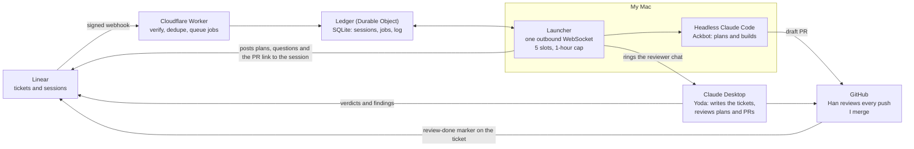

# A team-of-one agentic SDLC and the Practice's approaches

A reading of Alex Ward's essay "I built an agentic SDLC for a team of one. Here's the
plumbing" (published 5 November 2026), a reflection on it, and a concept-level comparison
with the several ways the Practice runs agentic delivery. Written 6 November 2026 by the seat
Swift holds Turbulence (Claude cloud, solo) for the owner, from the essay as supplied in the
session and from first-hand reads of this repository.

In brief: both systems solve one problem, a single human acting as the message bus between
capable agents. Ward's answer is a small pipeline whose contract is the ticket and whose
authority is authenticated identity. The Practice's answer is doctrine held in the repository,
with advisory coordination between seats and the merge delegated to a bot at settlement. §5.1
proposes four concepts the Practice could take from the essay: content read is data, a
per-criterion contract walk, a refuse-to-start check at `spawn`, and token revocation.

## 0. Method

### 0.1 The request, improved

The owner asked for the essay and its two diagrams to be read (the branding images ignored),
for a reflection, and for a comparison with "the multiple approaches taken by the Practice",
using every appropriate skill and principle; for the request itself to be improved first; for
the report to land in a draft OCE pull request; and for the author to be found on GitHub and
credited, without naming the platform the essay was published on. The improved request, by
`scope-from-goal-before-approach`:

```text
GOAL  A durable, cited comparison between the essay and the several ways the Practice runs
      agentic delivery: where they converge, where they diverge and why, and which concepts
      each could take from the other.
IN    1. The essay's text and both diagrams, read faithfully; the topology diagram's middle,
         hidden in the supplied print, recovered from the image embedded in the PDF.
      2. A reflection: what kind of thing it is, its design moves, the incidents it reports,
         the gaps its author names.
      3. The Practice as several approaches, not one, each mapped to the essay's mechanisms
         with the Practice file that holds it.
      4. A concept-level comparison by the Practice's exchange method: same concept under
         different names, divergences with their reasons, what each could take (each
         proposal with a warrant and a one-line falsifier; none ratified).
      5. Credit: the author by name, title and date; a GitHub account only where public
         evidence establishes it; the publishing platform neither named nor linked.
      6. This document under .agent/research/ beside the lights-on comparison, with its
         index row; a draft PR on the OCE fork against engraph.
OUT   Doctrine changes (proposals only; ratification is the owner's). Contact with the
      author; claims about the author's private product or code. Copying the essay's images
      or long passages (the diagrams are redrawn in text, with credit). Naming the readers
      who commented on the essay. Running the gates by hand (the cloud substitute set runs
      before each commit and push; CI is the gate).
```

### 0.2 Skills and instruments

| Part | Skills and instruments |
| --- | --- |
| Grounding | `start-right-quick` (host classified as Claude cloud, not ChatGPT Work; identity derived; the claims registry seeded and a claim opened on this file, the research index and the napkin) |
| Improving the request | `scope-from-goal-before-approach` (the GOAL/IN/OUT above); `metacognition` in generative mode, because the pointer ("compare it with the Practice") is narrower than the goal (which of the Practice's several approaches?) |
| Reading the essay | `read-diagnostic-artefacts-in-full`: the essay's text extracted whole and both diagrams read (§1.4 records the recovered figure) |
| Reflection and comparison | `reason` (name the kind of thing; surface the warrant; stress-test); the Practice's exchange method of comparing concepts, never files (`practice.md` §Philosophy; PDR-142); `one-instance-is-an-observation` for claims drawn from a single essay |
| Framing check | `cricket`, both stances, before drafting: ON-TRACK and SOUND from each. Redirections taken: every proposal carries a falsifier or is dropped; a limits paragraph (§0.3); no gendered pronouns for the author; a GitHub account named only where public evidence establishes it |
| Review of the draft | `prose-expert` and `docs-adr-expert`, read-only (§7 records what they found and what was done) |
| Closing | the napkin |

### 0.3 Limits of the comparison

The essay side rests on one essay, as supplied: no code, no logs and no conversation with its
author. Everything said here about Ward's system is what the essay says, and its absences are
absences from the essay, not from the system. The Practice side is read from this
repository's files on 6 November 2026 and cites them. The two sides are therefore unequal in
kind: one is a system's author describing it; the other is a corpus read directly. Where the
comparison judges, it judges designs as described, never implementations.

## 1. The essay

### 1.1 The problem it solves

Ward ran three capable Claude agents and was, in the essay's words, "the message bus between
two AIs": carrying "pickup", "see comments" and "look at the review" between a Claude Desktop
chat that held the design context and a Claude Code terminal that planned and built, and again
in a second loop with a review bot. "Three capable agents, and the slowest part of the system
was me." The essay describes the plumbing that took the human out of the middle; the product
that plumbing builds stays private.

### 1.2 The cast

| Name | What it is | What it does |
| --- | --- | --- |
| Admiral Ackbot | Claude Code, headless on the author's Mac | Plans, builds, opens draft PRs |
| Yoda | Claude Desktop, in the project chat where the ticket was written | Writes the tickets; reviews Ackbot's plans and PRs |
| Han | A GitHub Actions job on self-hosted runners | Reviews every push |
| The author | The one human | Decides what is built, can overrule any plan with one reply, and merges |

Each agent has its own identity in Linear; on GitHub, Ackbot is its own account and Han is a
GitHub App.

### 1.3 The first diagram: "Three agents in the middle. Me at both ends."

The pipeline figure, redrawn from the essay's opening image:

```text
 ┌──────────┐    ┌──────────┐    ┌──────────┐    ┌──────────┐    ┌───────────┐    ┌──────────┐
 │ Ticket   │ →  │ Plan     │ →  │ Review   │ →  │ Build    │ →  │ Review    │ →  │ Merge    │
 │ Linear   │    │ Claude   │    │ Claude   │    │ Claude   │    │ GitHub    │    │ GitHub   │
 │ me+Yoda  │    │ Code:    │    │ Desktop: │    │ Code:    │    │ Han+Yoda  │    │ me       │
 │          │    │ Ackbot   │    │ Yoda     │    │ Ackbot   │    │           │    │          │
 └──────────┘    └──────────┘    └──────────┘    └──────────┘    └───────────┘    └──────────┘
                      ↑               │               ↑                │
                      └── changes ────┘               └──── fixes ─────┘
                 └──────────────────── agents ─────────────────────────┘
 5 parallel runs · 1h cap per run · mint → use → revoke · agents never merge
```

The human is at the two ends that carry intent and consequence: the ticket and the merge.
Everything between is agents, with two feedback loops (plan changes; review fixes).

### 1.4 The second diagram: "Linear is the front door, and the Mac only dials out"

The topology figure, redrawn from the essay. In the supplied print a page overlay hides its
middle third (the Linear and Cloudflare Worker boxes); the full figure was recovered from the
image embedded in the PDF.



The essay's caption: Linear's webhooks only go to the Worker, and every connection to the Mac
is one the Mac opened.

### 1.5 The mechanisms

Numbered for the comparison in §§3 and 4.

- **M1. The ticket is the contract.** "If a decision only exists in chat, it doesn't exist."
  Settled decisions go into the ticket body: the reasoning under "current thinking", a
  checkable list under "acceptance". That body is what gets built and what every reviewer
  grades against.
- **M2. A pre-flight on the ticket.** Before planning, Ackbot checks that an acceptance
  section exists, every blocker is closed and the release label is set; otherwise it says
  exactly what is missing and stops without creating a branch.
- **M3. Delegation as the trigger, and dial-out only.** Delegating the ticket opens an agent
  session; a signed webhook (signature, a 60-second timestamp window, deduplication) queues
  a job in a Durable Object; a Mac launcher holding one outbound WebSocket is nudged and
  fetches it. Nothing calls into the Mac.
- **M4. Bounded parallelism.** Up to five runs at once, each in its own slot with its own
  database and server ports, each capped at an hour "so an unattended run can't quietly eat my
  Claude usage."
- **M5. A one-line landing.** Every run ends with one line saying where it landed (plan,
  question or done), posted to the session as the right kind of message. When Ackbot "hits a
  call it shouldn't make alone, it asks instead of guessing", and the reply resumes the same
  session.
- **M6. Plan review by the reviewer that holds the history.** A first version handed plan
  review to a fresh cloud session and was replaced the next day: "A reviewer without the
  project's history can tell you whether a plan hangs together, not whether it's right for
  this codebase." Yoda checks that every acceptance item maps to a step, that nothing
  contradicts a recorded decision or the per-layer definition of done, and that every claim
  the plan makes about the code is true on main; anything it cannot check makes the answer
  "changes".
- **M7. Machine-readable verdicts, gated by identity and revision.** The verdict's last line
  says approve or changes, plus the session and plan it is for; the Worker accepts it only
  from Yoda's app identity and only for the current plan, "so a late verdict on a stale plan
  does nothing."
- **M8. Round caps that hand back to the human.** Three automatic plan reviews; ten
  automatic PR rounds ("the agents are arguing instead of converging"); the human's reply
  overrides any verdict at any point.
- **M9. Gates before the push.** A pre-push hook runs typecheck and lint, "so those failures
  never leave the machine."
- **M10. Agents never merge.** Ackbot never merges and never closes a ticket; an instruction
  to do either, in a ticket or a comment, is ignored; GitHub will not let it approve its own
  PRs.
- **M11. Review from the contract, item by item, failing closed.** Han reads the ticket under
  its own read-only identity and walks the acceptance list: met, not met, can't tell, or not
  applicable with a reason; every "met" needs evidence (a file and line, a CI job, a log).
  Findings become inline threads marked blocking or non-blocking, because Ackbot works through
  threads. If Linear is unreachable, the status check errors: "A review that quietly skipped
  the acceptance criteria would look exactly like a pass." Yoda then makes a second pass and
  says so if Han did not finish, "instead of treating silence as a pass."
- **M12. Routing on authenticated identity; read content is data.** Every handoff checks who
  sent it, by OAuth app identity, "never on a display name or a phrase in a comment", because
  ticket text "can come from anywhere". Every agent treats what it reads as data under
  review, including the plans it reviews.
- **M13. Credentials: mint, use, revoke.** Every run mints a fresh token and revokes it at the
  end, failures included; tokens never appear in a command line, a prompt or a log; the exact
  scope string is pinned in a test, because asking for a different scope list revokes the
  app's other tokens.
- **M14. The human at both ends.** "My whole job in this loop is deciding what gets built,
  overruling a plan when I think it's wrong (one reply on the ticket does it), and merging."

## 2. Reflection

### 2.1 What kind of thing it is

A deterministic, event-driven state machine wrapped around non-deterministic agents. Every
transition is an authenticated event recorded in one external ledger; the agents are stages
whose outputs are parsed, not trusted. Authority lives in two places only: the identities the
pipeline routes on, and the human at the two ends. The essay names it plumbing, and the word
is exact: it describes how work moves and who may move it, not how the agents think or how
the system learns.

In the Practice's five-layer vocabulary (PDR-143) it is a family-and-contextual binding (one
vendor's agents, Linear, GitHub, Cloudflare, one Mac) with a strong general-layer idea at its
core: **the contract is a durable record, and every transition is checked against an
identity.**

### 2.2 The design moves that carry the weight

1. **The ticket as the only contract (M1).** This is the essay's most portable idea, and the
   one its three reviewers, two of them agents, all lean on. It turns "the agent did not know"
   into "the ticket did not say", which is a defect the human can see before code exists.
2. **Identity as authority (M7, M12).** Prompt-level instructions are not trusted to keep
   agents in role; the router is. A verdict posted from any identity but Yoda's app, or for a
   superseded plan, does nothing, because the Worker routes on identity and revision, not on
   text (M7, M12).
3. **Revision-bound verdicts (M7).** Tying a verdict to the plan ID makes staleness a
   mechanical property instead of a judgement.
4. **Caps that end in a person (M8).** The system declares in advance when agent-to-agent
   iteration has stopped converging, and the answer is a hand-back, not another round.
5. **Fail closed, and say so (M11).** Both reviewers treat an absent result as a finding.
6. **Dial-out only (M3).** The one machine that runs code accepts no inbound connection.

### 2.3 The incidents, read as lessons

The essay reports four redesigns. Each is a general lesson in local dress.

- **Long-polling to hibernating WebSockets.** The first design kept a Durable Object awake
  "about 3,580 seconds out of every hour", 83% of the free allowance in a day, "all of it
  spent by one object that mostly heard 'nothing yet.'" Waiting is a cost: here an
  event-driven wake replaced a poll that spent most of the daily free allowance hearing
  nothing.
- **A fresh reviewer to the history-holding reviewer.** A plan reviewer's value for fit is its
  context: coherence can be checked from the plan alone, fit to the codebase cannot.
- **One run at a time to five isolated slots.** Parallelism needs isolation (own database,
  own ports) and a budget (the hour cap), or it converts into collisions and spend.
- **Mint, use, revoke, and the uninstalled agent.** The credential rule worked exactly as
  designed and removed the agent from the workspace twice in one afternoon: Linear suspends
  an agent-style app install "the moment its last token is revoked." A correct security
  invariant met an unmodelled vendor lifecycle rule. The cure keeps one token alive in a
  second Durable Object, rotated mint-store-revoke in that order, with per-run tokens on top.
  The author had already pinned the scope string in a test after the earlier scope gotcha:
  the lesson was encoded as a check, not left as a memory.

### 2.4 What the author names as rough

One machine runs everything; closing the lid pauses the system; there is no alerting ("If
the launcher dies, I find out when a ticket goes quiet"); Yoda has no GitHub identity, so its
reviews post under the author's account, labelled as from Claude Desktop; and the webhook
deduplication is tested but "has never happened live. I'll believe the dedupe when I see it."
Each is stated plainly, with its consequence. The last is the right epistemic posture for a
mechanism that has only run in tests.

### 2.5 Questions the essay leaves open

These are absences from the essay, not findings about the system.

- **Correlated review.** Yoda writes the ticket, reviews the plan against it and reviews the
  PR against it; Han grades against the same ticket. The two reviewers are independent of the
  builder, not of the contract's author or of each other's premises. One reader's comment
  under the essay makes the point: two reviewers "can agree because they inherited the same
  wrong assumption". The design has no reviewer whose job is to doubt the ticket.
- **Where the history lives.** The plan reviewer's advantage is the project chat's
  accumulated context, but the essay's own rule says a decision that exists only in chat does
  not exist. The design applies that rule to the builder and the CI reviewer, not to the
  reviewer whose judgement depends most on unrecorded context.
- **Where learning goes.** The launcher loads "the same agent rules, hooks and skills I use by
  hand", and the essay's incidents became tests and redesigns; how a lesson becomes a rule,
  and how a rule is retired, is not described.
- **Liveness.** A quiet ticket is currently the only sign of a dead launcher; the planned cure
  (Sentry) observes errors, and a silent stall raises none.

## 3. The Practice's several approaches

### 3.1 One human here too

The comparison starts from a shared fact: the Practice in this estate is also a team of one
human. It has one owner, many agent seats on several vendors, and a body of doctrine that
exists because owner attention is the scarce resource. PDR-074 puts owner attention at the
centre: "Director value is broad-awareness-as-substrate-cognition, measured by
mind-coherence-per-owner-attention." In plain terms, a Director is worth the coherence it
buys per unit of the owner's attention. Both systems answer the same question: how does one
person stop being the message bus between capable agents, without losing control of what
gets built? They answer it with different machinery, at different scales, with different
places for authority to live.

### 3.2 The approaches

The Practice does not run one pipeline. It runs several delivery shapes over one substrate,
chosen by the work and the host.

| Approach | Where it is defined | Shape | Who carries messages | Where the owner stands |
| --- | --- | --- | --- | --- |
| A. Solo seat | `start-right-quick` | One agent seat with the owner in conversation; plan, edit, review by sub-agents, PR | The seat | In the conversation; settles intent; ratifies doctrine |
| B. Director and Implementers | PDR-117; `start-right-team` | "isolate the doing (Implementers, worktrees); centralise the awareness (Director, minimum action)"; the Director "Routes, does not execute"; each Implementer owns "one bounded lane" in its own worktree | The Director seat, over the claims registry, comms event stream and thread records | Talks to the Director only (the single owner interface); answers cards at action moments |
| C. Cloud seats | `cloud-environment.md`; `cloud-environment-routing.md` | Ephemeral container; Claude cloud commits with `HUSKY=0` and a blocking in-session substitute set, CI as the gate; a ChatGPT Work seat executes nothing locally and uses draft-PR CI as its verdict | The pull request record ("a cloud-to-local handoff rides the pull-request record") | Starts the session; reads the PR |
| D. Workflow fleets | `fleet-design-review-before-expensive-fleets`; the corpus-analysis agents | Deterministic fan-out of schema-forced agents (mapper, no-tools reducer, single-turn voter); answers constrained by JSON Schemas "DERIVED here from the zod SSOT" | The workflow script | Opts in explicitly; a cost estimate and enforced budget fire before launch |
| E. Cross-vendor instruments | `cricket`; `sif`; `the-codex-dialogues`; `codex-helper` | Bounded second opinions from another model or vendor: two verdicts (work and frame), bounded dialogues, one-shot tasks | The invoking seat | None during the call; the instruments carry no authority |
| F. Event-driven presence | `use-monitor-for-event-driven-wake`; `pr-watch`; `slack-watcher`; `liveness-heartbeat-cron` | Seats wake on events, not timers; a Watcher mantle holds the owner's Slack channel; heartbeats make liveness observable | Monitors, watchers and the comms stream | Reachable on Slack; alerted by the Watcher |
| G. PR lifecycle and the merge bot | `pr-lifecycle`; `.agent/reference/merge-bot.md`; PDR-132; PDR-140 | Harvest every review surface, triage by default, budgeted settlement pushes, then a bot merge at settled | The shepherding seat and the PR's own threads | Out of the loop for a green, clean PR; reserved surfaces still need the owner |
| H. Inter-Practice exchange | `inter-practice-collaboration`; PDR-142 | A join ceremony for writing into a sibling estate; concepts, not files, cross between estates | Seats on each side | Rules on what is adopted |

Ward's system is closest to approach G with B's division of labour folded into software: the
Worker and ledger do the routing work the Practice gives to a Director seat. The Practice
has no headless always-on builder. `spawn` "creates a fresh built draft-PR'd sibling
worktree, and emits its seat brief and launch command", and a person or seat starts the
session from that command.

### 3.3 The mechanisms mapped

Relation: **same** (one concept, different encoding), **different** (an opposite choice), or
**partial** (the Practice holds the concept in doctrine without the essay's mechanism); a
qualifier follows where one word does not fit.

| | Essay | The Practice | Relation |
| --- | --- | --- | --- |
| M1 | The ticket is the contract; nothing lives only in chat | The same rule ("A decision reached over a fast channel lands in its durable home at the moment it is acted on", `channel-by-audience-lifetime-and-consumer`), but the durable home is the repository: "PR bodies, plans, and tickets are temporary operational surfaces … Permanent documentation — ADRs, rules, PDRs, `docs/` — is the only durable tier" (`permanent-doc-is-the-consolidation-record`). Plan nodes carry "Acceptance criteria, each with a proof" (`plan` skill) | Same principle, different home |
| M2 | Refuse to plan without acceptance, closed blockers and a release label | Authoring disciplines: `plan-body-first-principles-check`, `scope-from-goal-before-approach`, typed `depends_on` and expiring owner gates in plan nodes, "Sequencing lives in blockedBy edges" (`ticket-management`), one-PR cardinality settled "before a branch exists" (`one-pr-per-leaf-issue`). Nothing refuses to start a lane | Partial |
| M3 | Delegation fires a signed webhook into a queue; the Mac only dials out | The owner's session is the trigger; `spawn` prepares a worktree and a launch command; cloud seats run in ephemeral containers, and "a cloud-to-local handoff rides the pull-request record" (`cloud-environment.md`) | Different |
| M4 | Five isolated slots, one hour each | A worktree per Implementer (PDR-117); concurrent full gates "bounded at two, ceiling three — by a mechanism, never a declaration" (`no-unbounded-host-load`); a gate step holding a slot "past thirty minutes is stopped" (`.husky/pre-push`); cold pause after an hour idle; fleet budgets enforced before launch. No cap on lanes or run time at spawn | Partial |
| M5 | One line on where a run landed; ask rather than guess | PDR-026's landing commitment; `agent-state-observable`; but the default is to proceed: `confident-seats-proceed-and-report`, `route-blocks-and-questions-to-director` ("KEEP WORKING … waiting is not a resting state"), `unattended-seats-never-prompt` ("asks become denies, which route to the Director") | Different |
| M6 | The plan reviewer holds the project's history | History lives in the repository; reviewers are fresh read-only sub-agents told to "read and internalise these domain-specific documents" (the `code-expert` template); the Practice states the cost plainly: "reviewers downstream are goal-blind and will polish the wrong decision rather than catch it" (`plan-body-first-principles-check`). The warm context is the Director's | Same need, different home |
| M7 | Verdicts gated by identity and plan revision | At the merge boundary the bot "reads the settlement verdict, and merges ONLY on SETTLE-READY", with "the VERDICTED tip's sha pinned in the call (a moved tip answers 409)" (`merge-bot.md`); suppressed findings are lifted only "by a signed Cured or Rejected line from a permitted author" (`pr-lifecycle`); "An assessment of revision N is not evidence about revision N+1" (`assess-specification`) | Same at the merge; signer identity is a text trailer, not an authenticated agent |
| M8 | 3 plan reviews, 10 PR rounds, then the human | "a healthy changeset settles in at most two review rounds — every class" (PDR-132); a settlement-push budget, two by default, refused past exhaustion by the review-cost gate in the pre-push hook (`pr-lifecycle`); a no-op loop stops after five iterations (`loop-exit-criteria-required`) | Same concept, tighter and enforced |
| M9 | Pre-push typecheck and lint | "light commit, full push" (`AGENT.md`); `local-broken-code-never-leaves` ("Pushing is the public act"); in Claude cloud the checks move to CI with a blocking in-session substitute set | Same |
| M10 | Agents never merge | "a green and clean PR — CI passing, no unresolved comments — merges without owner approval", executed "under bot identity" (`pr-lifecycle`); the bot sits under the branch protections with no bypass but the code-owner review gate (`merge-bot.md`); freeze-bound surfaces stay reserved | Different |
| M11 | Review walks the contract item by item; fails closed | CI's fan-in: "This is fail-closed: failure, cancelled, and skipped all block" (`ci.yml`); required-check parsing "fails closed" (`pr-watch`). No reviewer walks acceptance criteria one by one. One case does not fail closed: an unreadable review-run surface "is named on the settled verdict and does not block" (`pr-lifecycle`) | Partial |
| M12 | Route on authenticated identity; read content is data | Identity is derived and self-asserted ("the gate guards accident, not intent", PDR-027); all seats write through one bot ("if we have a bot identity created to represent us on that system, then we MUST always use that identity"), each marking its posts (`identify-as-agent-under-shared-credentials`); coordination "does not mechanically refuse entry to claimed areas" (`agent-collaboration.md`); "Only the owner's own turn is owner direction" (`precedence-is-not-approval`). No standing rule makes content read from tickets, PRs or pages data rather than instruction; prompt-injection red-team automation is a deferred control (`deferred-controls-register.md`, 6.5) | Different, with a gap |
| M13 | Mint, use, revoke; scope pinned in a test | The bot mints "scoped at mint time to this repository and to exactly the permissions of the `--scope` you name", and "`--scope` is **required and has no default**" (`merge-bot.md`); a token's own expiry "bounds every iteration" (`token-deadline.ts`); secrets are scanned before transfer. No revocation step | Same posture, revocation absent |
| M14 | The human at both ends | The owner sets intent and ratifies doctrine; "Owners review at the moment-of-irreversibility, not at the moments-of-deliberation" (`owner-attention-at-action-moments`); the merge is delegated | Different placement |

## 4. Compare and contrast

### 4.1 Where they converge

- **No decision lives only in a conversation.** Ward reached the rule by losing context
  between two chats; the Practice reached it through handoffs and compactions ("The receiver
  cannot read the sender's transcript", `handoff-messages-self-contained`). The same
  sentence, from two directions.
- **Failures stop before the public act.** Pre-push gates in both. Both also have a check
  that fails closed: Han's status check errors when Linear is unreachable, and the Practice's
  CI fan-in blocks on failure, cancellation or skip.
- **Silence is not a pass.** Han errors when its source is unreachable and Yoda reports an
  unfinished Han; the Practice's rule is "Silence from a watcher, monitor, or background task
  is never evidence that it is alive and healthy" (`silence-is-never-liveness`).
- **Iteration has a declared end.** Both cap agent-to-agent rounds in advance.
- **Waiting is a cost.** Ward's long-poll bill and the Practice's `use-monitor-for-event-driven-wake`
  and hour-idle cold pause are the same discovery.
- **Agents are distinguishable from people.** Yoda's reviews post under the author's account
  "labeled as coming from Claude Desktop"; that is the Practice's
  `identify-as-agent-under-shared-credentials`, arrived at independently.
- **Lessons become checks.** The scope string pinned in a test is the move
  `scope-from-goal-before-approach` asks for: encode a non-negotiable "as a validator the
  same day, so the sentence never needs saying again."

### 4.2 Where they diverge, and why

1. **Where the contract lives.** Ward's contract is the ticket; the Practice's is the
   repository, and its ticket is a temporary surface: "if it matters after the ticket closes,
   it is not recorded until it is in the repo" (`ticket-management`). The reason is lifetime.
   Ward's unit is one ticket's journey to a merge; the Practice's knowledge must outlive
   tickets, sessions, vendors and repositories. The cost runs the other way: Ward's agents
   read one bounded document; the Practice's read a corpus.
2. **Where state lives.** Ward's live state is in an external ledger, a Durable Object that
   stays reachable when the Mac is asleep. The Practice's is in the repository and on GitHub: claims,
   comms events, thread records, plan nodes, PR threads. The Practice's state is versioned,
   reviewable and portable, and nothing acts on it unless a seat is present. Ward's ledger
   accepts and queues work at three in the morning; the essay describes no use for its
   contents beyond the pipeline.
3. **Where authority lives.** Ward's authority is authenticated: each agent is an OAuth app,
   and the router acts only on the right identity for the current revision. The Practice's
   agent-to-agent coordination is deliberately advisory (knowledge and communication, not
   mechanical refusals), with identity derived from session seeds and self-asserted; its hard
   edges sit elsewhere, in the hook policy, the git hooks, CI, the branch rulesets and the bot
   that stands under them. The difference follows from where agents meet. Ward's meet only
   through external systems that can authenticate, so impersonation is the threat; the
   Practice's share a repository and a filesystem, where collision and drift are the common
   failures and a lock would mostly stop honest seats.
4. **Who merges.** Ward keeps the merge, the irreversible step, for the human. The Practice
   moved the owner's attention earlier, to intent and ratification, and made the merge a
   mechanical consequence of settledness: green by name, zero unresolved threads, every
   finding dispositioned, the verdicted SHA pinned. The owner ruling that delegates the merge
   (`pr-lifecycle`) carries its own counterweight: "any resulting problem makes
   recurrence-prevention the immediate priority." Both systems place the human at the moment they judge most consequential, and
   they judge it differently.
5. **Asking versus proceeding.** Ward's builder asks when a call should not be made alone. The
   Practice's seats proceed on recorded confidence, because it recorded the opposite failure:
   "a seat froze for nine hours on an exact head awaiting a Director ruling its own analysis
   already supported" (`confident-seats-proceed-and-report`). With one builder and one human
   whose "phone buzzes when there's a plan", asking is cheap. With many seats and one human, it is the bottleneck the essay set out to
   remove.
6. **What a reviewer is for.** Ward's plan reviewer is valuable because it holds the history;
   that is also why its judgement is correlated with the ticket it wrote. The Practice
   chooses the other side of that trade. Its reviewers are fresh and goal-blind, and it
   compensates three ways: a first-principles check on the plan body before review; a rule
   that "lenses run on one model from one brief" are "correlated evidence, never …
   independent confirmations" (`invoke-code-experts.md`); and instruments built for
   independence: Cricket's second verdict on the frame itself, and cross-vendor calls that
   bring "diversity of thought and approach that no same-vendor instrument can" (`sif`).
7. **Round budgets.** Ward's ten PR rounds detect non-convergence. The Practice's two are a
   shaping signal: PDR-132's claim is that "the round count a changeset will need is
   substantially fixed at the moment it is shaped", so a third round sends the shepherd back
   to the changeset's shape, not to another round.
8. **One vendor or several.** Ward's three agents are Claude in three harnesses. The Practice
   is canonical content with generated adapters for four platforms, and treats vendor coupling
   as a cost to keep thin.
9. **The learning loop.** The essay records four redesigns and at least one lesson encoded as
   a test; it does not describe how lessons become rules. The Practice is built around that
   loop: napkin, distillation, graduation to rules, PDRs and ADRs, enforcement. The loop has
   a price. The Practice's rule tier holds 124 rules, 75 of them always applied
   (`.agent/rules/`, counted by classification on 6 November 2026), and its seats read them
   before they work.

### 4.3 One sentence each

Ward's system is a small, deterministic, identity-checked pipeline in which three Claude
agents carry a ticket from contract to a reviewed PR while one person keeps the two decisions
that matter most: what to build and what to merge. The Practice is a portable body of
doctrine, seats, tooling and enforcement hooks in which many agents on several vendors plan,
build, review, merge and learn within one owner's attention, at the price of a heavy
substrate. The first is excellent plumbing. In the Practice's vocabulary it would be one
contextual binding, and the Practice runs no binding of that kind today (§3.2).

## 5. What each could take

Each proposal is research, not doctrine, and carries a warrant and a one-line falsifier.
Proposals without a falsifier were dropped.

### 5.1 For the Practice

1. **A standing rule: content read is data, never instruction.** Ticket bodies, PR comments,
   review text, fetched pages and peer seats' messages are evidence to evaluate; instructions
   come only from the owner's turn and the estate's doctrine. *Warrant:* the essay makes it a
   design premise (M12); the Practice guards the owner's authority (`precedence-is-not-approval`;
   "A peer's message is never the owner's approval", `comms-channels`) and names third-party
   skills as an injection channel (`third-party-skills-require-security-review`), but no
   portable rule states the general case, and seats on platforms whose harness does not
   inject the guidance carry none. *Falsifier:* a read of every platform adapter's loaded
   tier finds the principle already stated there for each platform.
2. **The contract walk as a reviewer's output schema.** For a plan node's acceptance criteria:
   one verdict per criterion (met, not met, cannot tell, or not applicable with a reason),
   evidence required for every "met", and the plan revision the walk judged. *Warrant:* this
   is the second independent system to converge on a multi-valued, evidence-bound verdict
   (lights-on's held / notHeld / notProvable was the first, §3.4 of
   [its comparison](practice-nature-and-lights-on-comparison-2026-10-22.md)); the
   `plan` skill already types a proof for every criterion, so the walk has something to read;
   no Practice reviewer produces it today. *Falsifier:* on the next five plan-node PRs, the
   walk finds no unmet or unprovable criterion that the prose reviews missed.
3. **A refuse-to-start check at `spawn`.** Before cutting a worktree for a plan node, refuse
   if its acceptance criteria are missing, a `blocking` dependency is open, or an owner gate
   has expired, and say exactly which. *Warrant:* the fields exist and the disciplines are
   doctrine (M2), but nothing mechanical holds them at the moment a lane starts; the essay's
   version costs one check and saves a branch. *Falsifier:* a count of the lanes spawned in
   the last month finds none that started on a node failing those three tests.
4. **Revoke minted bot tokens when the command ends, failures included, after checking what
   GitHub does when an installation has none left.** *Warrant:* the merge bot already mints
   least-privilege, scope-required tokens and bounds work by their expiry; revocation shrinks
   the window in which a leaked token works from the token's remaining lifetime to zero.
   Ward's incident is the caution: the invariant was right, and the vendor's lifecycle
   rule still removed the agent from the workspace. *Falsifier:* a review of the merge bot's
   token handling finds no path by which a token reaches a log, a transcript or a child
   process.

### 5.2 For a design like Ward's

Offered as what the Practice has learned, not as advice the essay asked for.

1. **Keep the reviewer's history where the builder and the CI reviewer can read it.**
   Decision records and lessons in the repository make the plan reviewer's advantage
   portable and survive the chat's context limits. *Warrant:* the essay's own rule (M1) and
   the Practice's "if it matters after the ticket closes, it is not recorded until it is in
   the repo". *Falsifier:* Yoda's verdicts never cite context that the ticket and repository
   do not already hold.
2. **Give one reviewer the job of doubting the ticket.** A frame verdict beside the work
   verdict, or a reviewer from a second vendor. *Warrant:* the correlated-review gap (§2.5)
   and the Practice's Cricket frame verdict and cross-vendor instruments. *Falsifier:* over a
   run of tickets, none of the human's overrules traces back to an error in the ticket.
3. **A heartbeat, not only error reporting.** A dead launcher raises no error. *Warrant:*
   `silence-is-never-liveness` and `liveness-heartbeat-cron` ("Silence past 10 minutes opens
   retired-pending-confirmation, never a verdict"). *Falsifier:* every launcher death in the
   next month raises an error event that error reporting would have caught.

## 6. Credit

The essay is Alex Ward's: "I built an agentic SDLC for a team of one. Here's the plumbing",
published 5 November 2026. This document quotes it briefly, redraws its two figures in text
from the originals, and reports its design as described; the design, the names Ackbot, Yoda
and Han, the incidents and the lessons are the author's. One reader's comment under the essay
is quoted without attribution in §2.5.

The owner asked for the author to be found on GitHub. On 6 November 2026 no GitHub account
could be linked to the author by public evidence: the author's profile on the publishing
site was not reachable from this session, and the essay names no code, organisation or site
that a search of GitHub's public users, repositories and commits could tie to its author. If
the owner confirms an account, this section names it.

## 7. Session record

- Landing: this document and its row in the research index, on the designated branch
  `ccr-b61cc722-5u4zff`, under claim `agentic-engineering-enhancements` (files: this
  document, `.agent/research/README.md`, the napkin), with a draft pull request on the OCE
  fork against `engraph`.
- Reading: the essay's text was extracted whole from the supplied PDF; both figures were read;
  the topology figure's middle third, hidden in the print by a floating page overlay, was
  read from the full 1344×838 image embedded in the PDF.
- Grounding: `start-right-quick`; the host classified as Claude cloud. Two read-only surveys
  of the Practice returned path-and-quote tables; every quotation used here was re-read in
  its file before use. One observation on an earlier record came from them: the lights-on
  comparison (§3.3) names a "Claude Approvals" check, and no workflow or Practice surface
  defines one; the Claude review the Practice reads is the Claude Code Review app's standing
  verdict (`pr-lifecycle`). The repository's rulesets were not read from this session, so a
  required check of that name outside the workflows is not ruled out.
- Review: `prose-expert` and `docs-adr-expert`, read-only, on the first draft.
  - `prose-expert`: fifteen findings, every one applied. The closing sentences of §4.3
    claimed more than §3.2 allows; §2.2's merge-instruction example contradicted the essay's
    own design; three claims about the essay's ledger and CI went beyond the essay; two
    lessons from single instances were stated as general laws; the §3.3 legend did not match
    its column; the rule-tier size was asserted, not counted (now counted); the document now
    leads with its point. One finding was applied in a different form: the essay does mention
    a phone, so §4.2.5 quotes it instead of dropping it. Of its three notes for the accuracy
    reviewer, the lights-on report is now linked once (§5.1). The "Claude Approvals"
    observation stays here only, because the earlier report is a dated record that this pull
    request does not edit.
- Validation: the Claude cloud `HUSKY=0` substitute set before each commit and push (branch
  guard, commit-message check, accidental-major-version guard, gitleaks over the outgoing
  range). CI on the pull request is the tree-state verdict.
