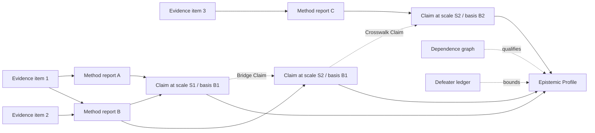

# Synthesis-method reference

Use this reference to create a synthesis that preserves provenance, dependence, scales, and bases.

## Evidence topology



Reports A and B are not independent corroboration for `C1` when both derive from `E1`. Preserve the distinction between evidence, analysis, and claim.

## Per-input identity contract

Do not replace input identity with aggregate coverage. For every input retain:

```yaml
artifact_id: ""
artifact_type: ""
artifact_revision: 1
relationship: "supports | challenges | qualifies | contextualises"
basis_ids: []
scale_regions: []
method_pass_ids: []
domain_profiles: []
assumptions: []
uncertainties: []
provenance:
  sources: []
  transformations: []
```

The synthesis-level identity coverage is derived from these records. It must not become the only surviving representation of their origins.

## Consequential transformations

Apply this procedure when a transformation could change warranted understanding or action: combining, abstracting, aggregating, translating or handing off material. The target can be a claim, model, measure, specification, recommendation or other representation; it need not be a report. The intended reliance determines which distinctions and conditions matter.

1. State what the resulting representation asserts and what material inferences it reasonably supports. Reconstruct its positive content and necessary concepts, not only its limitations. Identify a change in claim type, such as moving from an observed association to an intervention claim or from a requirement to an implementation guarantee.
2. Compare the representation and those claims or inferences with the actual inputs and their warrants. Preserve the meaning, scope, validity conditions, assumptions, uncertainty and dependence needed for the intended reliance. A partial note or delegated summary establishes only what it carries; return to the owning source or artefact when the transformed result needs a definition, condition or inspection it does not supply.
3. Try a counterexample or alternative that could expose a lost distinction or changed condition. An aggregate can conceal a consequential subgroup difference; a design can weaken a constraint while retaining its name. Choose the probe for the actual target rather than imposing one domain's fields on every inquiry.
4. Make justified changes explicit. A transformation may revise, reject or extend an input interpretation; state the operation and its warrant. Lossy transformation can be appropriate when its losses do not undermine the declared use. Narrow or withdraw unsupported conclusions instead of concealing the change behind general caution.
5. Recheck the representation that will actually be relied on, including any compressed or downstream form. Use the existing work record for material corrections and unresolved limits; no form for every sentence or additional artifact is required.

This is a check on meaning and warrant, not proof of human comprehension, runtime behaviour or independent assurance. Domain-specific authoring and verification procedures belong with the consuming work. A faithful representation may still describe a mistaken source; source appraisal remains necessary.

## Conflict Ledger entry

```yaml
conflict_id: ""
claim_ids: []
conflict_type: contradiction | scope | scale | construct | method | value | implementation | incomparability
compatible_comparison: true
shared_dependencies: []
bridge_claims: []
crosswalk_claims: []
current_resolution: ""
residual_uncertainty: ""
discriminating_evidence: []
reopening_conditions: []
```

## Epistemic Profile

Use a profile rather than one scalar when the dimensions diverge. For each chosen dimension, record:

- assessment and calibrated language;
- direct evidence;
- challenging evidence;
- dependence and assumption sensitivity;
- scope and validity domain;
- defeaters and missing evidence.

An empirically robust short-term association can coexist with weak mechanism, narrow transferability, and high decision relevance. Do not average those into an opaque score.

## Resolution discipline

Resolve only when a documented operation warrants it:

- correct a demonstrable error;
- narrow claims to compatible scopes;
- apply an evidenced scale bridge;
- apply an honest crosswalk;
- condition on context or population;
- distinguish empirical from value disagreement;
- collect discriminating evidence later.

Otherwise preserve the conflict. “Both contribute” is not a resolution unless the combination and its assumptions are specified.
